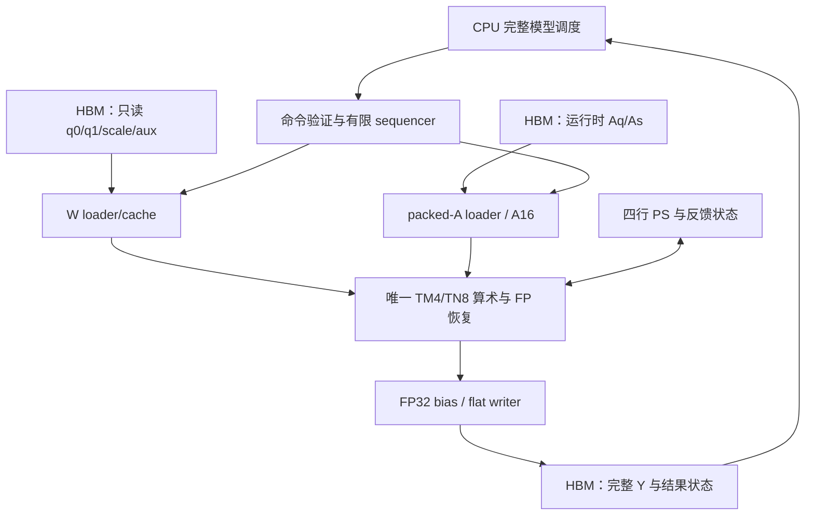

# Laya 完整模型在 U55C 上的部署方案

> **当前交付目标：按用户本轮确认的 Goal v8/M006 边界完成真实 Laya 推理：完整 Attention 在 FPGA，scorer/ACT 等软件尾部在 CPU，非线性保持严格函数输出语义；以完整请求的正确性、物理实现和端到端性能分别验收。TM4/TN8 矩阵独立卸载仅作为可选诊断基线，不承担 M006 或 50 ms 性能验收。**
>
> 版本：v2.0（M006 边界纠偏）；日期：2026-10-21（北京时间）。  
> 审计仓库：`zwj276765037-lab/Laya-HLS`。  
> 可访问公开源码提交：`546520092fc4bf57ed875681ba9c334498ed2e07`；本次重查 main 仍是此旧快照。Goal v8/M006 的当前约束来自用户本轮说明，尚未取得其本地原文与当前实现提交。  
> 本文是完整部署实施方案。本文没有修改生产工程，没有运行新的 RTL/HLS、布局布线或 U55C 板测；新增接口、硬件与性能结果均为待实施、待验证。

**阅读导航：** 第 0、19、22 节定义终点和交付；第 4、5、9 节锁定完整模型与数值；第 6–14 节保留可复用矩阵子系统设计，并明确诊断 profile 的范围；第 13.5、17 节给出性能必要条件和 M006 主线；第 20–21 节给出正确性和可信 warm 验收。

## 0. 修订结论、当前目标与版本边界

### 0.1 本次纠正的三个问题

上一版混合了三个不同层次：较容易完成的部署基线、历史 Goal v4 的设备边界、历史非线性容差。它们不能直接代表当前 M006。v2 作如下修正：

| 项目 | v1 的处理 | v2 的正式处理 |
|---|---|---|
| TM4/TN8 性能定位 | 作为首个完整部署版本，然后逐步优化 | 旧单 CU 配置仅作可选诊断；在本文 100/200 MHz 条件下无法承担 50 ms，不作为当前架构定案 |
| Attention | 首版 CPU，后续迁入 FPGA | 完整 Attention 上 FPGA 是 M006 主线的必要条件；CPU 版本用于 oracle 或诊断 |
| 软件尾部 | 最终 scorer/ACT 迁入 FPGA | scorer/ACT 与相关尾部处理保留 CPU；删除全尾部上 FPGA 的必做终点 |
| 非线性 | 引用旧 exp/tanh/log 容差作为主线 gate | 保持当前严格函数输出语义；旧容差不继承为当前许可 |
| 来源 | 公开 Goal v4 被视为当前总目标 | 当前约束以用户提供的 Goal v8/M006 为准；v4 只作历史背景 |

这些不是仅改名称：它们改变了执行边界、数值验证与性能验收，必须在部署 profile 和结果身份中分别登记。

### 0.2 当前主线的完成定义

主验收仍是完整真实 B1/S128：28 个 Encoder＋2 个串行 Decision＋scorer/ACT＋输入输出处理。完整模型需要 120 个主干大 Q8 矩阵、2 个 CPU 尾部 Q8 矩阵、2 个 CPU 尾部浮点矩阵，以及全部其余算子。[R02][R03]

本方案采用的 M006 对齐主线建议为：

- **FPGA：全部 120 个大 Q8 矩阵、完整 Attention，以及为使主干连续驻留所需的 LN、RoPE、GEGLU/ReLU、group32 量化、残差、final LN/type add。** 其中完整 Attention 在 FPGA 是用户明确的现行要求；其余驻留组织是本文为降低中间搬运提出的具体实现建议，须对照本地 M006 原文登记。
- **CPU：state/questions 处理、分词、token Embedding、模型/请求管理、marker/scorer/ACT 完整软件尾部及业务解释。** 尾部两小 Q8 和两浮点 linear 真实计算，不作预置输出。
- **严格数值：** 函数参考、FP 环境、基本算术、归约、量化与恢复分别冻结；不能通过采用旧误差线来放行新的近似实现。
- **性能：** 完整请求的 warm E2E、持续吞吐、正确性和资源/时序分别取证。本文用 50 ms 做必要条件预算，不宣称已满足；其在当前 M006 中是硬门槛还是参考目标，最终以取得的本地原文为准。

### 0.3 诊断路径的地位

上一版的 F0 重命名为 **D0：矩阵独立卸载诊断 profile**。D0 可以让 CPU 执行 Attention 和其它算子，以检查完整图、120 个真实矩阵、XRT、权重切换和输出正确性；这只是排障工具。它不能登记为满足 M006，也不能作为 50 ms 性能候选。

D0 的单 CU、TM4/TN8、100 MHz 请求档位、CPU 量化、120 次矩阵调用及约 173.3 MiB/题 PCIe 预算，仅适用于 D0。后文保留其可复用接口、writer、cache 和测试设计，以免丢失此前审查成果。正式主线的 Attention 服务、设备驻留边界、主干 ABI 与性能并行度见第 13.5 和 17 节。

如果当前本地 M006 已有等价或更先进的完整链路，不要求先重建 D0，也不要求退回本文旧快照的单 CU 架构。已有能力经当前身份复核后直接复用。

### 0.4 证据来源与待绑定项

本次公开 main 仍为 `546520092fc4bf57ed875681ba9c334498ed2e07`，其中 `goal/goal.md` 是 revision 4，公开 mission 未提供当前 M006。[R01] 因此：

1. 用户本轮指出的 Goal v8/M006、完整 Attention 在 FPGA、软件尾部在 CPU、严格函数语义，是本次修订的现行约束来源。
2. 本文对代码、shape、历史报告和数据布局的审查绑定上述公开提交；不是对用户本地最新 RTL 的逐文件审计。
3. 实施前登记本地 commit/dirty diff、Goal v8/M006 文件 hash、模型/numeric/layout/build identity，以及最新 FP 问题的具体报告。公开快照不能覆盖它们。
4. 当前模型若仍是本文件第 1 节的同一 GGUF/shape，可继承这里的数学工作量；若已变更，先重算，不能将旧预算直接贴到新版本。

本次修改的是部署方案，没有修改项目 goal/mission、生产代码、数值参考或任何权限规则。

---

## 1. 模型身份、源码和现有证据

### 1.1 公开快照中的模型基线

下表来自已审计的公开快照，后续工作量和布局推导以它为条件。S0 必须核对本地 M006 是否仍使用完全相同的模型、输入和数值身份；存在变化时重算相关预算，不能凭旧 hash 替当前文件背书。

| 项目 | 固定内容 |
|---|---|
| 模型 | 公开快照的 Laya Typed Decisions Q8_0 |
| GGUF 文件大小 | 455,179,648 B |
| GGUF SHA-256 | `6eb6ef58bc4f99bd9db40381604108af782ffc314aa00da6641f429991ca1f18` |
| graph spec SHA-256 | `f33f7848434b73048f957dcd232e1bd4ff99e95b8cf41c98191b69fddad815f9` |
| 主干 | 28 Encoder＋2 Decision |
| D / heads / head_dim | 1024 / 16 / 64 |
| Encoder Wi / gate | 5248 / 2624 |
| Decision FFN | 4096 |
| group size | 32 |
| 词表 | 50368 |
| 主设备场景 | B1/S128 |
| 每问题候选槽 | 最多 16，实际有效数和 mask 来自原预处理 |

上述身份和形状来自导出器、配置及实际完整图。`kBoCount=13` 表示旧接口的 13 个 BO，**不是 13 层模型**。[R02][R03][R04]

公开 Git 快照排除了大权重、原始张量 dump、部分构建产物与工具。实施前需要从原实验目录恢复这些文件并核验 hash；不能因为仓库中存在 manifest，就把它所指向的外部二进制视为已经取得。[R05]

### 1.2 现有成果应怎样继承

| 已有对象 | 可复用的内容 | 不能据此声称的内容 |
|---|---|---|
| 完整 CPU/CSim 软件图 | 图顺序、算子语义、既有完整数值回归、参考入口 | 新硬件已完成整网 |
| 独立全图 oracle | 从冻结 GGUF 按执行数值合同重算检查点和结果 | native/GPU 与硬件天然逐位相同 |
| TM4/TN8 算术及 FP restore | INT8 group dot、原 FP32 恢复、结果 credit/反馈机制 | 当前父 service 已支持所有 K/N |
| W loader/cache | 真实 HBM 读、q0/q1/scale 布局、七 shape 局部验证、lease/epoch | 整个矩阵 CU 已布线通过 |
| QKV MATRIX16 局部结果 | 已绑定源码和输入的限定数值、握手结果 | 全 S128、全部输出列和 120 次整网调用已通过 |
| 旧 XRT Host | 模型文件 SHA、BO 分配、XRT 调用、结果身份校验的实现方式 | 已接通新的协同矩阵 ABI |
| 旧 HLS/OOC 报告 | 相应历史对象的资源、失败原因和结构经验 | 新 profile 的资源、时序和 warm 时间 |

仓库已经记录完整软件图的独立检查点比较，不能把现状描述为“连完整模型软件参考都没有”。同样，这些软件 PASS 不能替代新设备路径的运行证据。[R06][R07]

### 1.3 公开快照中的问题及本地复核项

下列问题由旧公开源码和报告得到，不代表已确认用户本地 M006 仍存在同样缺陷。当前实现若已有修复，记录对应源码与验证身份后复用；不能为套用旧方案撤回已有正确路径。涉及 packed-A、七参数 ABI 和 CPU 图的改造只属于 D0 诊断分支，正式主干使用第 17 节的设备驻留边界。

| 编号 | 缺陷或缺口 | 整网方案中的处理 |
|---|---|---|
| D01 | 旧父链在 A16 保持/失败阶段缺少完整后继，矩阵接口未形成全链 | 补齐实际主干控制；可独立闭合矩阵子系统，D0 可辅助排障，不替代完整 Attention |
| D02 | `laya_matrix_service_v1` 固定 rows16、K1024、N3072、特定 key | 新多 shape service，保留合法全 K；不能只改参数名 |
| D03 | group 计数、A 地址、终组识别和 STEP16 回执固定 32 groups | 覆盖 G=32、82、128，重做位宽和末组判据 |
| D04 | writer 跨 tile rearm、全局行号、12-bit 列号及错误后的 front 排空存在静态风险 | 新 flat writer 的列号扩至至少 13 bit；统一 drain；完整矩阵多 tile、多窗口与错误后恢复验证 |
| D05 | 旧 A16 输入来自硬件量化，没有独立 CPU Aq/As 诊断入口 | D0 如有需要增加真实 packed-A loader；正式主干保留并验证设备原量化路径 |
| D06 | Q8S2 与 L13M 同为 416 B，但字段含义和准入检查不同 | 新矩阵 ABI 显式版本化；源模型包身份与运行时 BO 绑定分别处理 |
| D07 | 新旧数值/软件/RTL对象混用容易误继承 PASS | 按 source、numeric、layout、build、xclbin 身份建立新结果目录 |
| D08 | 旧 Host 每请求同步整套 184 MiB workspace | D0 同步有效 Aq/As 与 Y；正式主线同步入口 embedding 与 final hidden，按实际边界计数 |
| D09 | 全模型 layer/key/bias 切换未由固定 QKV 测试覆盖 | 导出权重注册表；按整网顺序及 A/B/A 权重交替验证 |
| D10 | 当前供数串行，阵列规模不能直接换算为真实吞吐 | 记录 A/W/PS/writer stall；优先复用 A group、解耦读与 issue |
| D11 | 公开快照不能提供用户当前 M006 的完整 U55C 证据 | 先核对本地已有结果，再补齐同一身份的联合实现、板测和整网 warm 证据 |
| D12 | Laya 的 Attention、LN、尾部与 Llama decoder 不同 | 以当前 Laya 图为唯一语义来源；不移植 Llama 的 causal/KV decode 图 |

D04 中跨 tile 和错误排空问题来自源码推导，本次未新运行 RTL 复现；实施时首先用最小相关用例确认。[R08][R09][R10][R11][R12]

---

## 2. 三层参考和数值完成标准

### 2.1 原模型参考、执行合同参考和被测实现

必须保留以下三层，避免同一个实现自我证明：

1. **原模型语义参考：** 固定 GGUF、固定 tokenizer、固定 native runtime 和真实输入。用于确认输入构造、模型输出含义、业务选择及整体质量。
2. **独立执行数值 oracle：** 从同一 GGUF 独立读取权重，按当前 group32/Q8-F、浮点恢复、归约顺序和非线性合同重算。这是设备与新协同执行流程的逐位比较对象。
3. **被测执行流程：** 正式主线为 Host＋FPGA 完整主干＋CPU 尾部；D0 另登记 CPU 图＋FPGA 矩阵。两者均不能从本次设备输出反推 gold，也不能将设备返回的 Aq、scale 或 Y 作为 oracle 的唯一输入来源。

现有 native capture 明确区分实际 GGML 内部量化路径和硬件 Q8-F；native fused attention 也没有全部可观测 score/probability 检查点。不能要求两个不同执行数值 profile 无条件逐位一致，也不能把二者差异隐去。[R06][R07]

历史 native B2/S128 的第二题 ACT 存在已记录的 CLS stride 偏差，不能将该错误输出作为新实现必须复现的 gold。首版按相同 B1/S128 输入构造政策建立语义参考；旧 native 捕获作为原始证据保留，运行时修复或 profile 变化记录新身份。详见第 20.1 节。[R26][R28]

### 2.2 必须复用的既有基线

先恢复原权重、独立 oracle、完整软件测试及真实请求，并对照当前 M006 的严格合同登记可继承和需要更新的部分。新 Host 的 `backend=cpu_contract` 用于对相同请求运行全部层，比较每层末尾、关键中间点和最终 candidate/ACT；现有等价且身份完整的基线可以直接复用，不强制重建。CPU oracle 与设备被测实现保持独立。

新增 CPU backend 是接口适配，不重新定义 LN、GELU、Attention 或量化算法。不得使用默认 BLAS、PyTorch GELU、fast-math 或新的 fused kernel替代原合同后仍声称逐位等价。

### 2.3 四个验收层次

| 层次 | 验收对象 | 判据 |
|---|---|---|
| 量化 | 全部有效 Aq 与 FP16 As | 对独立 oracle 位型一致；错误输入按原规则拒绝 |
| 单矩阵 | 全 M×N 输出及 bias | 原执行合同下全部 FP32 位型一致，mismatch=0 |
| 整网协同执行 | 全部层关键点、candidate logits、ACT logits、身份与 mask | 同一执行数值 profile 下对独立 oracle 逐位一致，无遗漏算子或隐式 fallback |
| 模型质量 | 同输入政策下的语义/native 输出差异、choice/score/noul/ACT 行为、真实数据集指标 | S0 绑定当前参考、数据集和业务门槛；不拿历史 RTL 误差线代替业务验收 |

公开审计资料没有提供可直接继承到当前部署的完整 native/业务质量 PASS 门槛。S0 应先绑定本地已有参考、数据集与门槛，缺失部分再明确建立；不能覆盖本地已定义合同。历史 RTL 非线性误差线只作历史记录，本次不用于 M006 的严格函数验收；当前合同及 FP 问题适用域见第 5.4、17.3 节。不能临时指定一个 cosine 代替最终任务正确性，也不能只看 argmax 一致而忽略 ACT 或 score 输出。

---

## 3. 正式分工与诊断分工分别登记

### 3.1 所有算子的归属

| 阶段/算子 | M006 对齐主线建议 | D0 可选诊断 |
|---|---|---|
| state/questions、分词、token Embedding、请求管理 | CPU | CPU |
| embedding/主干 LN、final LN/type add | 建议 FPGA，保持主干驻留；与本地 M006 核对 | CPU |
| 28 Encoder 与 2 Decision 的 120 大矩阵 | FPGA | FPGA |
| Encoder RoPE、QK、完整 mask/softmax、AV | FPGA，完整 Attention 必须覆盖 | CPU oracle/诊断 |
| Decision QK、完整 mask/softmax、AV | FPGA；保持无 RoPE 的原图语义 | CPU oracle/诊断 |
| GEGLU、ReLU、残差及主干动态量化 | 建议随主干在 FPGA 连续执行 | CPU |
| marker gather/LN、scorer FC1/FC2 | CPU | CPU |
| candidate mask/prob/stats、ACT 全部计算 | CPU | CPU |
| 最终 choice/score/noul/ACT 解释 | CPU | CPU |

软件尾部固定包括两个小 Q8 和两个浮点 linear。其放在 CPU 不改变完整模型定义，也不需要额外新增 tail FPGA kernel 才能完成 M006。

### 3.2 保留两个后端边界

D0 与单矩阵验证使用：

```cpp
Tensor linear_full(WeightKey key, const Tensor& x, NumericProfile profile);
```

它真实执行 CPU 原量化、A H2D、完整矩阵 RUN、完整 Y D2H。这个接口对排查矩阵数值、shape、writer 和模型权重切换有价值。

正式主线使用粗粒度 Attention/FFN/主干入口。其核心关系为：

```text
CPU token Embedding + mask/qtype
→ FPGA 28 Encoder + 2 Decision（含完整 Attention）
→ 最后 Decision hidden 完整回读
→ CPU marker/scorer/ACT
→ 原业务结果解释
```

软件调度器可以先控制粗粒度设备阶段，阶段间数据驻留 HBM；验证后再合成有限的固定图 sequencer。不要求通过一开始重建复杂动态 task 框架才能实现设备驻留。正式 profile 禁用无声 CPU Attention fallback。

### 3.3 group32 量化不改算法，执行位置随数据流明确

D0 上游输出在 CPU，故 CPU 动态量化合理，且计入 E2E。正式主干的 LN/Attention/GEGLU/ReLU 输出在设备，原 group32 量化也应在设备就近执行，不把中间激活专门回读 CPU 再上传。

“量化在 CPU”不是全局放宽目标；“量化在 FPGA”也不要求改变原 FP32 d、FP16 scale、roundf 或原恢复顺序。每个 profile 登记量化的真实输入来源、执行位置和已验证身份。

### 3.4 从 Llama-baseline 学习什么

可以学习完整图的共享算子组织、连续设备阶段的数据传递、设备动态量化、真实 Host 和模型输出连接。[R13] Laya 仍保持自己的双向/滑窗 Attention、LayerNorm、GEGLU、Decision 和软件尾部；不移用 Llama 的 RMSNorm、自回归 KV decode、GS64 或 FP32 scale 定义。[R29][R30]

本次主线不以“把更多小算子放进 FPGA”作为独立目标。完整 Attention 是现行范围要求，软件尾部保留 CPU 是现行边界；在这些边界内优化端到端时间。

---

## 4. 大矩阵的完整 shape 清单

M 为本次序列行数；主验收 M=128。表中的 K、N 对应 `Y[M,N] = X[M,K] × W[N,K]^T`，不以物理 pack 的数组顺序改变数学方向。

| 权重家族 | 张数/请求 | K | N | G=K/32 | TN8 tiles | 执行归属 |
|---|---:|---:|---:|---:|---:|---|
| Encoder `qkv` | 28 | 1024 | 3072 | 32 | 384 | FPGA |
| Encoder `wo` | 28 | 1024 | 1024 | 32 | 128 | FPGA |
| Encoder `mlp_wi` | 28 | 1024 | 5248 | 32 | 656 | FPGA |
| Encoder `mlp_wo`（Down） | 28 | 2624 | 1024 | 82 | 128 | FPGA |
| Decision `head_qkv` | 2 | 1024 | 3072 | 32 | 384 | FPGA |
| Decision `head_wo` | 2 | 1024 | 1024 | 32 | 128 | FPGA |
| Decision `head_fc1` | 2 | 1024 | 4096 | 32 | 512 | FPGA |
| Decision `head_fc2` | 2 | 4096 | 1024 | 128 | 128 | FPGA |
| Scorer `scorer_fc1` | 1，M=16 | 1024 | 1024 | 32 | 128 | CPU Q8 |
| ACT `act_fc2` | 1，M=1 | 256 | 2 | 8 | 1，尾 lane mask | CPU Q8 |

另有 scorer FC2 `1024→1` 的 F32 权重路径，以及 ACT FC1 `1028→256` 的 F16 权重路径；它们必须保留原 FP 运算规则，不能为了复用设备 Q8 接口临时重新量化。[R03]

120 个大矩阵只需要覆盖六种不同 K/N，但仍需逐一使用 120 个真实权重 key。只验证六种 shape 不等于检查了全模型所有层的权重索引、bias、偏移和模型身份。

### 4.1 bias 的责任

bias 由导出注册表决定：Encoder 四类大矩阵没有对应 bias；Decision 四类大矩阵含导出器登记的 bias。scorer FC1 还有 baked bias 与后续显式 `scorer_fc1.bias` 两个不同操作。每一项都必须按原位置恰好执行一次，不能因为统一 `linear_full()` 而重复添加或删除。[R03]

### 4.2 必须单独检查的边界

- Encoder Down 的 K 是 **2624，82 groups**；不是 4096。
- Decision FC2 的 K 是 **4096，128 groups**。
- Wi 的 N 是 **5248，656 tiles**；不能保留 QKV 的 384-tile 终止条件。
- 输入 group 数的“计数”要能表示 128，索引要能表示 0…127；不能让 7-bit 计数在 128 时回卷为 0。
- 全部大矩阵 N 都是 8 的倍数；CPU 小 ACT 的 N=2 按原尾部语义执行，不把它迁入 FPGA 作为当前完成条件。

---

## 5. 原 group32 数值合同

### 5.1 CPU 动态量化

每一行按原始 K 维顺序划分连续的 32 元素 group。对于一个 group：

\[
a_{\max}=\max_i |x_i|,\quad d_{32}=\operatorname{FP32}(a_{\max}/127),
\]

\[
\mathrm{inv}_{32}=\begin{cases}0,&d_{32}=0\\\operatorname{FP32}(1/d_{32}),&d_{32}\ne0\end{cases},
\quad s_{16}=\operatorname{FP16}_{\mathrm{RNE}}(d_{32}),
\]

\[
q_i=\operatorname{roundf}\bigl(\operatorname{FP32}(x_i\mathrm{inv}_{32})\bigr).
\]

`roundf` 的 halfway 行为按原实现远离零。原实现对非有限值、非法 scale 和越界结果报错；不能自行加入 silent clamp。**q 使用完整 FP32 的 d/reciprocal 计算，不能先把 d 舍入到 FP16 再计算 q。**[R14]

必须冻结 CPU 编译器、浮点环境与相关实现版本；禁止 fast-math、FMA 重结合、近似 reciprocal，以及未经验证的 FTZ/DAZ 改动。可以对不同 group 或行并行，但不得改变一个 group 的定义和规定的舍入。

### 5.2 FPGA group dot 与恢复

对输出 `(m,n)` 和 group `g`：

\[
z_{mng}=\sum_{j=0}^{31} A_q[m,32g+j] W_q[n,32g+j]
\]

整数点积精确累加到 INT32。随后按当前恢复合同依次执行：

\[
p_g=\operatorname{FP32}(\operatorname{F32}(s_A)\operatorname{F32}(s_W)),
\]

\[
r_g=\operatorname{FP32}(\operatorname{F32}(z_{mng})p_g),\quad
PS_{g+1}=\operatorname{FP32}(PS_g+r_g),\quad PS_0=+0.
\]

按 `g=0…G−1` 的原顺序更新同一个输出。最终按权重 descriptor 决定是否执行独立 FP32 bias 加法。当前 M006 的 IP 配置、subnormal、异常和舍入须绑定实际严格合同及测试向量；公开旧 R0 配置仅作审查起点，不能自动继承当前 PASS。[R15]

**禁止把 K2624 或 K4096 拆成若干 K1024 子矩阵，再把各块结果简单相加来代替原运算。** 这可能改变组间 FP32 累加顺序、bias 次数和量化行为。硬件可以分段搬运 K，但必须保持每个原 group 和跨段 PS 的连续语义。

### 5.3 其它算子的规则：CPU 与 FPGA 都保持同一语义

- 使用 LayerNorm，不能换成 Llama RMSNorm。
- 原图的相关 LN affine 已折入当前权重；不能把原训练模型的 gamma/beta 再应用一次。当前冻结图仅 embedding LN 与 final LN 额外应用对应显式 gamma，其余相关 LN 使用纯归一化。
- Encoder 使用固定实现的 GELU/GEGLU，Decision 使用 ReLU；不能换成 SwiGLU。
- Attention 的 QK 归约、softmax 和 AV 累加顺序按独立合同，不随默认库改变。
- CPU 原算子用于软件执行与独立检查；设备实现按当前严格函数输出合同重新验证，不因更换执行位置获得近似许可。

### 5.4 严格函数合同与已有浮点问题的适用域

本轮用户明确当前 M006 要求严格函数输出语义。因此严格合同是主线前提，不能以“硬件实现更容易”为理由采用旧 exp/tanh/log 容差。取得本地合同后锁定：函数参考及版本、合法输入域、输出位型、舍入/中间精度、signed zero、subnormal、异常和拒绝规则。不能擅自把“严格”解释为某个新选 libm 的输出，也不能把它偷换成一般的 IEEE 标签或一个 ULP 阈值。

D0 的非线性在 CPU，不意味着 FPGA 已经没有浮点风险。矩阵数据通路仍包含 INT32→FP32、scale 乘积、term 乘法、逐 group PS 加法和 Decision bias。已知问题必须先匹配到本次实际调用的模块和输入域。[R15]

**可证明的受限域：** 若接口确实为有限、非负 FP16 的 A/W scale，scale 精确扩为 FP32，q 为原合法 INT8，原 G≤128，PS 从 +0 开始，term 及每次 PS 加法均按当前 RNE 分别舍入，且不含任意 FP32 外部 PS 注入，则：

- 每个非零 FP16 scale 至少为 `2^-24`，两个 scale 的非零乘积至少为 `2^-48`，远高于 FP32 最小正规数 `2^-126`。
- FP16 数的有效精度至多 11 bit，两者相乘的有效精度至多 22 bit，在其合法指数范围内可由 FP32 精确表示。
- 原 q∈[-127,127] 时，group dot 的绝对值不超过 `32×127²=516128`，可精确转换成 FP32。
- 两个 FP16 scale 的乘积是 `2^-48` 的整数倍；整数 dot、正确 RNE term 和有序 PS 累加保持这一格点。**无 bias 的非零 term/PS 不会落入 FP32 次正规域。** 粗略幅度上界为单 term `<2^51`、128 组 PS `<2^58`，不触及 FP32 overflow。

这是建立在上述输入/实现前提上的数学域证明，不是现有硬件 PASS。它说明：**若一个缺陷已被证明仅作用于 FP32 次正规输入/结果，纯 Q8 无 bias 恢复有可能不触发它。** 不能据此排除 half→float 转换错误、正常数舍入错误、错误 FMA/重结合、signed zero、反压导致的数据配对错误等问题。

Decision 的 F32 bias 是另一条输入域；如果 PS=0 而 bias 为次正规数，就不能套用无 bias 证明。应读取真实全部 bias 位型，检查新 bias adapter 是否保留既有特殊路径。公开快照的 bias 模块通过 `helper_route` 与 `add_finite_rne` 处理零/次正规输入和 tiny cancellation，这不证明当前新 writer/bias 链已经继承相同行为。仅有某个数据集的 min/max 也不能代替合法输入域证明。[R32][R33]

AMD PG060 记录了部分 Floating-Point Operator 对次正规输入/结果的处理限制；具体是否涉及本项目，要绑定实际生成 IP 的版本、配置及包装路径，不能把官方说明直接写成“当前 M006 已复现的故障”。[A04]

每个 FP 问题建立一条范围记录：

| 项目 | 必须记录 |
|---|---|
| 复现 | 当前 source/IP/build hash、操作、精确输入 bits、期望/实际输出 bits、状态与时序 |
| 可达性 | 当前接口类型、模型数据、所有合法运行时输入与该反例域的关系 |
| 结论 | `会触发且待修复`、`已证明该子路径不可达`、`仅当前样本未触发`、`信息不足`，四者分开 |
| 修复 | 修复模块或保持严格输出的精确特殊路径；不通过拒绝原本合法输入规避 |
| 回归 | 反例、边界、真实矩阵/Attention、下游量化以及完整最终结果 |

用户提及的最新浮点问题报告尚未取得，本文不能给它填一个已确认的具体故障类型。当前结论是范围审查方法与上述条件证明；没有宣称 D0 自动通过，也没有把所有 Attention/非线性的输入域误并入 Q8 恢复域。

---

## 6. 模型文件和数据布局

### 6.1 模型包只保留一份

D0 可保留旧导出器的 q0/q1/scale/aux 内容与权重偏移，FPGA 会话上传矩阵所需的四个模型 BO。正式主干还必须取得 LN gamma、RoPE/type 与其它实际设备算子需要的全部参数，按当前已验证布局复用或显式版本化，不能把四个矩阵 BO 等同于完整主干资产。CPU 持有 Embedding 和原软件尾部权重。旧模型包中保留少量 CPU 尾部数据不代表 FPGA 执行了尾部。[R03]

实施时生成只读 `weight_registry.json` 及对应 C++/SV 表，每条包含：

- family、layer、WeightKey、tensor name、K、N、dtype、bias mode；
- q0/q1/scale/aux offset 与 span，合法对齐和 padded N；
- 来源 GGUF SHA、各 payload SHA、numeric/layout 标识；
- CPU/FPGA 执行归属，以及预期的一次请求调用次数。

源模型身份、部署 build 身份和设备会话身份分开保存。Host 不得在普通请求中重写已上传的只读权重；重载模型必须使旧 resident cache 失效。

### 6.2 继承的 q0/q1/scale 索引

令 `t=n/8`、`lane=n%8`、`g=k/32`、`j=k%32`，则当前导出布局为：

```text
q_port = t % 2
q_offset = q_base[q_port] + ((t/2)*G + g)*256 + lane*32 + j
s_offset = scale_base + (t*G + g)*16 + lane*2
```

q0 保存偶数 TN8 tile，q1 保存奇数 TN8 tile；每个 tile/group 是 8×32 个 INT8，scale 是 8 个 FP16。所有除法在这里都是整数除法。导出器的反向恢复校验必须继续存在，确保 pack/unpack 可回到原权重字节。[R03]

### 6.3 新 packed-A 布局

一个输入 BO 中依次放置：

```text
Aq: int8  [M][K]
As: uint16[M][G]      # FP16 原位型
```

Aq 与 As 起始地址分别按 64 B 对齐；descriptor 显式给出两个 offset、row stride 和有效字节数。M128 下尺寸如下：

| K | Aq | As | packed-A 合计 |
|---:|---:|---:|---:|
| 1024 | 131,072 B | 8,192 B | 139,264 B，136 KiB |
| 2624 | 335,872 B | 20,992 B | 356,864 B，348.5 KiB |
| 4096 | 524,288 B | 32,768 B | 557,056 B，544 KiB |

K2624 的单行 scale 为 164 B，不能假定每行 scale 都从 64 B 边界开始。AXI reader 必须能按合法对齐窗口读取、提取有效数据并跨行续读。内部 A bank 可以采用额外 padding，但不能悄悄改变 Host stride。

### 6.4 矩阵输出

统一输出 `Y[M][N]`，行主序 FP32，地址为：

\[
Y_{addr}=Y_{base}+4(mN+n).
\]

D0 将 QKV 保留为逻辑列序的 `M×3072`，CPU 通过独立检查的 layout adapter 转换到 Attention 视图。正式主干在设备内完成相同逻辑映射，衔接 plane/head/token/dim；可以沿用已验证的设备布局，但必须显式登记，不能把 CPU adapter 当作正式 Attention 的隐式依赖。

最大矩阵输出来自 Wi：`128×5248×4=2,686,976 B`，即 2.5625 MiB。D0 每次同步其实际有效范围；正式主干将 Wi 留在设备供 GEGLU 使用，不逐矩阵 D2H。

---

## 7. 可复用矩阵子系统：D0 验证入口与主干内部服务

### 7.1 顶层只负责有限的矩阵生命周期

D0 验证入口拟名 `laya_matrix_run`，采用单 CU 以便定位问题。下面的 TM4/TN8 组织是旧公开实现的可复用基础，不是当前 M006 已定硬件规模，也不是 50 ms 的最终架构。正式主干调用相同的已验证矩阵语义，可使用经联合预算选定的并行结构。



首次实现采用 `ap_ctrl_hs`、单在途矩阵调用、无 auto-restart。全模型层循环留在 Host；硬件必须自己完成一个矩阵的全部行和列，不负责解析 JSON、GGUF 或业务问题。

### 7.2 复用 TM4 前端的方式

公开 `tm4tn8_sync_ps_front_v2` 的非 STEP16 分支已准入 rows1/4 以及六种大矩阵 K/N；STEP16 分支仍固定 rows16/K1024/N3072。D0 多 shape 服务可复用 **非 STEP16 的 M4 视图**：一次 M128 RUN 内部执行 32 个四行视图，外部仍是一次完整矩阵调用。正式主线的 tile 规模按性能与资源重新选定。[R09]

具体顺序：

```text
验证命令与 WeightKey
LOAD 当前整张 W，等待真实完成
acquire 整个 M128 RUN 级 W lease，锁定 key/epoch/context
for window0 = 0,16,...112:
    从 packed-A BO 装入对应 A16，验证覆盖
    for subrow = 0,4,8,12:
        为全 K、全 N 的 M4 view 配置 front
        for group = 0..G-1:
            准备这四行的 Aq/As
            for tile = 0..T-1:
                取得本 tile/group 的 Wq/Ws
                按 front credit 和 PS 依赖合法 issue
        等待全部结果、bias 和输出写响应退休
    释放当前 A16
释放 W lease，保留允许复用的 resident 内容
等待所有端口与队列排空，写最终状态，完成 RUN
```

group-major 调度让同一 A group 可以跨输出 tile 复用；同一输出的 group 顺序不变。M4 视图之间的 configuration/done/ownership 交接属于新增集成，不能因 front 已支持 shape 就省略验证。

D0 选择整个 M128 RUN 持有同一 W lease；其 `task_context/numeric_identity/key/epoch` 对全部 read/release 保持一致。32 个 front view 的身份另行绑定和检查，不能逐 view 改变 cache 所比较的 lease context。正式服务同样需要自洽的 lease 生命周期；若逐 view 释放并重新 acquire，同一 resident W 也不应因此重复 LOAD。[R11]

### 7.3 新增 packed-A loader 的必要行为

- 只接受合法 descriptor、当前 session 和已登记 shape。
- 通过真实 AXI 读取 Aq/As；装完所有有效元素后才发布 A_READY。
- A16 最大逻辑 payload 为 69,632 B；内部 bank 的行 stride、scale 索引按 G 生成，不再使用固定 `34*row`。
- 读取时检查 scale 有限性和原合同所需范围；CPU 量化错误必须在提交前拒绝，设备传输/格式错误仍由设备检查。
- 不允许 Host 预填内部 RAM、force valid、跳过覆盖或伪造量化完成计数。
- 每轮记录 `a_payload_read_bytes`、实际 loaded rows/groups；D0 的 `device_quant_groups=0`。正式主线必须记录真实设备量化，不能沿用诊断值。

### 7.4 D0 的 W cache 选择与正式复用边界

D0 优先复用公开整矩阵 cache 的真实 reader/bank/lease 路径。最大 Wi 的 q+scale 为 5,709,824 B，另有必要 bias 存储。该 RTL 是双 slot 结构：即使只调度一个 slot，物理资源也不能自动按一半记账。正式主线须与 Attention/vector 共同预算，可复用更合适的当前本地缓存实现。[R11][R16]

已归档的 cache 装配资源属于该 cache 自身；它不能代表新矩阵 CU 已经满足时序。D0 的 100 MHz 是请求值，必须做新 top 的平台内实现；M006 主线的规模与频率另行评估。若 cache 的实际资源、扇出或时序成为明确阻塞，按第 16 节切换到 W tile＋A128 的重排方案，不能只缩小数组后继续宣称接口等价。

### 7.5 PS、反馈与计数

非 STEP16 的四行全列 PS 最大逻辑数据量为 `4×5248×4=83,968 B`；加上 busy、poison、tag、credit 等元数据单独核算。PS 必须推断为 RAM/合适 bank，不用大范围 reset 清所有数据；每个新 view 通过 valid/epoch 保证旧数据不被消费。

成功时，对一张矩阵至少满足：

\[
N_{stripe}=\lceil M/4\rceil\,\lceil N/8\rceil\,(K/32),\qquad
N_{Y}=MN,
\]

并核对实际 Aq/As 读字节、W payload、输出有效写字节、所有 R/B 响应和 owner 退休。尾部扩展时必须按有效 row/lane 计数，不能把 padding 算成有效 MAC。

外层整矩阵累计计数只在新 RUN 接受时清零。front 每次 view config、writer 每次局部 rearm 会重置各自计数；必须在切换前恰好汇总一次，不能只报告第 32 个 view 或最后一行。

---

## 8. 输出、错误和连续调用

### 8.1 flat writer

writer 每个 view 使用真实 `global_row=window0+subrow+physical_row`，列使用 `8*tile+lane`。列号至少 13 bit，覆盖 Wi 的 4096…5247；全局行号至少 8 bit，地址乘加使用足够位宽并检查 span/溢出。旧 writer 的 12-bit `tile_n0/held_n0` 不能不改就复用到 Wi。至少检查第二个 tile、第二个 M4 view、第二个 window 和最后一行/最后一列。[R10][R31]

生命周期冻结为：一次 `matrix_begin` 清整矩阵累计状态；每个 `view_begin` 更新全局 row base 并初始化本 view 的 local row/tile/beat/pack；每个 tile 在输入、pack 和 AW/W/B 债务归零后 rearm，下一 tile 的 local row 明确回 0。`view_done` 只表示当前 M4 退休；最后一个 view 全部退休后才允许一次 `matrix_finish`，不能提前 run_finish。整矩阵累计计数在 view 切换时保留。

复用半 beat 写法时，AWADDR 按 64 B 向下对齐；偶/奇 TN8 使用相应低/高 32 B 数据区和 WSTRB。记录有效字节和总线 beat 数；不能用有效输出大小假装已经实现满 beat 吞吐。连续 burst、16-column 合并写可后续优化，但完整正确写回先完成。

### 8.2 成功完成的条件

`ap_done` 之前必须同时满足：全部 M×N 输出已写回、全部成功 B 响应已接收、必要读响应已退休、内部 issue/return/PS/trace 队列无欠账、A/W lease 已合法释放或转为明确 resident 状态。最终状态必须绑定 request/op/session/build 身份。

数据与 ownership 收束后冻结 `cycles_data_service`，写最终状态并等待其真实 B 响应退休，随后才能产生 `ap_done`。包含状态写回的 `cycles_command` 在独立、稳定的完成寄存器锁存，避免把状态写自身的完成时间再写回同一状态造成定义循环。状态写错误或永久无响应不伪造成功，按协议错误/超时处理。

### 8.3 失败路径

错误流程为 `记录首个错误 → 停止接纳新工作 → 排空已接纳事务/算术返回 → 标记本次输出无效 → 写终态`。数值错误不能直接 release W/A 而让 front 停留在 RUN。保留原合同的数值错误、位置与首错/排序规则；排空只退休实际债务，不以 cancel 或后续错误覆盖首因，也不能清零计数伪造排空。

Host 超时不等于设备已结束。超时后禁止复用本次 BO；按匹配的 XRT 版本取得终态，必要时将整个设备会话标记为不可继续并重新装载。应用不能在命令尚未退休时释放正在被 DMA/设备使用的内存。首版不承诺透明断点恢复或中途抢占。[A01]

### 8.4 整网切换必须验证

按真实调用顺序验证不同 key、不同 K/N 和 bias 切换，至少包括 QKV→Wo→Wi→Down，以及 Decision FC1→FC2。另用 W_A→W_B→W_A、输入 A→B→A、正常→错误→正常识别 stale cache、stale Y 和错误后的恢复问题。验证通过以当前构建身份登记，不覆盖其他旧 profile。

---

## 9. 从真实请求到最终回答的完整执行流程

### 9.1 输入不是一份预计算的 QKV fixture

面向用户的入口保留原 `state + questions` 语义。每个 question 都构造自己的完整序列，包含 CLS、问题类型和指令、选项及其 MASK 标记、state 和分隔符。模型是双向条件编码；同一个 state 对应多个不同 question 时，不能只计算一次 state 的 Encoder 输出然后套用多个尾部。[R17][R18]

首版采用每题 B1/S128 串行执行，按原 `question_id` 和原顺序返回。输入适配器输出：

| 输入 | 类型与形状 | 校验 |
|---|---|---|
| token_ids | INT32 `[1,128]` | token 在词表内，特殊 token 来自真实 tokenizer |
| attention_mask | UINT8 `[1,128]` | 仅 0/1，至少一个有效 token |
| marker_pos | INT32 `[1,16]` | 有效 marker 在本行内且被 attention mask 覆盖 |
| marker_mask | UINT8 `[1,16]` | 仅 0/1，候选数满足对应问题类型规则且不超过 16 |
| qtype | INT32 `[1]` | 按原映射：choice=0、score=1、noul=2 |

无效 marker 槽指向本题 CLS，并令 mask=0。未来 B2 时位置是 `b*S+local_position`，不能把所有无效槽都指向 batch0 的 CLS。[R19]

**S128 的默认生产政策：无法完整容纳问题、全部候选及按模型 recipe 构造的输入时，返回明确长度错误。** 如业务需要截断 state，应另行冻结“保留问题和全部候选、仅在规定位置截断 state”的政策、输入版本及对应参考；不得静默丢候选或生成越界 marker。

现有 `LAYA_REFERENCE_ABI128` 是在构造序列后强制 S128 的参考开关，后续截 token 不等于验证所有 marker；不能原样作为生产入口。Vendor 的全 padding dummy batch 行也不满足当前请求合同。首版 B1 逐题执行，避免这个不兼容；后续 B2 的最后奇数题使用 B1，不伪造空请求。[R17][R18][R19]

还须从实际 GGUF 导出 tokenizer、特殊 token、序列 formatter、temperature/temperature_baked、按选项数选择的温度、confidence 配方及其 hash。源码 fallback 值不能当作这份模型已经核实的配置。本次源码审查没有取得实际 GGUF 的全部字符串 recipe；恢复模型资产是实施前的明确依赖。

### 9.2 完整数学图伪代码与执行后端

下面描述完整数学顺序，不意味着每一行都是一次 Host 调用。D0 通过单矩阵接口运行 `Q8_device()`、其余主干函数在 CPU；M006 对齐主线把 Embedding 后至最后 Decision hidden 的主干放在设备阶段内，Attention 必须实际在 FPGA，`Q8_device()` 只表示内部算子。`Q8_cpu()` 仅用于软件尾部。`LN0` 表示纯 LayerNorm，`LNg` 表示当前图中需要显式 gamma 的 LayerNorm。所有 add/mul 和浮点归约按冻结合同执行。[R02][R20]

```python
def infer_one(encoded_request):
    ids, mask, marker, marker_mask, qtype = encoded_request
    # 本入口固定 B1，显式移除 batch 轴；后面张量均采用二维 [S,D]。
    ids, mask = ids[0], mask[0]
    marker, marker_mask = marker[0], marker_mask[0]
    qtype = int(qtype[0])
    h = token_embedding(ids)                        # [128, 1024], CPU
    h = LNg(h, emb_norm_w)                          # 主线设备；D0 CPU

    for layer in range(28):
        a = h if layer == 0 else LN0(h)             # Encoder0 无额外 attention LN
        qkv = Q8_device(key("qkv", layer), a)       # [128, 3072]
        sliding = (layer % 3 != 0)
        q, k, v = split_qkv_in_frozen_layout(qkv)
        q, k = rope_from_frozen_tables(q, k, sliding)
        a = attention_contract(q, k, v, mask, sliding)
        h = add(h, Q8_device(key("wo", layer), a))
        wi = Q8_device(key("mlp_wi", layer), LN0(h)) # [128, 5248]
        g = mul(gelu_contract(wi[:, :2624]), wi[:, 2624:])
        h = add(h, Q8_device(key("mlp_wo", layer), g))
        checkpoint("encoder", layer, h)

    h = LNg(h, final_norm_w)
    h = add(h, type_embedding(qtype))               # 广播到本题全部 token

    for layer in range(2):                         # 两层串行 Decision
        qkv = Q8_device(key("head_qkv", layer), LN0(h))
        q, k, v = split_qkv_in_frozen_layout(qkv)    # Decision 不做 RoPE
        a = attention_contract(q, k, v, mask, sliding=False)
        h = add(h, Q8_device(key("head_wo", layer), a))
        a = Q8_device(key("head_fc1", layer), LN0(h))
        a = relu_contract(a)                       # [128, 4096]
        h = add(h, Q8_device(key("head_fc2", layer), a))
        checkpoint("decision", layer, h)

    marked = gather_all_16_slots(h, marker)         # [16, 1024]
    z = Q8_cpu(key("scorer_fc1"), LN0(marked))      # 此 linear 含 baked bias
    z = gelu_contract(add(z, scorer_fc1_bias))      # 另一个原 bias，不能遗漏
    raw = add(fp32_ordered_dot(z, scorer_fc2_w), scorer_fc2_bias)
    candidate = add(raw, mul(sub(1.0, marker_mask), -10000.0))

    p_internal = softmax16_contract(candidate)     # ACT 用，不加 Host 温度
    stats = candidate_stats_contract(p_internal, marker_mask)
    act_input = concat(h[0], stats)                # 本题 CLS 1024 + 4
    act_hidden = fp32_dot_fp16_weight(act_input, act_fc1_w)
    act_hidden = gelu_contract(add(act_hidden, act_fc1_bias))
    act = Q8_cpu(key("act_fc2"), act_hidden)        # [2]，含 act_fc2 bias
    return candidate, act                         # 16 + 2 个原始 logits
```

每次成功的主场景请求必须记录：Encoder 完成数 28、Decision 完成数 2、设备大矩阵完成数 120、CPU Q8 完成数 2、CPU 非 Q8 linear 完成数 2。最后仍执行原输出解码，不把“最后一层 hidden 已返回”当作完成模型。

### 9.3 Attention 的精确边界

- Encoder 全局层为 0、3、6、…、27，共 10 层；其余 18 层使用双向 `|query-key|≤64` 窗口。两者都有 key padding bias。
- Decision 两层都是全局双向 Attention，无 RoPE。模型没有 Llama 的自回归 token loop，也没有可直接移植的 decode KV cache。
- QK 的 64 项乘积按相邻二叉树相加，随后乘 0.125。滑窗 bias 与 padding bias 先相加，再加到 scaled score；不能交换这些 FP32 运算顺序。
- 所有 S 个 key 都参与原规定的有限负数 mask 计算；首版不把 mask 改成负无穷，不跳过被 mask 的运算，也不擅自将 padding query 清零。
- softmax 使用最大值平移、原 exp、固定归约与逐项除法；AV 按 key 升序 FP32 乘、加。RoPE 使用冻结表中的位型。[R20][R21]

### 9.4 scorer、ACT 与业务解释

ACT 四项统计必须复用原实现：`top1`、`top1-top2_approx`、归一化熵、`max(valid_options,2)/255`。其中 `top2_approx` 不是普通第二大概率。逐项先算 `delta=FP32(top1-p)`，再算 `ratio=FP32(delta/FP32(delta+1e-6))`，最后算 `FP32(p*ratio)` 并按原顺序取最大值。不能改成先乘后除、通用 top-k 或使用经过 Host 温度标定的概率。[R22]

最终 Host 按真实 recipe 处理有效的 k 个候选 logits：

| 问题/输出 | 保留的原语义 |
|---|---|
| choice | 概率 argmax 映射回原 criteria key；保留候选概率与原 confidence |
| score | `Σ i·P[i]`，i 从 0 开始；不是 argmax 或从 1 开始的等级 |
| noul | false/true 顺序下的 `P[1]` |
| ACT | 两个 ACT logits 的 softmax 第 0 项，返回 `act_probability` |

所审 runner 没有把 ACT 概率自动阈值化为某个动作，也不能把 noul 解释为 noop。比较时保留未四舍五入的内部结果，面向用户的显示格式另行处理。[R17]

---

## 10. 诊断矩阵 ABI、权重注册与会话身份

### 10.1 独立命名，不伪装兼容旧 13 BO 接口

拟新增 D0 ABI：`laya_matrix_abi_v1`。七参数只定义单矩阵验证入口，不能视为 M006 完整主干接口；后者见第 17 节。D0 kernel 采用七个指针参数：

| 参数索引 | 参数 | 用途 |
|---:|---|---|
| 0 | `cmd_status` | 注册/运行命令、模型绑定、完成状态、计数 |
| 1 | `a_packed` | 当次 Aq/As，Host 写、设备读 |
| 2 | `w_q0` | 模型 q0 只读池 |
| 3 | `w_q1` | 模型 q1 只读池 |
| 4 | `w_scale` | 模型 FP16 scale 只读池 |
| 5 | `aux` | 权重描述、bias、必要源身份信息 |
| 6 | `y_fp32` | 完整输出，设备写、Host 读 |

准确的 AXI-Lite offset、结构大小与 alignment 由同一 ABI schema 生成 `kernel.xml`、C++ header 和 SV package，再通过 layout 测试锁定。本文给出字段和行为，不虚构一个已经存在或已经被 XRT 接受的寄存器映射。

### 10.2 必须包含的字段

| 结构 | 必要信息 |
|---|---|
| 会话注册 | ABI magic/version/size、模型/graph/numeric/layout identity、build allowlist、各模型 BO 实际 base/span、registry hash、session generation |
| 矩阵命令 | request_id、operator_seq、session generation、WeightKey、M/K/N/G、Aq/As offset/stride/span、Y offset/stride/span、bias mode、预期操作类型 |
| 完成状态 | 同一组身份、首个错误和坐标、完成行/元素、accepted/retired stripes、有效读写字节、LOAD/compute/drain 等计数、cache hit/load 标记 |
| 状态保护 | 提交与完成 generation，避免读到上一条命令的 success；保留原始错误，不被 cleanup 覆盖 |

地址和 span 使用 64 bit，检查加法溢出、越界、输入输出非法重叠、未对齐起点、非法 stride 和 shape。`WeightKey` 决定注册表中的 K/N/bias，不允许普通请求用自填的 N、offset 或 bias 覆盖模型定义。

### 10.3 L13M、Q8S2 与新 ABI 的连接

`generate_laya_model_identity_sv.py` 的 L13M 416 B 身份包属于旧完整接口；当前 cache 的 Q8S2 416 B 字段与准入条件不同。长度相同不能直接 memcpy 互用。[R11][R23]

实施顺序：

1. Host 核验原 GGUF 和五模型文件 manifest，保留旧源身份；检查本次部署允许的 numeric/layout/build。
2. 新会话以真实 XRT BO 地址和长度登记四个设备模型池，并确认登记成功。
3. 给 cache 增加明确版本的注册/描述适配层，或版本化其身份解码器；由已登记的真实 BO 范围和固定权重目录产生合法 LOAD 请求。
4. cache 原数据 reader、覆盖校验、bank commit、lease/epoch 继续工作；不能 force `resident_valid`、硬接 `identity_ok=1` 或用虚构地址通过准入。
5. 更换模型、xclbin、registry 或 BO 后增加 session generation，清除旧 resident 对象和全部未完成引用。

Host 文件 SHA 检查说明读取的是哪份文件，设备范围检查说明本次访问是否合法。若设备只比较已登记摘要而不现场重算整个模型 SHA，应如实记录该验证边界，不能宣称设备独立认证了每一个权重字节。权重实际路径的正确性通过原 pack/unpack、真实 loader 和数值结果共同验证。

---

## 11. Host：常驻会话、D0 适配与正式主干调用

### 11.1 会话只初始化一次

新 `LayaSession` 持有设备、xclbin UUID、kernel/run、模型 BO、最大 A/Y BO、CPU 模型、tokenizer/recipe 和 CPU scratch。一次进程内初始化完成文件检查、权重冷上传和模型注册，随后接受多个完整请求。

旧 `host/laya_host.cpp` 的完整文件核验、XRT BO/group_id 和状态检查可以借鉴；其 `laya_typed_q8_forward`、13 BO、每次运行同步整个 workspace 的流程不直接沿用到新矩阵后端。[R24]

### 11.2 D0 一次矩阵调用的顺序

```text
1. 从完整图取得本次真实 FP32 x；确认上一个依赖算子已成功。
2. CPU 原 group32 量化，按有效尺寸写 Aq/As；记录量化/打包时间。
3. 写新命令与 generation；sync 有效 A 和本次命令范围。
4. 绑定当前模型 BO，start 一个完整 M128 run。
5. 等待真实终态；读取并核对状态、身份、计数与错误。
6. 仅在成功时 sync 完整有效 Y；按原布局交给下一 CPU 算子。
7. 释放逻辑 Tensor 生命周期；A/Y BO 保留供下一条串行调用复用。
```

使用 `kernel.group_id(arg_index)` 取得本次 xclbin 的参数连接，并使用 XRT 支持的 size/offset 局部同步；不能把源码中手写的 HBM 编号当作实际 BO 绑定，也不能认为 map() 后已经自动 DMA。[A01]

为了保持性能口径清楚，调试模式可额外保存全矩阵输出、guard 和中间检查点；正式计时模式仍完整回读 Y、校验运行状态，但不在计时区写数十 MiB 调试文件。完整正确性验证独立运行且使用同一二进制、同一执行路径。

### 11.3 CPU oracle、D0 与正式入口

CPU oracle 与 D0 保留完整 `forward()`，通过 `LinearBackend` 选择 CPU 合同后端或设备矩阵。D0 只替换大矩阵边界；LN、Attention、GELU 等封装既有可验证实现。正式主线则为 `frontend/embedding → device_trunk → final_hidden → cpu_tail → business_decode`，不能因复用 D0 Host 代码而在正式路径留下 CPU Attention。

`device_trunk` 可以是一次完整主干调用，也可以在 bring-up 中用多次粗粒度设备服务调用；中间 tensor 始终按正式边界驻留设备。实际 launch 数、状态同步和等待全部计时，不把 120 个数学矩阵误写成必须 120 次 Host RUN。CPU 尾部从真实设备输出开始，完成后才允许标记整题成功。

建议固定矩阵执行表及 `operator_seq=0…119`。表与 graph manifest 独立核对：每层四个 key、各 key 只调用一次、形状与 bias 合法。CPU 小 Q8 和两个 FP linear 也进入图日志，不能因为它们没有 XRT RUN 就从完成统计消失。

先采用易核对的单在途请求；已有合法并发实现可按当前身份复用。CPU 内部可按独立行/group 并行，但必须验证不会改变归约、浮点环境和线程配置；吞吐比较时记录线程数和 CPU 型号。

### 11.4 失败、重载和接口返回

任何一个矩阵失败，整题失败；后继算子不消费部分 Y，业务接口不把失败转成均匀概率或上一题答案。保留 `question_id/request_id/op/key/error_coordinate`，由顶层决定是否重建会话后重新执行整题。

多题调用应返回每题的明确状态；若接口采用原整批失败语义，就整体返回错误，不悄悄丢失失败题。策略在应用层固定，不在 FPGA 错误路径临时选择。

模型重载、设备 reset 和 xclbin reload 仅在会话无在途事务时执行。首版不做在线权重更新、跨进程共享 resident cache 或多个 Host 抢同一 CU。

---

## 12. HBM 与工作区：可复用容量及 D0 边界

### 12.1 外存容量

U55C 的板级规格是 16 GB HBM，分为 32 个 512 MB 通道；实际平台暴露的 bank、可用地址范围及连接约束仍由本机平台确认。[A02]

120 个设备大矩阵 q+scale 有效载荷为 391,331,840 B，即 373.203125 MiB；Decision bias 为 73,728 B。保留原四个模型 BO 时还含目录、对齐和少量 CPU 尾部/辅助数据，分配长度必须直接来自真实 manifest，不能拿有效载荷代替 BO 总长度。正式主干的其它只读参数另登记。只保留一份设备模型池，无需按三次 kernel 参数复制三份整模。[R03][R25]

D0 可采用以下初始连接，**属于待平台验证的布局**；正式主干另做第 17.6 节的接口和 bank 规划：

| 端口 | 候选位置 | 原因 |
|---|---|---|
| cmd/status | HBM[1] | 少量控制读写 |
| w_q0 / w_q1 | HBM[4] / HBM[5] | 保留两路权重 tile 奇偶分片 |
| w_scale / aux | HBM[6] / HBM[7] | 分开 scale/bias/描述读取 |
| a_packed | HBM[8] | 当次激活输入 |
| y_fp32 | HBM[9] | 当次完整结果 |

bank 编号不是性能证明。实现时检查每个 BO 长度、AXI master 的实际映射、跨区域布线与争用；若改连接，更新连接 hash、xclbin 与对应板测记录。

### 12.2 D0 设备临时空间

| 空间 | D0 最大有效大小 | 生命周期 |
|---|---:|---|
| packed-A BO | 557,056 B | 一张完整矩阵，在设备消费完前不可重写 |
| Y BO | 2,686,976 B | 一张完整矩阵，在完整 D2H 前不可复用 |
| A16 片上缓冲 | 69,632 B 逻辑数据 | 当前 16 行，覆盖验证后发布 |
| M4 PS | 83,968 B 逻辑数据 | 当前四行 view，按 group 持续累加 |
| 整 W cache | 当前双 slot 逻辑容量 11,461,632 B | LOAD 后按 key/epoch 驻留；实际 RAM 资源另报 |
| 命令、状态、队列 | 按 ABI 和有界队列生成 | 单命令在途；全部容量有静态上限 |

最大 A/Y 两个 BO 的有效数据合计 3,244,032 B；页对齐和 guard 另计。D0 不需要因旧接口存在 184 MiB workspace 而每次同步整块；正式主干 workspace 也不因此需要逐请求全量上传。

### 12.3 oracle/诊断张量与正式交接生命周期

CPU oracle/D0 可以保留已验证的旧 scratch 布局用于完整图重放；正式主干中的相应对象改由设备 workspace/片上缓冲持有，具体容量见第 17.6 节。至少保护以下语义对象：

- 当前 hidden 与残差基值：在对应 Wo/Down/FC2 成功前保留。
- QKV：在 Attention 完成前保留；其 layout adapter 不覆盖仍被读取的数据。
- Wi：GEGLU 必须同时读对应前半和后半；完成 gate 后才释放 Wi。
- Decision FC1：ReLU/量化完成前保留。
- 最后 Decision hidden：marker gather 和 ACT CLS 都完成后才能释放。
- 最终 logits、输入 metadata 和业务解码信息：返回答案前保留。

可以对无依赖张量复用 CPU 或设备 buffer，但必须由 Tensor view/span 和生命周期控制；不能用“都叫 tmp”证明安全。CPU 的 final hidden 在 marker 和 ACT CLS 都消费完前不得复用。B2 扩展还必须重新检查 batch stride 和 marker/CLS 索引。

---

## 13. 全模型工作量、D0 限制与 50 ms 必要条件

以下工作量按公开快照的 B1/S128、120 个设备大矩阵和原 group32 推导；是条件预算，不是当前本地实现的板测。第 13.3 节每矩阵回读预算只适用于 D0；正式主干边界见第 17 节。[R03][R25]

固定工作量包括全部 128 行的读取、规定 stripe 和完整 `128×N` 写回。padding/mask 按原图语义参与计算，不静默跳行后继续沿用这里的预算。

### 13.1 MAC 工作量

| 家族 | 张数 | 每请求 MAC |
|---|---:|---:|
| Encoder QKV | 28 | 11,274,289,152 |
| Encoder Wo | 28 | 3,758,096,384 |
| Encoder Wi | 28 | 19,260,243,968 |
| Encoder Down | 28 | 9,630,121,984 |
| Decision QKV | 2 | 805,306,368 |
| Decision Wo | 2 | 268,435,456 |
| Decision FC1 | 2 | 1,073,741,824 |
| Decision FC2 | 2 | 1,073,741,824 |
| **FPGA 合计** | **120** | **47,143,976,960** |
| CPU scorer FC1＋ACT FC2 | 2 | 16,777,728 |
| **全模型 Q8 合计** | **122** | **47,160,754,688** |

120 个大矩阵覆盖全部 Q8 MAC 的 99.9644%。这不包含 Attention、LN、非线性、浮点尾部等工作，也不等于 99.9644% 的整网耗时已经被加速。

### 13.2 单 CU 的理想算术约束

一个 TM4/TN8 stripe 处理一个 group32，对应 `4×8×32=1024 MAC`。在**单 stripe issue、每周期恰好完成一次有效发射**的理想条件下：

\[
C_{ideal}=47,143,976,960/1024=46,039,040\ \text{cycles}.
\]

| 假设时钟 | 仅理想 Q8 发射工作换算 |
|---:|---:|
| 100 MHz | 460.3904 ms |
| 150 MHz | 306.9269 ms |
| 200 MHz | 230.1952 ms |

以上没有计 LOAD、A/W 供数空泡、PS 反馈、writer、配置/drain、CPU、PCIe 和 XRT 调用，也没有证明上述频率能够实现。它说明：**固定该单 CU、TM4/TN8 结构时，不能合理承诺整网 50 ms。** 当前严格合同下必须增加真正有效的并行处理能力，并同步解决恢复、供数和反馈限制；数值或模型变化属于另行明确采纳的方案，不能自动成为当前目标的替代。

### 13.3 D0 的 PCIe 载荷，不能代表 M006 主线

\[
A_{bytes}=MK+2M(K/32),\qquad Y_{bytes}=4MN.
\]

| 家族 | 次数 | 每次 H2D A | 每次 D2H Y |
|---|---:|---:|---:|
| Encoder QKV | 28 | 139,264 B | 1,572,864 B |
| Encoder Wo | 28 | 139,264 B | 524,288 B |
| Encoder Wi | 28 | 139,264 B | 2,686,976 B |
| Encoder Down | 28 | 356,864 B | 524,288 B |
| Decision QKV | 2 | 139,264 B | 1,572,864 B |
| Decision Wo | 2 | 139,264 B | 524,288 B |
| Decision FC1 | 2 | 139,264 B | 2,097,152 B |
| Decision FC2 | 2 | 557,056 B | 524,288 B |
| **全请求** | **120 RUN** | **23,640,064 B** | **158,072,832 B** |

合计 **181,712,896 B＝173.294921875 MiB/题**；不含命令、状态、guard、调试和模型冷上传。量化本身处理 22,249,472 个 FP32 输入元素、695,296 个 group。它们的 CPU 时间也计入整网。

设备内部有 960 个 A16 window、3,840 个 M4 view，但 Host 目标仍为 120 次 RUN。如果实现把 LOAD 和 RUN 分成独立命令，或每个 A16 都一次 XRT start，就必须按实际更高的 launch 数报告。

### 13.4 W LOAD 与带宽预算

120 个大矩阵 q+scale 共 391,331,840 B。预算按每张权重在对应 M128 内只加载一次、每题从 HBM 读一次这 120 张权重计算；实际重读和预取按真实计数报告。整个模型无法因为权重“已在 HBM”就免除 HBM→片上 cache 的 LOAD。

理论传输下界写成 `有效字节/实测有效带宽`；串行路径按实际和计算，已验证重叠的路径按真实关键路径计算。不要用板卡标称总带宽除全网字节后直接当 latency。

当前 SV cache 在 16 B scale commit 时并行检查 8 个 FP16，不采用旧 HLS 的逐 scale 四拍后扫。因此旧报告中的 355.897 ms LOAD 条件预算不直接套到本方案。新 LOAD 的 HBM 字节、cache commit、验证与等待需要重新计量。[R11][R25]

### 13.5 面向 50 ms 的必要条件：不能以 TM4/TN8 定案

固定大矩阵工作量 `W=47,143,976,960 MAC`，即使把完整 50 ms 全给 Q8 大矩阵，所需**有效**吞吐也至少为：

\[
R_{eff}\ge W/0.05=0.9428795392\ \mathrm{TMAC/s}.
\]

这里 MAC 不按两次操作重复计数；`1 TMAC/s=10^12 MAC/s`。当前单 stripe TM4/TN8 在 100 MHz 的理想峰值是 `1024×10^8=0.1024 TMAC/s`，不是 1.024 TMAC/s。

设阵列名义每拍可计算 `P` 个有效模型 MAC，频率 `f`，实测利用率 `η`，分给大矩阵的时间 `T_mat`，必要条件为：

\[
P\ge W/(f\,\eta\,T_{mat}).
\]

| 条件 | 100 MHz | 150 MHz | 200 MHz |
|---|---:|---:|---:|
| 全 50 ms、100% 利用率所需 MAC/拍 | 9428.80 | 6285.86 | 4714.40 |
| 全 50 ms、80% 利用率所需名义 MAC/拍 | 11785.99 | 7857.33 | 5893.00 |
| 仅 30 ms 给矩阵、80% 利用率所需名义 MAC/拍 | 19643.32 | 13095.55 | 9821.66 |

80% 与 30 ms 是用于敏感性分析的假设，不是已测利用率或已分配的 M006 时间。具体阵列还必须按 TM/TN、尾块和实际流水取整。完整 Attention、严格函数、LN/FFN 向量、HBM、CPU 尾部和调用还需要时间；不能拿第一行当整网可达证明。

例如把现阵列理想扩大十倍，在 100 MHz 时 Q8 仍需 46.03904 ms；若利用率只有 80%，就是 57.5488 ms，尚未加任何其它开销。所以“乘十就到 50 ms”不成立。

**恢复通路也必须一起扩：** 每个 group32 对应一次输出贡献，120 大矩阵共有 `1,473,249,280` 个 group-output term。按现精确恢复表达式，需要两次 FP32 乘法和一次有序 PS 加法，即约 `2.9465×10^9 FMUL + 1.4732×10^9 FADD`，另有转换、bias 和控制。增加整数 MAC 阵列，却保留原恢复/PS 服务率，无法实现表中的有效吞吐。精确的重用优化可以评估，但不能改变浮点结合顺序。[R15]

**正式并行度选择流程：**

1. 先按本地 M006 当前模块结果记录严格函数、Attention、CPU 尾部、I/O 与 W LOAD 的时间/服务率；未测项保留未知，不设为 0。
2. 给出可复算的关键路径预算，得到 `T_mat` 和所需有效 MAC/拍；重叠只扣除已被证明的重叠部分。
3. 比较增大 TM、增大 TN 或多个共享计算簇。保留一份模型池，避免机械复制整套 W cache；检查 q/scale 广播、PS bank、恢复 lane、局部扇出与布线。
4. 对候选做矩阵、FP 恢复、完整 Attention、vector/quant、严格函数、存储、控制与平台的联合资源/时序验证；不能只综合 INT8 MAC 然后外推完整实现。
5. 仅当候选的完整数值、实际频率、有效利用率、字节与主干/CPU 尾部时间可共同支持目标，才登记为性能主线。否则记录差距，调整架构，不暗中降低目标或放宽数值。

若所有大矩阵 Wq+scale 每题从 HBM 读取一次，有效载荷 391,331,840 B；50 ms 内处理完对应约 7.83 GB/s 的平均有效读取量。它只是带宽必要条件；每层切换、实际 bank/端口、cache commit 和严格函数工作仍可能限制速度，不能用板卡标称总带宽代替服务率。

---

## 14. 综合、布局布线、XO 与 xclbin

### 14.1 固定一个可重现工具环境

实施前登记实际 Vivado/Vitis/XRT 版本、U55C 平台包、平台 UUID、设备 BDF、Host 编译器、RTL/IP 配置和构建资源限制。选择实际安装且相互兼容的一组版本；不能将旧工程脚本的工具版本、另一台机器的平台和新文档的时钟参数混合使用。

D0 可以请求 100 MHz 来排查功能和接口；这既不是已确认 Fmax，也不是 M006 性能主线的频率定案。正式设计应由第 13.5 节的有效吞吐预算和包含严格函数实现的整体布局布线共同选定频率与并行度，不把降频后的 D0 当成性能目标已经降低。

### 14.2 实现流程

1. 多 shape 矩阵服务完成有限范围 RTL 验证，确认真实 AXI、W cache、A loader、bias 与 writer 都在被测对象内。
2. 对同一新 top 综合；检查 RAM 推断、意外寄存器阵列、blackbox、时钟约束、复位、CDC 和主瓶颈。
3. 按 RTL kernel 流程封装控制接口、AXI master、参数/端口、IP 依赖和时钟，生成 XO；`kernel.xml` 与 Host ABI 来自同一 schema。[A03]
4. 用本机 U55C 平台链接硬件目标，产生 xclbin；完成平台内 placement/routing 与时序分析。
5. 保存最终利用率、时序、时钟、连接、工具日志与 xclbin SHA；核对 Host `group_id()` 和实际 kernel 参数。
6. 在真实 U55C 上先跑合法完整矩阵，再跑完整模型，并绑定同一 build/xclbin。

不能以 C simulation、HLS estimate、OOC synthesis、RTL cosim 或生成 XO 任何一个单独阶段代替板上部署完成。

### 14.3 资源与时序 gate

已有 cache 装配 OOC 报告为 384 URAM288、192 RAMB36＋64 RAMB18、22,008 LUT、15,469 FF、18 DSP；其综合 WNS 为 −3.043 ns @6.667 ns，没有该对象的 P&R/Fmax 通过结论。这些数据仅说明当前缓存候选的实际成本，不能直接与不同 build 的其它模块资源相加当作新 top 报告。[R16]

新实现必须报告完整平台内 CU 的 LUT/FF/DSP/BRAM/URAM、最差 setup/hold、约束覆盖、跨区域拥塞和实际时钟。若资源超限或时序失败，先定位具体路径和实例，再选择减少控制复制、改善局部连线、调整缓存/供数或降低请求时钟；不靠关闭准入检查、遗漏矩阵或假定未使用 slot 会自动删除来过关。

每次高成本 EDA 运行绑定一个具体问题与退出条件。工具超时/内存耗尽记为工具成本未完成；功能失败、资源不满足和时序失败分别登记，不能统一写成“基本通过”。

---

## 15. 性能主线：先做联合预算，再修主要瓶颈

完整 Attention 在 FPGA 是当前范围要求，不再以“CPU Attention 占比高时才考虑迁移”为条件。软件尾部保持 CPU；优化它的执行、交接和调度，但不把迁尾部到 FPGA列为完成目标。

| 问题或门槛 | 具体动作 | 通过条件 |
|---|---|---|
| 当前阵列算力下界已超过 50 ms | 使用第 13.5 节计算候选并行度；D0 不作最终规模 | 可说明目标需要的有效算力以及剩余成本 |
| MAC 后恢复/PS 速率不足 | 同步扩展精确恢复、独立输出 PS 交错和 bank 端口 | 真实输入连续服务率、数值和联合资源通过 |
| A 请求/等待 | 同一 M4/group 的 A 取一次，跨 N tile 复用 | 不改变 group 序，身份和反压正确 |
| W LOAD/供数 | 真实 burst、请求/返回解耦、有界预取和实际 bank 连接 | 同一矩阵不无故重复加载，LOAD 时间包含在请求内 |
| Attention 串行服务慢 | head/query 并行、Q/K/V 复用，严格 QK/softmax/AV | 全输出、严格函数语义和实际吞吐共同通过 |
| 严格非线性资源/时序压力 | 共享原语、明确路由、按需求复制精确实例 | 不能靠旧容差取得主线 PASS |
| 大量中间 PCIe 往返 | 主干阶段间留 HBM/片上，按第 17 节交接最终 hidden | CPU 仍实际执行完整尾部，传输按真实边界计量 |
| writer/B 停顿 | 合法 burst、相邻 tile 合并、有限 outstanding | 地址/WSTRB/响应和完成计数正确 |
| CPU 尾部占比明显 | 固定语义下优化 CPU 数据布局、独立输出并行及常驻权重 | 不改变原归约/函数输出，不删去尾部计时 |

A/W/PS/writer 的多个 stall 可同周期发生，不能直接求和当总时间。若需要可相加归因，定义唯一优先归因规则并保留原事件计数。

不在同一主线迭代同时更换量化、引入近似函数、W 分页、扩阵列和改主干 ABI。对每次高成本实现运行设定一个明确假设。严格数学函数、Attention 与恢复成本必须在性能候选选择时纳入，不等到最后拼装才发现资源或时序不成立。

---

## 16. 整 W cache 不满足物理约束时的备选方案

本节是有明确触发条件的架构替代：新矩阵 CU 的资源、布线或时序证明整 W cache 是主要阻塞，或者完整请求实测确认其 LOAD/端口代价值得改变。它不作为默认同时开发的第二套主线，也不要求替换当前本地已有合适实现。

### 16.1 候选：A128 驻留＋TN8 权重页

一个 TN8 页包含 8 个输出通道的全部 K groups：

| K | 每页 Wq＋Ws | 全 A128 |
|---:|---:|---:|
| 1024 | 8,704 B | 139,264 B |
| 2624 | 22,304 B | 356,864 B |
| 4096 | 34,816 B | 557,056 B |

每页 bias 最多另 32 B。最大 A128 的逻辑容量为 544 KiB，必须把实际 bank/padding/端口成本一起综合。

调度改成：先将完整 A128 装入；对每个 N 页加载一次 W；本页复用到全部 128 行；然后进入下一页。每个输出仍按 g 升序更新同一个 PS。页内有限个输出减少了原 full-N group-major 的交错空间，必须重新安排多行 PS 交错或等待反馈；不能直接保留原 issue 频率假设。

这需要新的 W page identity、页范围校验、PS 生命周期、输出完成逻辑和数值测试。Host 接口仍是一次完整矩阵，不把每一页暴露成一次 XRT launch。

现有 non-step16 front 强制全 N 的 group-major 次序；页外层调度不能原封不动使用这个顺序。必须版本化 front 的页准入、tile 基址/范围、sequence、计数和退休合同，再与新页 cache 联合验证。

### 16.2 为什么不直接“缩成小 W＋原 A16”

下表是**设备 HBM→片上缓存的有效读取量**，不是 PCIe 流量。只要 Host 仍为每矩阵上传一次 A，设备内部重读不会把 D0 的 PCIe 预算变成这些 GiB 级数值。

| 循环与缓冲 | 全请求 W payload | 全请求 A payload |
|---|---:|---:|
| 旧整 W＋A16 | 391,331,840 B | 23,640,064 B |
| 页 W＋A128，页外层 | 391,331,840 B | 23,640,064 B |
| 页 W＋A16，16 行窗口外层 | 3,130,654,720 B | 23,640,064 B |
| 页 W＋A16，页外层并重读全部 A | 391,331,840 B | 6,261,309,440 B |

第三种 W 被读八遍；第四种 A 被每个输出页重读。以上仅有效载荷，未加页启动、描述、bias 或协议开销。减少 RAM 容量可以是合理选择，但必须同时支付并报告重复流量，不能用小页容量推导“更快”。

### 16.3 决策标准

将两个候选放在同一模型、同一时钟请求、同一平台上比较综合/实现资源、实际 LOAD 和整矩阵时间。只有新方案在已经明确的瓶颈上取得收益且完整数值通过，才替换主线。保留旧整 W 版本作为对照，避免在新方案尚未闭合时丢失可用基线。

---

## 17. M006 对齐主线：设备完整主干＋CPU 软件尾部

本节替代 v1 的“最终全尾部上 FPGA”路线。现行终点是完整 Attention 在 FPGA、软件尾部在 CPU。下述把其它主干算子一并驻留的组织是具体架构建议；本地 M006 若已定义更细接口，按其原文登记后对齐，不以本方案覆盖已有正确实现。

### 17.1 明确软件尾部起点

设备执行至 **第二个 Decision 的最终残差完成后**，发布 `hidden[128,1024]`。CPU 从 marker gather 开始执行尾部：

```text
CPU：state/questions → token Embedding
FPGA：embedding LN → 28 Encoder → final LN/type add → 2 Decision
      含全部 QKV/Wo/Wi/Down/FC1/FC2、完整 Attention 和主干向量运算
CPU：marker gather/LN → scorer FC1/FC2 → candidate mask/prob/stats
      → 本题 CLS + stats → ACT FC1/GELU/FC2 → 业务解码
```

这样 FPGA 完成 120 大 Q8 和 30 个完整 Attention block；CPU 完成 2 小 Q8、2 浮点 linear 及其它尾部逻辑。本方案将两层 Decision 保留在设备主干，尤其其中的两层 Attention 也必须满足完整 Attention 在 FPGA 的现行要求，不能作为 CPU 回退路径。marker gather 作为软件尾部起点是本文具体交接建议，取得本地 M006 原文后核对；不能以 scorer/ACT 留在 CPU 为由判当前范围未完成。

### 17.2 完整 Attention 的硬件验收边界

共享 Attention 服务必须包括 QK、scale、原 finite mask、严格 softmax、AV；Encoder 的原 RoPE 在设备相应阶段执行，Decision 不做 RoPE。Attention 输出由设备 Wo 实际消费，不允许用 CPU 结果替换。[R02][R21]

B1/S128 的必要完整范围为：

- 28 Encoder：10 个全局、18 个双向滑窗；2 Decision：全局、无 RoPE。
- 每层全部 16 heads、128 queries、128 keys 和 64 维 head。
- 全请求 61,440 个 softmax 行、7,864,320 个 score/probability 元素。
- QK 与 AV 各 503,316,480 次数学 MAC；这些是期望工作量，报告须来自真实接受/退休事件。

先分别验证一个全局层、一个滑窗层、一个 Decision 层的完整 Attention 服务，再接 QKV→Attention→Wo→residual 和全部 30 层。CPU Attention 只作独立 oracle 或明确标记的 D0 诊断，正式 profile 无回退路径。

可以按独立 head/query 并行，并复用该 head 的 K/V。S128 下每 head K、V 各为 32 KiB，单行 score/probability 各 512 B；bank、双缓冲和端口资源另计。不得以 online softmax、跳过 finite masked 项、改变 QK 树或 AV key 累加序来获取同一严格 profile 的性能 PASS。

### 17.3 严格函数输出语义保持不变

| 对象 | 当前主线要求 |
|---|---|
| exp/tanh/log 等函数 | 对当前合同规定的输入、参考实现和异常规则，输出严格一致；不继承旧 `1e-4/1e-3` 容差 |
| group32 量化 | 同一 FP32 输入下，q 与 FP16 scale 位型符合原合同 |
| Q8 dot/restore/bias | 同一实际输入下，整数结果、转换、独立 FP 运算及 group 累加顺序精确 |
| LN/RoPE/QK/AV/向量/尾部 dot | 保留原步骤、归约、舍入、signed zero 和数值错误行为 |
| 完整图 | 按当前 M006 的检查点、位型和错误语义与独立严格 oracle 逐项比较，要求逐位处逐位一致；不以业务相同掩盖函数错误 |

旧公开 `hardware_agent/task.md` 中的非线性误差工程线是历史 profile 的约束，不构成当前 M006 的近似授权。[R26] 将它用于当前主线是 v1 的错误，v2 撤销。

函数内部可以改变流水、共享或精确实现方法，但必须证明规定范围内输出语义不变。若确需研究近似函数，应建立独立且不默认启用的数值 profile，保留旧基线，验证同输入函数误差、下游首次量化变化、完整 logits/概率及业务指标；没有明确采纳前不能替换当前 M006。

严格参考应与本地 M006 原文一致；本文没有擅自指定一个新的 libm 版本作为现行标准。第 5.4 节给出的输入域分析也不能作为放宽严格输出的理由。

### 17.4 共享硬件、有限调度和连续 FFN

推荐按以下职责复用有限服务：

| 服务 | 职责 |
|---|---|
| matrix | 120 大 Q8 的原 group dot、精确恢复、bias、完整写回；并行规模按联合预算选 |
| vector/quant | 原 LN、残差、type add、RoPE、GEGLU/ReLU、严格 group32 量化 |
| attention | 完整 QK/mask/softmax/AV，严格函数和原归约 |
| trunk sequencer | 28＋2 层的固定次序、buffer 依赖、真实退休和错误排空 |

Wi→GEGLU→原量化→Down 与 Decision FC1→ReLU→原量化→FC2 在设备连续执行，实际切换两张权重。可以先把中间 FP32 结果放 HBM，再按行计算并产生下一矩阵的 A；功能、数值和资源证明后再改更深流水，不用预计算 gate 注入冒充连续执行。

主干调度可以先由 Host 发粗粒度命令、阶段间张量留设备；然后收敛为拟命名 `laya_trunk_run` 的完整主干入口。调度方式变化不改变完整 Attention 和 CPU 尾部边界。若本地已有同等入口，优先复用，不为命名重写。

### 17.5 主干输入输出与 PCIe 预算

**默认交接选择完整 final hidden，便于尾部独立验证。**

| 方向 | 有效张量 | B1/S128 有效字节 |
|---|---|---:|
| H2D | CPU 原 token Embedding FP32 `[128,1024]` | 524,288 B＝512 KiB |
| H2D | mask/qtype/必要命令 | 另按正式 ABI 计量 |
| D2H | 最后 Decision hidden FP32 `[128,1024]` | 524,288 B＝512 KiB |
| D2H | 状态和计数 | 另按正式 ABI 计量 |

主输入输出张量合计 **1 MiB/题**，前提是全部主干中间张量留设备；这不是已实现的性能结果。三类 type embedding 表、gamma、RoPE 表等辅助参数在初始化阶段常驻设备并绑定源 hash。

旧文“设备只回读 72 B logits”不再适用，因为 scorer/ACT 现在在 CPU。72 B 是最终 18 个 FP32 logits 的数学大小，不是当前主干设备出口大小。

后续可评估仅同步 16 个 marker 行和 CLS 行，最多 `17×1024×4=69,632 B=68 KiB`。这需要明确重复/无效 marker、本题 CLS、局部同步和尾部输入布局，且不得遗漏严格参考需要的数据；未验证前主预算仍用完整 512 KiB 回读。

对照：D0 的 173.2949 MiB，以及仅 FFN 融合但 Attention 仍在 CPU 时的历史 86.953125 MiB，都是不同服务边界的预算，后者也不能冒称 M006 完整 Attention 已在设备。

### 17.6 主干 ABI 与 HBM 生命周期

D0 七参数矩阵 ABI 不等于主干 ABI。主干入口必须显式描述 input_embedding、mask/qtype、只读权重/辅助表、设备 workspace、final_hidden、命令/结果身份；由本地已有接口或同一 schema 生成 Host/RTL 映射，不虚构已存在的 kernel.xml。

设备保留 hidden ping-pong、QKV、attention context、Wi/FFN、量化输入和必要 PS；按真实生命周期复用，不为每层复制全部 workspace。最后 Decision hidden 在全部消费者退休前不可覆盖，结果发布后保留到 Host 完整同步结束。

matrix、vector 与 Attention 必须使用相容的模型/numeric/layout 和 request/epoch。每个阶段在所有真实事务退休后才交接下一 owner；整图 done 包含最后 hidden 和状态写响应。CPU 尾部只消费同一题、同一 generation 的成功结果。

### 17.7 CPU 尾部不是可忽略开销

CPU 按原图完成 16 marker 的 gather/LN、scorer 的两级 bias、FP32 scorer FC2、candidate softmax/stats、正确本题 CLS、ACT FP16 dot/GELU/Q8 FC2 以及原解码。两个小 Q8 与两个 FP linear 全部计数，并与独立 oracle 比较。[R02][R22]

尾部 Q8 MAC 占比很小不保证严格 CPU 实现耗时很小。测量 `cpu_tail_ns`，与主干计算、同步和前处理共同组成 E2E。保持软件尾部常驻权重和工作区，避免每题重新解析模型；优化独立行/输出时仍保留规定归约和函数输出。

### 17.8 连续请求

先证明同一会话 A→B→A、shape/key 切换及正常→错误→正常正确，再评估双缓冲/并发。CPU 可以处理上一题尾部与下一题设备主干，但是否重叠、需要几份 buffer、实际排队和完成间隔必须取证；不能将吞吐的重叠收益当作单题延迟等量降低。

---

## 18. 文件级实施清单

以下是职责和建议文件名，不是已实现能力，也不是要求重建用户本地已有模块。主目录以 `project/E002_Laya_HLS/experiment/` 为根；取得当前 M006 后优先映射到现有文件，保留原 profile、参考和结果身份。

| 文件/区域 | 动作与责任 |
|---|---|
| 当前 Goal/M006 与 `config/deploy_profiles.json` | 绑定本地目标/source/IP；登记正式主线与可选 D0 的边界、严格数值及真实支持状态 |
| `tools/export_deploy_package.py` | 复用原导出器，生成模型/辅助参数 registry、recipe/tokenizer、hash 和真实 BO 长度 |
| 主干 ABI schema 与 C++/SV 生成物 | 正式入口 embedding/mask/qtype、最终 hidden、状态/错误与会话身份；不套用 D0 七参数契约 |
| `host/laya_session.{h,cpp}` | 常驻 XRT 会话、模型注册、实际 BO/group_id、超时与重载 |
| `host/laya_graph_cpu.cpp` | 独立 CPU 合同 backend 与诊断适配；不把 DUT 数值 helper 当 oracle |
| `host/laya_frontend.cpp` | 原 state/questions、tokenizer/recipe、合法 S128、Embedding 与业务解码 |
| `host/laya_trunk_fpga.cpp` | 一次或粗粒度驻留主干调用，final hidden 全量交接，无 CPU Attention fallback |
| `host/laya_tail_cpu.cpp` | 原 marker/LN/scorer/candidate/ACT 的全部 CPU 路径；两个小 Q8 和两个 FP linear 不遗漏 |
| `host/laya_bench.cpp` | cold/warm、两种 E2E、CPU 尾部、实际 launch/byte/cycle、原始样本与统计 |
| `rtl/laya_trunk_run_top.sv`、有限 sequencer | 真实设备主干入口、28＋2 图执行、实际退休与错误排空 |
| 矩阵服务、restore、PS、bias、writer | 六大 shape 和 120 key；完整列/行/组、严格恢复、真实事务；并行度由联合预算确定 |
| 完整 `attention_service` | Encoder/Decision 的 QK→mask→严格 softmax→AV，全 head/query，接真实 QKV/Wo |
| vector/quant 与严格函数模块 | LN、RoPE、GEGLU/ReLU、残差、type、原 group32；绑定当前严格参考和函数输出 |
| 模型 registry/cache/lease 适配 | 真实数据读取、覆盖发布、会话和权重身份，不 force valid 或 identity_ok |
| 正式 workspace/layout 管理 | hidden/residual/QKV/FFN/Attention 生命周期，片上/HBM bank 与端口边界 |
| `config/u55c_trunk_link.cfg`、packaging Tcl | 完整主干加平台的 RTL→XO→xclbin、实际资源和 P&R |
| 可选 `laya_matrix_run`/packed-A/D0 Host | 只在排障需要时建立；复用第 7–12 节诊断接口，不作为 M006 强制前置 |
| `tests/full_reference.py` 等既有 oracle | 对当前严格合同核对和继承；不静默采用旧非线性容差 |
| 矩阵/Attention/严格函数/整网验证 | 实际输入域、完整输出、连续调用、反压/错误及首次差异定位 |
| `results/full_deploy/<run_id>/` | 当前身份、完整正确性、资源、板测、CPU 尾部和性能原始证据 |

当前路线不新增尾部 FPGA 服务作为验收项。每个阶段只登记真实接通的功能；空入口、常量结果、返回成功的 Host stub 不进入能力表。

不要求把旧通用 task/controller 框架逐项修完才允许得到新完整模型。也不建议复制一份难以对照的全新数学实现：应从已有完整图提取可检查的模型级边界，把设备后端限制在这些明确边界内。

---

## 19. 里程碑：诊断与 M006 主线分开

以下是修订后的执行依赖，不要求已经前进的本地 M006 回到旧快照。先对照当前身份复用已完成项；缺失项按明确 gate 补齐。

| 阶段 | 工作 | 退出证据 |
|---|---|---|
| S0：当前范围/数值/性能绑定 | 取得本地 Goal v8/M006、当前源码/IP、FP反例与严格参考；核对固定模型；做50ms必要条件预算 | 当前身份清单、参考定义、合法输入域、已知问题分类、条件预算 |
| S1：矩阵子系统闭合 | 全 M128、六大 shape、bias、高列writer、真实W/A、排空 | 全输出严格比较与计数；已有等价证据可继承到相同身份 |
| D0：可选诊断 | CPU完整图＋120设备矩阵，用于定位问题 | 明确标为诊断；不作为M006/50ms完成门槛，也不要求强制重建 |
| S2：完整 Attention | 全局/滑窗/Decision的QK→mask→严格softmax→AV，接真实QKV/Wo | 16heads/128queries全输出、严格函数、反压/错误、端到端使用 |
| S3：连续主干块 | 原LN、FFN、量化、残差、final/type等；与S2联合 | 一个完整Encoder和Decision块严格正确，资源与服务率可解释 |
| S4：完整功能主线 | 28＋2设备主干→final hidden→CPU完整尾部 | 全图47检查点、120大Q8、30Attention、CPU2小Q8+2FP、最终业务结果 |
| S5：性能候选联合实现 | 根据第13.5节选并行度；包含精确恢复、严格函数、真实存储/平台 | 完整资源、布局布线、实际频率与有效吞吐，不能只报MAC阵列 |
| S6：整网板端验收 | 同一xclbin真实输入、完整回读、CPU尾部、连续请求 | 严格数值、warm E2E/P50/P95、吞吐、同口径CPU/GPU比较与目标差距 |

S2 与 S3 可独立推进并联合；S0 的算力/资源预算在大规模实现前完成，S5 不是到项目最后才第一次考虑能否达到目标。原先真实128行QKV上板目标保留为 S1 的明确板端子门槛，不能代替 S2/S4/S6。

当前 M006 的完成不需要将软件尾部迁入 FPGA。功能完成、严格语义、平台实现与性能达标分别勾选；若50ms仍未达到，报告实际差距，不把诊断版成功改写成目标已降低。

---

## 20. 正确性与完整性验证方案

### 20.1 已有参考的复用与边界

已有独立 `tests/full_reference.py` 从冻结 GGUF 和五类输入重算全部图，`full_forward_oracle.py` 不注入 native 中间张量。历史门槛包含 B2/S128 和两个重基后的 B1/S128，共 141 个检查点、18,094,384 个 FP32 数值的逐位比较。它们是已有软件成果，绑定各自旧 build；新 CPU 分解图、RTL 和板端必须重新运行。[R06][R20][R27]

原 native B2 ACT 已记录 CLS stride 偏差：第二题读到了 `b0/s1`，而不是 `b1/s0`，1024 个值全部不同。新实现坚持本题 CLS，不能通过复制这个错误来降低与 native 的差异。旧捕获保留；按相同 B1/S128 输入政策建立新的语义参考，运行时修复或 profile 变更记录新身份。[R26][R28]

### 20.2 单矩阵 gate

使用真实权重与独立生成的 A/Y 期望，覆盖全部 M128/N/K。六个 shape 的 PASS 需要全输出比较，不能只比较前四行、前八列或一个 sum/checksum。checksum 可用于归档，不能替代完整比较。

必须检查：

- 行 0、3、4、15、16、127；tile 0、1 和每张矩阵最后 tile。
- G82 的 group63/64/81；G128 的 group127；Wi 的 tile511/512/655。
- Encoder 无 bias、Decision 有 bias，以及按真实注册表加载 bias。
- Aq/As、W 的最后有效字节、完整输出、guard 未越界。
- stripe 接受/退休计数、M×N 完成数、AXI response 数与实际 byte/WSTRB。
- key A→B→A、输入 A→B→A、相同输入重复、多次换 shape。

S1/S6 用当前严格 CPU 图取得的 120 个真实矩阵边界输入，逐一执行完整设备矩阵，生成按 key/shape 的全量比较报告。随后正式主线必须跑实际在线前序和完整设备 Attention；D0 若运行也必须用在线 CPU 前序。固定中间输入只能验证局部，不能代替完整闭环。

### 20.3 协议、错误和恢复

测试围绕现有风险，不要求遍历所有可能事务排列：

| 风险 | 有针对性的用例与通过条件 |
|---|---|
| 第二 tile/view 未 rearm | 连续至少两个 tile、32 view；每个全局位置只写一次且计数覆盖全矩阵 |
| R/W/B 反压 | 分别延迟关键端口和最后响应；不得提前 done、丢包或越界 |
| key/shape/地址错误 | 在任何非法 payload 访问前拒绝，status 明确 |
| NaN/Inf/非法 scale | 保留原错误类别与坐标，所有已接受债务排空 |
| 错误后状态污染 | 同会话正常→错误→正常；后次结果与独立 oracle 一致 |
| 模型重载 | generation 改变、旧 cache 不能命中、旧结果不能接受 |
| Host timeout | BO 不过早复用，会话状态明确，不伪报成功 |

故障注入属于验证模式，不得出现在生产性能路径。对于工具/设备不可控的硬超时，记录不可恢复状态并重建会话；不能声称软错误恢复测试覆盖了所有平台异常。

### 20.4 完整模型 gate

按现有 47 点命名保存 embedding raw/norm、每个 Encoder/Decision 输出、final/type 和完整尾部。尾部名称为 `marker_gather`、`marker_norm`、`scorer_fc1_baked`、`scorer_post_bias_gelu`、`candidate_raw`、`candidate_masked`、`candidate_prob`、`stats`、`act_input`、`act_dot`、`act_hidden`、`act_logits`、`final18`；其中 `act_dot` 在显式 bias/GELU 之前。另保存 120 个矩阵边界的 shape/hash/计数；定位首次差异时再展开完整中间 tensor。

正式主线和 D0 都按各自登记的同一严格 profile 与独立 oracle 比较，不因执行位置变化放宽语义。报告至少包含 `compared_count`、`mismatch_count`、首差坐标、expected/actual bits、max_abs、max_rel、RMSE。精确合同要求位型一致的部分只要不一致，即使最大误差很小也不能 PASS。

矩阵/层完成计数必须由实际运行事件递增，不把期望的 120、28、2 写成常量 trace。正式主线还记录 30 个 Attention block、480 个 head、61,440 行 softmax 的实际处理与退休、设备量化和真实下游消费；计数须对应事务而不是只写预期常量。日志证明没有 CPU Attention fallback。

非线性函数按第 17.3 节的当前严格合同检查，旧误差线不用于任何正式阶段放行。CPU 尾部单独记录真实执行和完成，整题成功必须发生在尾部与业务结果构造之后。完整回读以所测服务边界定义：正式主线完整 final hidden，D0 完整各矩阵 Y；功能定位时再导出内部 tensor。

### 20.5 输入和业务质量 gate

至少覆盖 choice、score、noul 三类真实问题，以及 1/16 候选边界、拒绝超 16 候选、超长输入、有效 marker=127 与非法 marker=128、候选顺序变换、接近并列概率、多题重排、不同 state 和相同输入重复。每种 qtype 的有效候选数继续按原规则校验，不因通用边界测试而放开非法业务输入。

语义/业务评估与数值执行验证分开：

- 正式主线或 D0 与独立严格合同一致，证明相应硬件替换没有改变该合同输出；仍需说明该执行合同与原模型/native 的关系。
- 同一输入政策下分别记录 choice 一致率、score/noul 概率或数值偏差、ACT 概率偏差及真实业务指标。
- 优先恢复项目原有完整质量集，包括原计划的 400 例集合；若其资产或业务门槛未取得，质量栏记为未验收，不能把两题或一个 QKV 的通过外推成数据集准确率。
- 历史 RTL 误差工程线不是当前严格函数或业务质量阈值。S0 绑定真实数据集、指标与允许变化；优化后不可为接受结果临时放宽。
- 程序返回错误不得进入正常概率/置信度统计；显示四舍五入不能掩盖内部误差。[R26]

---

## 21. 可信 warm 时间、吞吐与比较方式

### 21.1 分开记录设备阶段与完整函数时间

| 名称 | 开始与结束 | 包含/说明 |
|---|---|---|
| Cold startup | 创建会话→模型注册完成 | 文件校验、xclbin、BO、模型 H2D；单独报告 |
| Matrix device time | 一次矩阵被设备接受→所有结果与事务退休 | 该路径的 W LOAD、A 读、dot/restore/bias/writer/drain；只作子阶段指标 |
| Trunk device time | 主干请求被设备接受→final hidden 及所有事务退休 | 全部主干矩阵、Attention、向量、量化、严格函数、真实 LOAD 与写回；CPU 尾部不在此项内 |
| Encoded-input warm E2E | 已编码真实请求开始 Embedding→完整原函数结果构造完成 | 全部 CPU/FPGA 计算、真实尾部、H2D/D2H、launch/wait、状态与业务解码；明确去掉的仅是前端编码 |
| Raw-input warm E2E | 接收 state/questions→完整答案构造完成 | 包含 encoded-input 各阶段，再加序列构造/分词；多题完整次数明确 |

当前 M006 若已规定 50 ms 的原函数边界、统计量、输入集合和预热规则，直接沿用；尚未取得时不擅自改为 kernel-only 或 device-trunk-only。表中两个 E2E 口径都报告，用本地原文明确主验收口径。

“HBM warm”表示模型 BO 常驻、设备会话已初始化。正式主线和 D0 每题仍有 120 张大矩阵的实际权重读取/切换，从 HBM 到片上 W-cache 的 LOAD 必须计入实际路径；不能因为权重已在 HBM 就将其删除。正式主线还包括完整 Attention、向量和辅助参数访问，CPU 尾部实际执行并计入 E2E。反复测同一张 QKV 的 resident cache hit 可以单列，不能替代整网 warm。

单在途/串行执行时，分项应能解释端到端时间；设备内部重叠活动计数不能简单求和。并发执行另报排队、关键路径、完成间隔和 CPU 尾部重叠，不能把同一重叠区间重复扣除，也不能把吞吐收益当作单题延迟收益。

### 21.2 采样流程

1. 固定模型、源/build/xclbin、平台、实际时钟、CPU 线程与频率策略、输入集合、服务边界和计时模式。
2. 单独运行 cold，记录失败与加载开销。
3. 在同一会话执行预先约定的 warm-up，例如 3 次完整请求；每次仍完整计算和读取结果。
4. 取得至少 30 个完整请求样本作为初始稳定基线；正式报告建议 100 个或更多完整样本。实际数量、输入顺序和 warm-up 数必须写入报告，不能事后只留下最快的样本。
5. 使用不同真实请求与固定回放两组结果：前者观察连续任务，后者观察同输入重复稳定性。每次都校验成功状态和输出身份。
6. 保存原始时间序列，再计算 P50、P95、最小/最大、均值、标准差及错误数；记录分位数算法。
7. 给出连续请求完成间隔、题/秒，以及每个用户请求包含多少题。Laya 不是 token 生成模型，不用没有定义的 tok/s 代替题/秒。

初始 30 样本足以发现明显异常，但不足以夸大尾延迟置信度；报告样本数与实际范围即可。功能 gate 的完整 tensor dump 放在计时外。正式主线的 timed path 完整回读 final hidden 并真实运行 CPU 尾部；若使用已独立验收的 gather 出口，另登记精确布局和实际字节。D0 则完整 D2H 各矩阵 Y。内部驻留 tensor 只在功能定位时额外导出，不能在计时中恢复中间往返后仍声称每题仅 1 MiB。

连续吞吐定义为 `正式测量窗口内成功题数 /（首题进入所选 Host E2E 边界至末次返回的 wall time）`。起点与 raw-input/encoded-input 模式一致，不能改为首次 XRT start。失败、超时及恢复占用的时间保留在窗口内并另报错误数；不用 `1/P50` 冒充吞吐。多题 API 同时报告题/秒和 API 请求/秒，两者分母与计数范围明确。

### 21.3 时间记录建议

每题记录至少：

```text
request_id, input_hash, model_hash, numeric/layout/build, xclbin_sha
profile, B, S, qtype, valid_options, actual_clock_hz
frontend_ns, embedding_ns, cpu_tail_ns, business_decode_ns
diagnostic_cpu_ln_ns, diagnostic_cpu_attention_ns
diagnostic_cpu_nonlinear_ns, diagnostic_cpu_quant_pack_ns
h2d_ns, launch_wait_ns, d2h_ns, status_ns, total_e2e_ns
host_launch_count, matrix_keys_completed, encoder_completed, decision_completed
attention_blocks_completed, heads_completed, softmax_rows_completed
device_quant_groups, cpu_tail_completed, cpu_attention_fallback_count
h2d_payload_bytes, d2h_payload_bytes, device_w_read_bytes, cache_hit_count
trunk_device_cycles, per_matrix_device_cycles, attention/vector_activity_cycles
load_cycles, stall/activity_counters, overlap_intervals
status, numerical_compare_id
```

Host monotonic clock 测 wall time；设备计数器按实际 kernel clock 换算。不把估算频率当实际时钟，不用 CPU clock 为 FPGA cycles 换算。设备计数至少 64 bit 或提供可证明无溢出的快照逻辑。Attention/vector 活动可能与其它服务重叠，不直接相加为 E2E；正式主线的 CPU Attention fallback 必须为零。

### 21.4 与 CPU/GPU 的公平对照

至少建立两类对照：

- **同数值 CPU backend：** 与正式主线使用同图、同输入、同严格函数、同 group32 和结果范围，用于比较完整设备主干替换的收益；D0 的矩阵卸载收益另报。
- **原 native CPU/GPU：** 代表应用现有可用实现；明确 numeric profile、批次、S、输入预处理、精度和输出差异，不冒称逐位同实现。

两者都报告 raw-input 和 encoded-input 边界中实际支持的口径、权重 warm 状态、硬件型号、线程数、GPU 同步、batch 和样本数。未经同口径比较，不宣称“超过 GPU”或“加速若干倍”。

若 D0 比优化 CPU/GPU 更慢，它仍可提供闭环诊断证据，但不能作为当前 M006 完成或性能达标的证明。正式主线若功能通过但超过 50 ms，也分别登记“功能通过、性能未达标”，依据分项数据调整架构，不能用理想算术值替代实测。

---

## 22. 最终交付、完成清单与本次状态

### 22.1 工程交付物

| 交付项 | 必须包含 |
|---|---|
| 当前范围与身份 | 本地Goal v8/M006/source/IP hash、部署profile、固定model/numeric/layout/build；注明历史证据范围 |
| 可复现源码与模型包 | 实际主干RTL、CPU尾部、Host、ABI生成、模型registry、tokenizer/recipe与全部hash |
| 硬件产物 | 同一build的XO/xclbin、平台连接、时钟、完整资源和P&R时序报告 |
| 严格数值证据 | 函数及基本运算合同、已知FP问题的可达域审查、完整Attention、全部真实矩阵与全图比较 |
| 完整应用 | 真实state/questions、合法S128、设备主干、CPU尾部和正确choice/score/noul/ACT |
| 性能证据 | cold/warm原始样本、分项、P50/P95、完成间隔、吞吐、字节计数及CPU/GPU比较 |
| 使用与状态台账 | 精确构建/运行依赖、实际支持范围，以及CPU/RTL/P&R/板测/质量/性能各自状态 |

### 22.2 本方案所选驻留架构的完成清单

用户已确认完整 Attention 在 FPGA、软件尾部在 CPU。下面列出本文将全部 28＋2 主干驻留设备时的完成条件；本地 M006 的更细条款须绑定原文，不把本文建议冒称为已审阅的合同。

- [ ] 当前 Goal v8/M006 原文、源码与严格数值身份已经绑定；未用旧 v4 覆盖。
- [ ] 完整真实 28＋2 主干在 FPGA 执行，包含全部 120 大 Q8。
- [ ] 30 个完整 Attention block 的 QK/mask/严格 softmax/AV 实际在 FPGA，Encoder RoPE与Decision旁路正确。
- [ ] final hidden 完整交接，CPU 实际执行 marker/scorer/ACT，包含 2 小 Q8＋2 浮点 linear。
- [ ] 基本运算、量化、restore/bias及严格函数输出对当前独立参考符合合同；已知FP问题有明确适用域或修复证据。
- [ ] 全图检查点与最终结果通过；没有 CPU Attention fallback 或预计算中间值注入。
- [ ] 同一实现具有实际平台资源、时序、xclbin、板测与连续请求证据。
- [ ] warm E2E 包含 CPU 尾部、加载、传输和等待；给出目标与实测差距。
- [ ] 数据集质量、业务结果与同口径CPU/GPU加速分别报告，不由少量数值PASS代替。

D0 单独登记功能/性能结果，不能用于勾选完整 Attention 或 M006 主线完成。旧“Embedding 后全部模型算子上 FPGA”的清单和尾部硬件迁移终点已撤销。

### 22.3 本次修订状态

本次已纠正旧计划的性能定位、目标版本/设备边界和非线性许可，并保留仍适用的完整图、shape、布局、writer、lease、真实AXI、参考与计时设计。新增第 5.4 节解释如何按真实输入域判断 FP 问题，第 13.5 节给出50ms必要条件，第 17 节重写为设备完整主干与CPU尾部。

**本次没有访问到用户本地 Goal v8/M006 原文、最新RTL或最新浮点故障包，没有运行新的 EDA、布局布线、模型执行或 U55C 板测。** 本文不声称当前工程已经达到严格数值或性能目标；新实现与新验证保持待完成。公开旧快照中已有结果仍按各自原身份保留。

---

## 23. 源码与外部文档索引

下列 Laya 链接均固定于本次审计提交。本文的资源/历史 PASS 以链接内具体对象为准；设计建议与由形状推导的预算已在正文标明，不能把它们当成当前运行结果。

- [R01] 公开历史 Goal v4 的模型目标、边界与证据定义；不是用户本地 Goal v8/M006 原文。
- [R02] 实际完整控制图：28 Encoder、2 Decision、scorer、ACT。
- [R03] 模型 hash、124 个 WeightKey 家族、shape、bias、q0/q1/scale 导出布局。
- [R04] 模型维度、输入 shape 与旧 BO 定义。
- [R05] 公开 Git 快照包含与排除的资产。
- [R06] 工程状态与历史完整软件/局部硬件结果，使用时须区分 build。
- [R07] native 捕获、S128 replay、Q8-F 与 native 数值区别。
- [R08] 当前固定 QKV MATRIX16 包装、group/A 地址与执行边界。
- [R09] non-step16 多 shape、group-major、PS/credit 和局部计数。
- [R10] PS 输出控制、局部 row/tile 状态与 writer 生命周期。
- [R11] 真实双 slot W cache、Q8S2 身份、lease/context、scale commit 与资源结构。
- [R12] 当前 S128 QKV 父请求与阶段控制。
- [R13] Llama-baseline 的 embedding、层循环、设备动态量化、classifier 计算组织。
- [R14] 原 group32 动态量化与 scale/roundf/错误合同。
- [R15] 精确 group 恢复中的转换、scale multiply、term multiply、PS add。
- [R16] 七 shape、真实 Wi/Down 局部结果与 32-bank cache 装配 OOC 记录。
- [R17] 真实输入处理、逐题模型执行、温度/输出解释与参考 S128 开关。
- [R18] 问题/选项/state 序列构造、padding/truncation 与 marker。
- [R19] 输入 ABI 校验、batch/marker/mask 合同。
- [R20] 独立完整数值 oracle、Q8 与完整模型图；不以 DUT 输出作期望。
- [R21] QK、finite mask、softmax、AV 的原数值顺序。
- [R22] candidate statistics 与 ACT 特征，尤其近似 top2 顺序。
- [R23] L13M/LYMP 结构生成，不能与 Q8S2 按长度互换。
- [R24] 旧 13 BO XRT Host、模型上传、workspace 同步和结果状态检查。
- [R25] 原全模型 shape/MAC/存储预算；旧 LOAD 条件公式不直接适用于当前 SV。
- [R26] 公开历史算子数值合同与 RTL 非线性工程线；其容差不构成当前 M006 授权，同文 12.5.3 区分 native/质量 gate。
- [R27] 五输入到完整 oracle 的调用与检查点生成。
- [R28] 历史 native B2 ACT 的 CLS stride 偏差证据。
- [R29] Llama-baseline 的量化实现与 FP32 scale。
- [R30] Llama-baseline 的 GS64 和具体模型配置。
- [R31] 旧输出 writer 的 12-bit 列端口、pack/rearm/AXI 行为。
- [R32] 公开 bias 辅助路径的路由条件与有限 FP32 RNE 加法实现。
- [R33] 公开 bias 输出服务中的 native/helper 路由和实际调用。
- [A01] AMD/Xilinx XRT Native APIs：kernel、BO、group_id、sync 和 run；实现锁定实际兼容版本。
- [A02] AMD U55C 卡特性：16 GB HBM 与通道组织。
- [A03] AMD RTL kernel 封装流程；平台内实现和板测仍须单独取得。
- [A04] AMD Floating-Point Operator v7.1 PG060；用于核对具体 IP 的浮点与次正规行为，不代表当前故障已复现。

[R01]: https://github.com/zwj276765037-lab/Laya-HLS/blob/546520092fc4bf57ed875681ba9c334498ed2e07/goal/goal.md
[R02]: https://github.com/zwj276765037-lab/Laya-HLS/blob/546520092fc4bf57ed875681ba9c334498ed2e07/project/E002_Laya_HLS/experiment/hls/control/full_forward_controller.cpp#L2357-L2550
[R03]: https://github.com/zwj276765037-lab/Laya-HLS/blob/546520092fc4bf57ed875681ba9c334498ed2e07/project/E002_Laya_HLS/experiment/tools/export_gguf.py
[R04]: https://github.com/zwj276765037-lab/Laya-HLS/blob/546520092fc4bf57ed875681ba9c334498ed2e07/project/E002_Laya_HLS/experiment/include/laya_config.h
[R05]: https://github.com/zwj276765037-lab/Laya-HLS/blob/546520092fc4bf57ed875681ba9c334498ed2e07/GIT_SNAPSHOT.md
[R06]: https://github.com/zwj276765037-lab/Laya-HLS/blob/546520092fc4bf57ed875681ba9c334498ed2e07/project/E002_Laya_HLS/experiment/README.md
[R07]: https://github.com/zwj276765037-lab/Laya-HLS/blob/546520092fc4bf57ed875681ba9c334498ed2e07/project/E002_Laya_HLS/experiment/reference/README.md
[R08]: https://github.com/zwj276765037-lab/Laya-HLS/blob/546520092fc4bf57ed875681ba9c334498ed2e07/project/E002_Laya_HLS/experiment/vivado/module_design/q8_linear_and_restore/tm1tn8_gs32_512/rtl/laya_matrix_service_v1.sv
[R09]: https://github.com/zwj276765037-lab/Laya-HLS/blob/546520092fc4bf57ed875681ba9c334498ed2e07/project/E002_Laya_HLS/experiment/vivado/module_design/q8_linear_and_restore/tm1tn8_gs32_512/rtl/tm4tn8_sync_ps_front_v2.sv
[R10]: https://github.com/zwj276765037-lab/Laya-HLS/blob/546520092fc4bf57ed875681ba9c334498ed2e07/project/E002_Laya_HLS/experiment/vivado/module_design/q8_linear_and_restore/tm1tn8_gs32_512/rtl/laya_matrix_ps_writer_ctrl_v1.sv
[R11]: https://github.com/zwj276765037-lab/Laya-HLS/blob/546520092fc4bf57ed875681ba9c334498ed2e07/project/E002_Laya_HLS/experiment/vivado/module_design/hbm_loader_and_cache/rtl/t4_dual_w_cache_v1.sv
[R12]: https://github.com/zwj276765037-lab/Laya-HLS/blob/546520092fc4bf57ed875681ba9c334498ed2e07/project/E002_Laya_HLS/experiment/vivado/module_design/q8_linear_and_restore/tm1tn8_gs32_512/rtl/laya_qkv_s128_request_v1.sv
[R13]: https://github.com/zcy-001-001/LLAMA-HLS-Baseline/blob/69d70e3d5906570a49d2d959c4b39be37f243c66/src/forward.cpp
[R14]: https://github.com/zwj276765037-lab/Laya-HLS/blob/546520092fc4bf57ed875681ba9c334498ed2e07/project/E002_Laya_HLS/experiment/vivado/module_design/activation_quantizer/source/quant16.cpp
[R15]: https://github.com/zwj276765037-lab/Laya-HLS/blob/546520092fc4bf57ed875681ba9c334498ed2e07/project/E002_Laya_HLS/experiment/vivado/module_design/q8_linear_and_restore/tm1tn8_gs32_512/rtl/tm4tn8_fp_restore_v1.sv
[R16]: https://github.com/zwj276765037-lab/Laya-HLS/blob/546520092fc4bf57ed875681ba9c334498ed2e07/project/E002_Laya_HLS/experiment/results/compute_throughput_optimization_20261010/stage_results.md
[R17]: https://github.com/zwj276765037-lab/Laya-HLS/blob/546520092fc4bf57ed875681ba9c334498ed2e07/project/E002_Laya_HLS/experiment/reference/vendor/ggmlc/examples/laya/src/engine.cpp#L241-L408
[R18]: https://github.com/zwj276765037-lab/Laya-HLS/blob/546520092fc4bf57ed875681ba9c334498ed2e07/project/E002_Laya_HLS/experiment/reference/vendor/ggmlc/examples/laya/src/sequence.cpp
[R19]: https://github.com/zwj276765037-lab/Laya-HLS/blob/546520092fc4bf57ed875681ba9c334498ed2e07/project/E002_Laya_HLS/experiment/hls/common/laya_full_io.cpp
[R20]: https://github.com/zwj276765037-lab/Laya-HLS/blob/546520092fc4bf57ed875681ba9c334498ed2e07/project/E002_Laya_HLS/experiment/tests/full_reference.py
[R21]: https://github.com/zwj276765037-lab/Laya-HLS/blob/546520092fc4bf57ed875681ba9c334498ed2e07/project/E002_Laya_HLS/experiment/hls/operators/attention_full_compute.cpp
[R22]: https://github.com/zwj276765037-lab/Laya-HLS/blob/546520092fc4bf57ed875681ba9c334498ed2e07/project/E002_Laya_HLS/experiment/hls/operators/decision_full_compute.cpp
[R23]: https://github.com/zwj276765037-lab/Laya-HLS/blob/546520092fc4bf57ed875681ba9c334498ed2e07/project/E002_Laya_HLS/experiment/tools/generate_laya_model_identity_sv.py
[R24]: https://github.com/zwj276765037-lab/Laya-HLS/blob/546520092fc4bf57ed875681ba9c334498ed2e07/project/E002_Laya_HLS/experiment/host/laya_host.cpp
[R25]: https://github.com/zwj276765037-lab/Laya-HLS/blob/546520092fc4bf57ed875681ba9c334498ed2e07/project/E002_Laya_HLS/experiment/results/cpu_embedding_q8_validation_20261010/pipeline_budget.md
[R26]: https://github.com/zwj276765037-lab/Laya-HLS/blob/546520092fc4bf57ed875681ba9c334498ed2e07/project/E002_Laya_HLS/experiment/hardware_agent/task.md#L395-L408
[R27]: https://github.com/zwj276765037-lab/Laya-HLS/blob/546520092fc4bf57ed875681ba9c334498ed2e07/project/E002_Laya_HLS/experiment/tests/full_forward_oracle.py
[R28]: https://github.com/zwj276765037-lab/Laya-HLS/blob/546520092fc4bf57ed875681ba9c334498ed2e07/project/E002_Laya_HLS/experiment/results/p2_environment_20261007/native_act_cls_stride_check.json
[R29]: https://github.com/zcy-001-001/LLAMA-HLS-Baseline/blob/69d70e3d5906570a49d2d959c4b39be37f243c66/src/forward.h
[R30]: https://github.com/zcy-001-001/LLAMA-HLS-Baseline/blob/69d70e3d5906570a49d2d959c4b39be37f243c66/src/config.h
[R31]: https://github.com/zwj276765037-lab/Laya-HLS/blob/546520092fc4bf57ed875681ba9c334498ed2e07/project/E002_Laya_HLS/experiment/vivado/module_design/q8_linear_and_restore/tm1tn8_gs32_512/rtl/tm1tn8_axi512_writer.sv
[R32]: https://github.com/zwj276765037-lab/Laya-HLS/blob/546520092fc4bf57ed875681ba9c334498ed2e07/project/E002_Laya_HLS/experiment/vivado/module_design/q8_linear_and_restore/tm1tn8_gs32_512/rtl/tm4tn8_bias_bits_v1.sv
[R33]: https://github.com/zwj276765037-lab/Laya-HLS/blob/546520092fc4bf57ed875681ba9c334498ed2e07/project/E002_Laya_HLS/experiment/vivado/module_design/q8_linear_and_restore/tm1tn8_gs32_512/rtl/tm4tn8_bias_output_v1.sv
[A01]: https://xilinx.github.io/XRT/2023.2/html/xrt_native_apis.html
[A02]: https://docs.amd.com/r/en-US/ug1469-alveo-u55c/Card-Features
[A03]: https://docs.amd.com/r/2023.2-English/ug1393-vitis-application-acceleration/Packaging-RTL-Kernels
[A04]: https://docs.amd.com/api/khub/documents/ym1A7qsltTGP_saZFTrikQ/content

