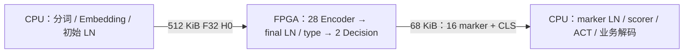

# Laya-HLS

面向 **AMD Alveo U55C + CPU** 的 Laya 推理硬件工程，包含 RTL/HLS、Host/CPU 实现、验证脚本、架构规格和可追溯实验记录。

**截至 2026-10-25（北京时间）：修复版完整 30 层硬件主干已在一次连续 RTL 仿真中通过。完整顶层资源、布线后 300MHz、板卡性能和 CPU–FPGA 端到端性能尚未验证。当前实验暂停。**

## 整体架构与功能

固定工作负载为 `B=1 / S=128 / hidden=1024 / 16 heads × 64`，包含 **28 层 Encoder + 2 层 Decision**。所有层顺序复用同一套计算与存储服务。

| 边界 | 执行内容 |
| --- | --- |
| CPU 输入端 | 原生请求处理、tokenizer、Embedding、初始带 gamma 的 LayerNorm，产生 `128 × 1024` F32 输入 |
| FPGA Attention | QKV 投影、Encoder RoPE、QK、掩码、严格 softmax、AV、WO；完整 Attention 在 FPGA 执行 |
| FPGA FFN 与向量 | Encoder 的 Wi → GEGLU → Down；Decision 的 FC1 → ReLU → FC2；残差加法、各层 LN、final LN、type 加法和 gather |
| CPU 输出端 | 16 个 marker 与 CLS 的原始 hidden 接入 scorer/ACT，产生 16 个候选 logits 和 2 个 ACT logits并解码 |
| 控制与数据流 | 一次公开 `BEGIN`，请求/模型/数值身份绑定；层间激活驻留；真实写入、资源退休、尾部提交和完成通知 |

主计算采用分组 Q8 矩阵、F32 恢复和严格浮点运算，保持冻结参考的归约顺序与逐步舍入。当前架构为两组 `Tm8 × Tn16 × Pk32` 矩阵 tile，合计名义 **8192 INT8 MAC/周期**；矩阵恢复与 Attention 共享 **256 路 F32 乘法 / 256 路 F32 加法**，量化、LN、softmax 复用 8 路直接除法服务。中间 hidden、QKV、context、PS 和 G 使用片上银行及阶段复用。

详细模块接口、数值规则、带宽和预算见 [M007 架构合同](mission/M007_完整Attention高性能主干与部署闭合/contract.md)与[机读指标](mission/M007_完整Attention高性能主干与部署闭合/performance_requirements.json)。

## 已验证的完整硬件功能

D37 / E021 R005 使用修复版生产父模块、正式参数 `VERIFY_POST_ENCODER27_H=0` 和原始 `embedding_norm` 输入，**一次 BEGIN 连续完成全部 30 层**。没有跳层、预填中间激活或使用 CPU 替代硬件算术。

| 检查项 | 实际结果 |
| --- | --- |
| 完整层与大矩阵 | 30 层、120 次矩阵执行通过 |
| Attention | 480 个 head 完成 |
| LN / 向量 / GEGLU | 60 次 LN、61 次向量操作（60 次残差 + type）、28 次 GEGLU |
| 每层数值 | 全部 30 份真实 H，各 `131072` 个 F32，与原独立参考逐位一致；每层 `4096` 个唯一接口采集组可独立重建 |
| final LN / type | 各 `131072` 个 F32 逐位一致；此前 gamma 交接修复在本次完整运行中通过 |
| Decision 交接 | 两次 FC1 各 `16384` 组真实写入/确认和发布完成后才进入 FC2 |
| 最终输出 | `544 × 128 = 69632` 字节，与原参考一致；真实 tail commit、保持后的 DONE 消费与最终 idle 通过 |
| 执行结果 | 原完整 PASS 终标、进程返回 0、无 Fatal/Error；3200 项执行身份复核一致 |

验证后端是已做局部 XSim 对照的 **Verilator 5.020 + 项目固定运行时**，本次采用单线程、两态仿真。该结果覆盖所测原始请求的完整正常路径；异常/复位全覆盖和四态行为仍需另验。旧版完整运行失败、修复后的分段后缀通过均保留各自证据。

证据：[主控独立终审](results/reviews/m007_fixed30_final_review_20261024.json) · [全部层实际输出核验](results/reviews/m007_fixed30_all_layer_capture_review_20261024.json) · [本次最终收据](project/E021_m007_compiled_rtl_validation/experiment_results/runs/R005/attempts/AT002_fixed_original30_kind7/final_fixed_original30_receipt.json) · [实验摘要](project/E021_m007_compiled_rtl_validation/experiment_results/summary.md)。

## 性能：测量、条件换算与目标

| 指标 | 数值 | 含义 |
| --- | ---: | --- |
| 完整仿真记录周期 | **13,036,119 cycles** | 本次全图收据口径，包含测试序列中的初始化、输入、控制与收尾；不是上板计时 |
| 按 300MHz 换算 | **43.45373 ms** | `13,036,119 / 300,000,000`；仅当同一周期行为和频率成立时的条件换算 |
| RTL 仿真墙钟 | **10,101.231 s（2小时48分21秒）** | 服务器执行仿真的耗时，不是 FPGA 推理延迟 |
| 矩阵阵列名义峰值 | **4.9152 TOPS @ 300MHz** | `8192 MAC/周期 × 300MHz × 2`；不代表持续有效算力或已实现频率 |
| 权重供给要求 | **≥28.8 GB/s** | 四个逻辑 W 读口聚合服务目标；真实 HBM/CDC/平台争用未测 |
| 系统性能目标 | 热请求 P50 ≤50ms、P95 ≤55ms、持续 ≥18QPS | 尚未验收；包含 CPU、数据传输与设备执行，不能由上方周期换算代替 |
| GPU 对照 | 本地 RTX A6000 | 尚无同请求边界的最终对照结论 |

当前完整仿真使用 AXI 测试 peer 提供权重和数据。实际 HBM、PCIe/DMA、平台外壳和多请求运行可能引入不同等待，因此不能把 **43.45ms** 标为板端实测或 CPU–FPGA 端到端性能。

CPU 边界已有独立原生实现测量，200 个热请求样本如下（与本次硬件仿真不是同一次系统运行）：

| CPU 部分 | 中位数 | P95 |
| --- | ---: | ---: |
| 输入准备 | 0.499ms | 0.589ms |
| scorer/ACT 尾部与解码 | 1.913ms | 2.080ms |

首请求及部分尾部样本仍超过原局部性能门槛，CPU 性能未整体验收。完整功能、样本范围和失败记录见 [Host/CPU 结果](project/E009_m007_host_tail_contract/experiment_results/summary.md)。

## 硬件资源与物理状态

目标器件为 `xcu55c-fsvh2892-2L-e`，目标时钟 300MHz。以下是**用户计算核预算上限，完整顶层实际用量仍未测**；最终还需与真实平台外壳共同装入器件。

| 资源 | 用户核预算上限 | 完整顶层实测 |
| --- | ---: | --- |
| DSP | 7,200 | 未完成联合综合 |
| LUT | 900,000 | 未完成联合综合 |
| FF | 1,800,000 | 未完成联合综合 |
| BRAM36 等价块 | 1,200 | 未完成联合综合 |
| URAM288 | 640 | 未完成联合综合 |
| 布线时序 | 300MHz，WNS ≥0、TNS=0，setup/hold 达标 | 未完成布局布线 |

部分严格浮点单模块已经独立综合：

| 单路模块 | LUT | FF | DSP |
| --- | ---: | ---: | ---: |
| F32 加法 | 443 | 447 | 0 |
| F32 乘法 | 459 | 326 | 2 |
| F32 直接除法 | 1,806 | 1,594 | 0 |

这些数据有对应综合报告和 DCP，但没有完成布局布线；不能将单模块数值简单放大为全设计占用。完整矩阵阵列、严格 EXP/TANH、银行和控制的联合资源及连线时序仍是待验证项。见[严格浮点模块证据](project/E008_m007_strict_fp_shared_service/experiment_results/summary.md)与[SFU 资源阶段结果](project/E017_m007_sfu_resource_closure/experiment_results/summary.md)。

## 代码与复核入口

| 内容 | 路径 |
| --- | --- |
| 唯一硬件实现树 | [project/E002_Laya_HLS/experiment/vivado/module_design](project/E002_Laya_HLS/experiment/vivado/module_design) |
| 生产完整父模块 | [laya_m007_single_parent_v3.sv](project/E002_Laya_HLS/experiment/vivado/module_design/forward_controller/rtl/laya_m007_single_parent_v3.sv) |
| 完整图测试台 | [m007_fullgraph_binary_tb.sv](project/E002_Laya_HLS/experiment/vivado/module_design/forward_controller/tb/m007_fullgraph_binary_tb.sv) |
| Host/CPU 入口与说明 | [host/m007_deploy](project/E002_Laya_HLS/experiment/host/m007_deploy/README.md) |
| 编译式 RTL 工具与说明 | [tools/m007_verilator](project/E002_Laya_HLS/experiment/tools/m007_verilator/README.md) |
| 当前目标与结果 | [Goal](goal/goal.md) · [M007 总结](results/missions/M007_summary.md) · [当前任务](mission/current.md) |

修复版父 RTL SHA256：`9d87721737ceea74e47f565321ed83a625abae89931287d8a002d4f8e1534db6`。

本仓库发布源码、测试台、脚本、合同和验证记录。模型权重、原始二进制张量、较大生成向量、编译缓存和工具安装保留在本地；详细范围见 [GIT_SNAPSHOT.md](GIT_SNAPSHOT.md) 与 [排除清单](GIT_LOCAL_ARTIFACTS.tsv)。历史清单和脚本包含原实验绝对路径，复现需要准备匹配哈希的输入、工具/IP和路径映射；仅克隆仓库并不等于取得完整二进制实验环境。

当前已完成本轮验证并暂停。后续关键工作是同版顶层综合、资源与时序核查、平台接口/部署验证，以及真实 U55C 与 A6000 的同口径性能比较。

内部项目导航与历史记录（自动生成）

<!-- research-agent:navigation:begin -->
生成时间（UTC）：2026-10-24T16:28:47.278122+00:00。来源修订：`7ff16673ba4d`。

# Laya-HLS 项目首页

项目根：`/home/user/EDA-202/zhuowenjun/Workspace/Laya/Laya-HLS`

## 查看入口

| 记录 | 入口 |
| --- | --- |
| 目标与历史 | [打开](goal/goal.md) |
| 所有 mission | [打开](mission/index.md) |
| 实验与每次结果 | [打开](project/index.md) |
| agent 讨论与待办 | [打开](communication/index.md) |
| 用户技术问答 | [打开](question/index.md) |
| 四个职责会话 | [打开](agent/index.md) |
| 全项目报告与历史 | [打开](results/index.md) |

## 当前任务

[M007 · 完整Attention高性能主干与部署闭合](mission/M007_%E5%AE%8C%E6%95%B4Attention%E9%AB%98%E6%80%A7%E8%83%BD%E4%B8%BB%E5%B9%B2%E4%B8%8E%E9%83%A8%E7%BD%B2%E9%97%AD%E5%90%88/README.md)

合同：[原始任务定义](mission/M007_%E5%AE%8C%E6%95%B4Attention%E9%AB%98%E6%80%A7%E8%83%BD%E4%B8%BB%E5%B9%B2%E4%B8%8E%E9%83%A8%E7%BD%B2%E9%97%AD%E5%90%88/contract.md)
唯一实现入口：[工程代码](project/E002_Laya_HLS/experiment)

## 最新执行报告

| 职责 | 当前任务 / 阶段 | 执行状态 | 上报时间 | 下一步 / 阻塞 |
| --- | --- | --- | --- | --- |
| 项目主控与架构评判 | D37修复版完整30层正常路径已通过并核验归档 已核全部结果/身份/预算与owned清理，按用户要求暂停 | paused | 2026-10-24T16:28:42.260390+00:00 | 等待用户明确恢复；不启动后继  |
| 工程实现与验证 | M006/SM007/E007/R001完整板端Attention首段 AT023旧11拍add次正规诊断已结束；AT021/022/023数值FAIL保留；无本项目在途进程 | paused | 2026-10-17T15:27:19.465644+00:00 | 仅在用户明确通知恢复后继续TANH DAG及strict FP修复 用户明确要求暂停，等待用户通知恢复 |
| 研究探索与瓶颈分析 | M004/SM004 AT368 A16_HELD到唯一MATRIX16/STEP16接口静态增量 按用户‘先暂停 等我通知’及m004-user-pause-research-20261016停止研究推进；此前MATRIX16静态增量已交付，现有源码、文档、日志和成本原样保留。A003没有未结束的owned实验或脚本；本次仅登记暂停状态并回报，不启动实现、审核或实验 | paused | 2026-10-15T23:17:21.647787+00:00 | 等待用户明确恢复通知；普通内部里程碑或旧合同继续消息不能解除暂停。AT404集中审核保持待续，修订22及M004/SM004未完成；不回滚、不升级PASS、不转预算  |
| executor入口源码核查 | 阶段A/B owned program真实consumer测试/runner 阶段D只读Q映射已交付；准备12源owned program独立gold用例 | running | 2026-10-13T01:36:28.707539+00:00 | 交父host-only/生成入口，自己不跑重工具  |
| executor真实控制consumer验证 | 阶段A真实LHC1控制transport RTL control transport RTL/TB/runner已交父；仅静态检查，DUT NOT_RUN | completed | 2026-10-13T01:41:47.287705+00:00 | 父在executor HLS后串行有限RTL  |
| executor生成入口验证与runner | 阶段C真实adapter/fence/source保护接线盘点 HLS reuse入口已交付；新只读检查实际物理端口 | running | 2026-10-13T01:41:48.660604+00:00 | 给父首次正常计算必需接线；无重工具  |
| 严格浮点与共享计算实现 | D32 source-only sole joint_v3 TANH8v3 substitution completed and delivered to A010/root D32_source_only_manifest_delivered_NOT_JOINT_TESTED | completed | 2026-10-23T07:12:26.027799+00:00 | A010 R007 source-bound production parent build and affected joint checker; A007 no active/queued heavy tool, D29 remains frozen and budget closed.  |
| Host与CPU尾部实现 | D32 read-only B1 input/tail source binding support delivered Only authorized source JSON/md written; original5input SHA/metadata and existing544tail vector byte mappings PASS. qtype2/markers23,33/mask0003/count2; no floating refe… | completed | 2026-10-23T06:26:45.804258+00:00 | A010/root received exact source binding. Parent-v3 build and SIM source_epoch remain A010 actual bindings. A008 support ended; no active/queued tool  |
| 矩阵供数接口核查 | 已交付矩阵供数源码与精确布局/输入映射 A001已核对并转交A010实施 | completed | 2026-10-21T02:26:47.647442+00:00 | 无在途任务；实现已由A010接续  |
| 高吞吐权重供数实现 | D37 actual complete original30 PASS documentation finalized; no subsequent task D37 documentation-only closeout complete; user-requested pause restored | paused | 2026-10-24T16:25:41.234187+00:00 | None. Root/A013 own global results and E021 archival; no A010 implementation or experiment is active/queued.  |
| 残差与完整模型架构核定 |   | 未登记 | 未登记 |   |
| 编译式RTL交叉验证 | D36 SEGMENTED_SUFFIX gamma fix verification complete PASS; original30 once-BEGIN acceptance remains unclaimed actual suffix and original gold checked;1654 identities frozen;4525 known owned processes clear;budget sealed;paused pe… | paused | 2026-10-24T12:58:26.725541+00:00 | await explicit user resume; no successor work  |
| 修复版完整30层验证 | D37修复版原30层一次BEGIN PASS；证据/清理/封账完成，按用户要求暂停 D37_completed_and_paused | paused | 2026-10-24T16:27:07.456595+00:00 | 等待主控集中审核与用户明确后续授权；无自动实验/优化/部署  |

## 当前证据范围（来自负责人概览，截取）

# 当前结果：修复版完整30层一次运行通过，项目暂停

updated: 2026-10-25（北京时间）
execution_state: paused
verdict: unassessed

主控增量128已接纳D37/E021 R005完整正常路径：正式参数0，从原embedding_norm开始，一次BEGIN连续计算28 Encoder、final LN/type、2 Decision和544组尾输出。13036119周期，RTL仿真10101.230975秒（2小时48分21秒）；原完整终标、实际尾部提交、heldDONE消费和idle全部通过。

主控独立核全部30层真实H及唯一采集trace、finalLN/type和69632B输出对原参考逐字一致；实际120矩阵/480head/60LN/61VECTOR/28GEGLU、两FC1各16384写/ACK/发布后才FC2。3200执行身份无失配，2262已知进程身份无存活/僵尸；2个瞬态policy样本保留UNKNOWN。22份费用收据复算static372.653189/1800s、RTL10101.230975/15600s；另2次失败准备耗时UNKNOWN、保守预留240s，余额封存不转。

本次证明修复版完整硬件主干在该原始请求上的RTL正常路径功能；未验所有异常/复位或四态行为，也未验联合物理时序、上板和实际吞吐。D35原FAIL及D36分段PASS保留。按用户要求完成核验归档后暂停，不启动后继。

[主控独立终审](results/reviews/m007_fixed30_final_review_20261024.json) · [工程最终收据](project/E021_m007_compiled_rtl_validation/experiment_results/runs/R005/attempts/AT002_fixed_original30_kind7/final_fixed_original30_receipt.json)

[完整概览及审核来源](results/overview.md)

## 最近讨论

- [C064 · 用户暂停M006工程](communication/C064_%E7%94%A8%E6%88%B7%E6%9A%82%E5%81%9CM006%E5%B7%A5%E7%A8%8B/thread.md) — 已答复待实施
- [C062 · SM007 AT015–019：直接 F32 除法单 lane 证据](communication/C062_SM007%20AT015%E2%80%93019%EF%BC%9A%E7%9B%B4%E6%8E%A5%20F32%20%E9%99%A4%E6%B3%95%E5%8D%95%20lane%20%E8%AF%81%E6%8D%AE/thread.md) — 已答复待实施
- [C063 · SM007：8拍加法IP的次正规反例](communication/C063_SM007%EF%BC%9A8%E6%8B%8D%E5%8A%A0%E6%B3%95IP%E7%9A%84%E6%AC%A1%E6%AD%A3%E8%A7%84%E5%8F%8D%E4%BE%8B/thread.md) — 待答复
- [C061 · SM007严格TANH现有模块与160拍帽的静态冲突](communication/C061_SM007%E4%B8%A5%E6%A0%BCTANH%E7%8E%B0%E6%9C%89%E6%A8%A1%E5%9D%97%E4%B8%8E160%E6%8B%8D%E5%B8%BD%E7%9A%84%E9%9D%99%E6%80%81%E5%86%B2%E7%AA%81/thread.md) — 已答复待实施
- [C059 · M006硬件恢复派发：完整板端Attention首段](communication/C059_M006%E7%A1%AC%E4%BB%B6%E6%81%A2%E5%A4%8D%E6%B4%BE%E5%8F%91%EF%BC%9A%E5%AE%8C%E6%95%B4%E6%9D%BF%E7%AB%AFAttention%E9%A6%96%E6%AE%B5/thread.md) — 已答复待实施
- [C060 · SM007共享FP对QK/AV数据依赖的接口问题](communication/C060_SM007%E5%85%B1%E4%BA%ABFP%E5%AF%B9QK_AV%E6%95%B0%E6%8D%AE%E4%BE%9D%E8%B5%96%E7%9A%84%E6%8E%A5%E5%8F%A3%E9%97%AE%E9%A2%98/thread.md) — 已答复待实施

本页是原记录的导航投影；登记、送达及局部结果不代表整体验收。

<!-- research-agent:navigation:end -->

