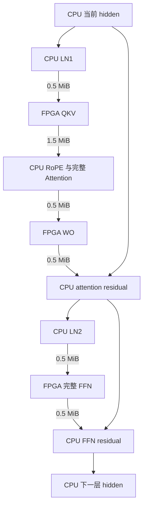

# Laya CPU 与 FPGA 协同推理系统架构

2026 年 10 月 17 日。适用对象：Laya-HLS，U55C 与主机 CPU，固定 B1/S128、hidden 1024。图依据为仓库提交 `546520092fc4bf57ed875681ba9c334498ed2e07`。本文给出新系统的职责划分、数据交接和验收标准；性能数值中的传输量为静态推导，绝对延迟需要完整实现测量。

## 1 架构决策

**首版采用 CPU 执行 LN、完整 Attention、残差和尾部，FPGA 执行 QKV、WO 与完整 FFN 子图的分工。** 每个 Encoder 或 Decision block 对 FPGA 发起三类大粒度调用。分组量化、整数点积、尺度恢复、累加和相应 bias 都封装在硬件矩阵服务内部。

这样可以保留 FPGA 的主线矩阵工作，把复杂的 Attention 与小型尾部交给软件，同时将 FFN 最宽的中间激活留在板端。按当前图，主线激活交换量从独立矩阵方案的 235.625 MiB 降至 120 MiB，依赖性的 FPGA 服务段从 120 个降至 90 个。最终以端到端时间决定该分工是否投入运行，完整 FFN 尤其必须通过含通信的性能比较。

后续优先评估将 **LN、残差及 hidden 驻留一起迁入 FPGA**。这会减少交接次数与流量；是否进一步把完整 Attention 迁入板端，取决于它对整个系统的实际收益。

### 完整职责表

| 推理任务 | 首版执行方 | 输入与输出的处理 | 划分依据 |
| --- | --- | --- | --- |
| 请求管理、问题构造、分词、mask 与位置准备 | CPU | 生成输入序列、候选位置和请求元数据 | 与业务接口、可变请求和错误处理相连 |
| 模型读取、校验、权重布局准备与加载 | CPU | 硬件用权重及 scale 一次装入板端 HBM；软件用权重留主机 | 模型装载独立于每次热请求 |
| token Embedding 与初始 embedding LN | CPU | 生成 FP32 的 128×1024 hidden | 输入已在主机；取消原来初始 LN 必须由 FPGA 执行的边界 |
| 主线 pre-attention LN 与 pre-FFN LN | CPU | 输入输出都是 128×1024 FP32 | 与主机持有的 hidden、残差连续执行 |
| QKV 大矩阵 | FPGA | 接收归一化激活；返回 128×3072 FP32 | 合并 Q、K、V 输出，并利用矩阵内部复用 |
| Q/K RoPE、Attention 布局、QK、mask、softmax、AV | CPU | 接收 QKV；产生 128×1024 context | 整段 Attention 连续处理，score/probability 不跨 PCIe |
| WO 大矩阵 | FPGA | 接收 context；返回 128×1024 投影结果 | 规则矩阵计算及 recovery 留板端 |
| attention residual 与 FFN residual | CPU | 与 CPU 保留的原 hidden 相加 | 本方案相关张量已回主机，残差不增加传输 |
| Encoder FFN | FPGA | 一次执行 Q→Wi→GEGLU→Q→Down；只返回 1024 维结果 | 避免 5248 维和 2624 维中间激活往返 |
| Decision FFN | FPGA | 一次执行 Q→FC1+bias→ReLU→Q→FC2+bias | 保留完整的 4096 维中间计算 |
| 硬件矩阵的激活量化、group32 recovery、累加、bias | FPGA | 仅最终 FP32 矩阵输出可出板 | 分组点积与尺度恢复属于同一服务边界 |
| Encoder 到 Decision 的 final LN、type embedding 加法 | CPU | 完成后进入两个 Decision block | 首版 hidden 已在主机，无新增往返 |
| marker gather、marker LN、完整 scorer | CPU | 保留全部 16 个 scorer 槽与两次 bias 的原顺序 | 尾部规模较小、算子类型多，避免新增硬件尾部链路 |
| 候选 mask、softmax、四个统计量、完整 ACT、结果处理 | CPU | 返回规定的 logits，并完成软件结果解释 | 与业务逻辑及软件尾部连续执行 |

这里的 Q 表示 group32 激活量化，LN 表示 Layer Normalization，FFN 表示前馈网络。本文的完整 Attention 子图特指 QKV 投影之后、WO 投影之前的 RoPE、QK、mask、softmax 与 AV，两个投影仍在 FPGA。首版所有 CPU–FPGA 激活边界采用 FP32。三类调用可以共用同一套矩阵计算引擎，不要求实例化三套阵列，也不要求切换三个 bitstream。

## 2 必须保留的真实计算图

固定图包含 **28 个 Encoder 和 2 个 Decision block**，主线共有 120 次 Q8 矩阵计算。scorer FC1 与 ACT FC2 是另外两次 Q8 调用；将完整尾部放 CPU 后，主线矩阵仍有 47,143,976,960 MAC，约占原 Q8 MAC 的 99.9644%。因此，尾部迁移的主要价值是减少硬件异构功能与控制负担，不能把它解释为大幅减少矩阵计算量。[1][2][3]

### 输入与 Encoder

CPU 做 token Embedding 和带 gamma 的 embedding LN。第 0 个 Encoder 直接使用该结果进入 QKV，不能额外增加一次 pre-attention LN。其余 Encoder 先做 LN。

每个 Encoder 按以下顺序执行：

1. CPU 准备 pre-attention 激活，FPGA 完成 QKV。
2. CPU 对 Q/K 做 RoPE，执行完整 QK、mask、softmax、AV，得到 context。
3. FPGA 完成 WO，CPU 加 attention residual。
4. CPU 做 pre-FFN LN，FPGA 完成完整 Encoder FFN。
5. CPU 加 FFN residual，得到下一层 hidden。

Encoder 的 QKV 形状为 128/1024/3072，WO 为 128/1024/1024。Wi 为 128/1024/5248，随后按同一行配对：

\[
g_j=\operatorname{GELU}(w_j)\times w_{j+2624},\qquad 0\le j<2624.
\]

Down 为 128/2624/1024。不能将 Wi 相邻列直接配对。每三层中的第一个 Encoder 使用 full 模式，其余使用原 sliding 模式；RoPE 和 mask 均按原参考规则选择。[1][2]

### Encoder 与 Decision 的连接

28 个 Encoder 完成后，CPU 执行带 gamma 的 final LN，选择请求对应的 type embedding 并广播相加，然后进入两个 Decision block。

两个 Decision block 都处理完整 S128，执行 LN→带 bias QKV→完整 Attention→带 bias WO→残差，再执行 LN→带 bias FC1→ReLU→带 bias FC2→残差。Decision 不使用 RoPE 或 sliding；其 FFN 中间宽度为 4096，不能复用 Encoder 的 GEGLU 语义。[1][2]

### 尾部

CPU 在第二个 Decision block 完成后执行：

- gather 全部 16 个 marker 槽，做 marker LN。
- Q8 scorer FC1，先按原规则使用 baked bias，再独立加 scorer bias，随后 GELU。
- F32 scorer FC2、候选 mask、softmax 与四个统计量。
- 将最终 Decision 的原始 hidden[0] 与四个统计量拼成 1028 维 ACT 输入。
- F16 权重、FP32 运算的 ACT FC1，再 bias/GELU 和 Q8 ACT FC2。

最终输出是 **16 个 masked logits 与 2 个 ACT logits**，前 16 项不是概率。ACT 使用的 hidden[0] 不经过 marker LN。当前冻结图没有 ACT 控制的提前退出或重复 Decision 循环，也没有自回归 KV-cache 解码阶段。[2]

## 3 每层三个硬件服务

令一个 128×1024 FP32 张量的大小为：

\[
X=128\times1024\times4=524,288\ \mathrm{B}=0.5\ \mathrm{MiB}.
\]

| 服务 | CPU 提交前 | FPGA 内部执行 | CPU 收到后 |
| --- | --- | --- | --- |
| QKV | 执行需要的 LN，准备 X 字节输入 | 激活 Q→QKV 整数点积→group recovery→有序累加→适用的 bias | 接收 3X 字节 QKV，执行 RoPE/完整 Attention |
| WO | 将 Attention context 的 X 字节输入提交 | 激活 Q→WO→recovery→累加→适用的 bias | 接收 X 字节，完成 residual 与下一次 LN |
| FFN | 将 LN 输出的 X 字节输入提交 | Encoder 模式执行 Wi/GEGLU/Down；Decision 模式执行 FC1/ReLU/FC2；每个 Q8 线性前都量化 | 接收 X 字节，完成 residual 并进入下一层 |

单层的依赖与残差来源如下。第 0 个 Encoder 的 LN1 按规则跳过；Decision 的 Attention 不含 RoPE。

原 hidden 与第一条残差结果由 CPU 保留，FPGA 返回对应增量。首版不要求在 CPU 和 FPGA 各维护一份权威 hidden，也不需要为了残差额外上传 skip tensor。

## 4 软件运行时与硬件数据通路

### CPU 运行时

CPU 负责模型生命周期、请求调度、数值软件算子和硬件调用。软件接口可分为输入处理、计算执行、结果处理三个部分；实际热路径采用编译后的 CPU 实现，避免用 Python 逐元素循环作为性能基准。

模型初始化时完成权重校验、布局准备、设备加载和可复用缓冲分配。根据矩阵清单，主线 120 个矩阵的量化权重与 scale payload 合计 391,331,840 B，另有 73,728 B bias；这是一遍装载的逻辑字节量，不是每个请求的 PCIe 传输量，也不是实际片上占用。Embedding、scorer、ACT 所需权重留在 CPU，板端主线权重常驻 HBM，计算时再装入片上工作集。[3]

主机保持 hidden、attention residual、LN 工作区和 Attention 工作区。QKV 输出使用一个打包缓冲区；CPU 用约定的视图解释 head、Q/K/V 与序列维度，避免三次小传输和不必要的临时复制。mask、位置、候选信息尽量一次提交并按请求引用。

使用 XRT 管理可复用的设备、kernel、run 和 buffer 对象。映射到主机地址的缓冲并不意味着数据自动到达 U55C HBM；输入更新、DMA 完成、内核执行、输出 DMA 完成仍是明确的依赖。XRT 的异步提交和事件可以减少主机阻塞，但不能消除这些依赖。[4]

### FPGA 服务

FPGA 保留一个可复用的矩阵服务及所需的数据准备和后处理模块：

- group32 激活量化及 scale 生成。
- A/W 缓冲与读取调度、整数点积阵列。
- group32 FP32 尺度恢复、每个输出的顺序累加、适用的 bias。
- Encoder GEGLU 与 Decision ReLU。
- FFN 内部 group32 再量化、结果打包及命令完成控制。

完整 FFN 是一个主机调用边界。若 Wi 与 Down 共用一个阵列，它们仍按依赖先后使用阵列；“融合”不等于两次矩阵乘法同时执行。首版可以使用板端 HBM 暂存中间张量，也可以在缓冲容量允许时按行窗口转发。关键是宽中间量不跨 PCIe，而且内部 HBM、bank 和恢复流水能够持续供数。

每个 Encoder 的 Wi FP32 输出为 2.5625 MiB，GEGLU 输出为 1.28125 MiB。若按组转发，必须先获得完整 group32 的 GEGLU 输出，才能按原规则求 amax、生成 scale 并量化；不能为了流水而改变尺度计算范围或舍入。

权重调度应尽量让 Wi 与 Down 在片上不同工作槽内保留，并跨多行复用；仅在 HBM 常驻还不足以保证有效复用。现有逻辑双槽预算提供了研究基础，实际银行分配、端口冲突、资源映射与频率仍需核算。[1][3]

### 命令与完成语义

逻辑命令至少说明请求 ID、模型版本、算子模式、层号、形状、输入输出缓冲、权重与 bias 引用、数值规则版本。它们是新接口设计字段，不代表现有 XRT API 已直接提供对应的神经网络操作。

CPU 每次提交完整矩阵或 FFN 服务，不参与 group、tile、FP32 叶子的逐项调度。硬件负责有限数量的在途事务、合法反压、读写返回匹配与最终退休。CPU 只在相应 DMA 完成后读取输出；命令成功必须建立在真实结果及写响应完成之上。

## 5 通信成本与分工收益

### 可核对的流量账

下面按 FP32 有效激活 payload 计算。独立矩阵与首版融合 FFN 的统计都包含首次主线输入上传及最后一次 FFN 的完整输出下载；最终 hidden 在 CPU 完成残差后形成，因此不再额外加一份 Embedding 上传或最终 hidden 下载。权重初始化、命令、mask、对齐、布局复制及驱动开销另计。

| 分工 | H2D | D2H | 主线激活总量 | 依赖交接 |
| --- | ---: | ---: | ---: | --- |
| FPGA 执行四个独立主线矩阵，其他 CPU | 84.875 MiB | 150.75 MiB | 235.625 MiB | 120 个 FPGA 服务段 |
| 首版 QKV、WO、完整 FFN | 45 MiB | 75 MiB | 120 MiB | 90 个 FPGA 服务段 |
| 后续板端驻留方案中的 Attention 边界 | 15 MiB | 45 MiB | 60 MiB | 30 个 CPU Attention 间隙；入口与出口另计 |

独立矩阵流量来自完整矩阵清单。[3] 一个 Encoder 的 QKV/WO/Wi/Down 合计 7.84375 MiB；一个 Decision 的 QKV/WO/FC1/FC2 合计 8 MiB，因此：

\[
28\times7.84375+2\times8=235.625\ \mathrm{MiB}.
\]

首版每层的 QKV 调用交换 2 MiB，WO 交换 1 MiB，FFN 交换 1 MiB，因此：

\[
30\times(2+1+1)=120\ \mathrm{MiB}.
\]

FFN 融合使 28 个 Encoder 不再下载 Wi 宽输出及上传 GEGLU 输出，共省 107.625 MiB；两个 Decision 省下 FC1/ReLU 的往返 8 MiB。合计节省 **115.625 MiB，约 49.1%**，同时省下 30 个依赖性硬件服务段。

120 MiB 与 90 个 FPGA 服务段对应全部 30 个 FFN 都选择融合硬件路径的配置；若按层选择 CPU 回退，需要重新统计实际流量与调用数。90 个 FPGA 服务段不是 90 次单向 DMA：每段都需要输入和输出；QKV 打包为单缓冲时，这对应约 180 次方向性批量数据传输。实际 API 次数还受分段、驱动与运行时实现影响。

### 流量减少不等于相同比例的提速

若仅以每个方向有效 8 GB/s 为示例，并按单请求依赖顺序累加双向 payload，235.625 MiB 对应约 30.88 ms，120 MiB 对应约 15.73 ms。节省的纯 payload 时间约 15.16 ms。这里没有假设 U55C 已达到该带宽，也没有计提交、同步、CPU 计算和硬件计算。

因此，不能仅凭节省宽张量通信就认定硬件 GEGLU 值得保留。应在相同输入、数值规则和权重驻留条件下验证：

\[
T_{\mathrm{FPGA\ complete\ FFN}}^{\mathrm{incl.\ transfer}}
<\min\left(
T_{\mathrm{CPU\ complete\ FFN}},
T_{\mathrm{FPGA\ Wi\;CPU\ G\;FPGA\ Down}}^{\mathrm{incl.\ transfer}}
\right).
\]

共同的前置 LN 和后置 residual 可以一致地排除，量化、GELU、内部 HBM 读写、权重工作集装载和完成等待都必须计入。完整 FFN 是硬件建设目标；运行时保留完整 CPU FFN 与拆分路径作为验证和性能对照，按实际胜出的路径配置运行。

## 6 数值规则与任务归属分开管理

此次架构改变执行设备与交接边界，保留现有数值规则。[1][2]

| 路径 | 必须保留 | 可采用的并行方式 |
| --- | --- | --- |
| LN | 原均值与方差相邻二叉树、先减均值再平方、eps、sqrt、倒数、gamma 和逐步舍入 | 不同行，以及同一归约层的独立节点并行 |
| Q8 量化与恢复 | group32 amax/scale、原舍入规则；整数 dot 后分别舍入 scale 乘积与恢复乘法，再按 group 次序累加 | 不同 row、输出列、tile 交错 |
| Attention | 原 QK 64 项树、有限 mask、expf、softmax sum 树与除法、AV 的 key 顺序累加 | 不同 head、query、独立输出向量并行 |
| GEGLU 与尾部 | 原 GELU/tanh 运算步骤、对应 gate 配对、scorer 两次独立 bias、ACT/统计的顺序 | 独立元素或独立输出并行 |
| 错误行为 | 原有限值检查、逻辑首错顺序，失败不发布成功输出 | 并行执行后按规定逻辑位置选择首错 |

CPU 上的通用 BLAS、softmax 或向量数学库不能默认满足这些规则。软件后端可以跨独立输出使用 SIMD 和多线程，但应检查编译器的 FMA 合并、重排、FTZ/DAZ 与数学函数实现，保持规定的 FP32 中间舍入。

物理流水融合不授权改变算术。例如 GEGLU→Q 可以省去一次板外张量传输，但不能省略原 FP32 结果的舍入；Wi/Down 合并为一个硬件调用也不能把 group 之间的累加改为另一棵树。

冻结输入中的 72 个有效 token 仍按 S128 图计算，两个有效候选仍保留 16 个 scorer 槽。首版不引入 token 裁剪、候选裁剪、早停、近似非线性或新的低位宽方案。一个 state 被多个问题复用时，可以复用分词、权重等准备工作；不能自动复用不同问题序列的上下文化 hidden。

## 7 后续将 LN 与 residual 连同 hidden 驻留迁入 FPGA

首版的 CPU hidden 是权威状态。后续候选方案改为 FPGA 持有权威 hidden，并把以下两段连接起来：

1. CPU Attention context 回板 → Q→WO→attention residual→LN→完整 FFN。
2. FFN 输出→FFN residual→下一层所需 LN→Q→QKV，再把 QKV 交 CPU Attention。

同时将 Encoder–Decision 的 final LN 与 type add 纳入板端驻留。CPU 仍负责 type embedding 的选择或离线解码，只把小向量或标识交给 FPGA，FPGA 执行广播加法。单独把一个 LN 放 FPGA、结果立刻又回 CPU，不能获得这条连续路径的通信收益。

### 完整流量边界

30 个 Attention 间隙合计 60 MiB，另加初始 0.5 MiB hidden 上传。第二个 Decision 完成后，硬件只需 gather 原始 16 个 marker 行以及 hidden[0] 供 CPU 尾部使用：

\[
17\times1024\times4=69,632\ \mathrm{B}=68\ \mathrm{KiB}.
\]

固定打包保留槽顺序，即使存在重复行也先不去重。marker LN 仍在 CPU；ACT 使用的 raw hidden[0] 必须独立保存。这样包含入口和紧凑出口的有效激活 payload 约为：

\[
60+0.5+68/1024=60.56640625\ \mathrm{MiB}.
\]

如果 final LN/type add 仍在 CPU，桥接额外需要完整 hidden 下载和上传各 0.5 MiB，总量变为 **61.56640625 MiB**。上述紧凑 gather 仅发生在第二个 Decision 完成后，不改变两个 Decision 对完整 S128 的计算。

### 迁移判据

LN 与 residual 迁入 FPGA，应满足节省的 CPU 时间、通信和同步时间，大于新增板端计算、内部访存，以及资源争用或工作频率变化造成的损失。使用完整 block 或完整请求测量这一判据，不能仅比较孤立 LN 的算术核。

Attention 首版明确在 CPU。只有板端完整 Attention 在相同数值要求下，包含其存储和资源影响后优于当前 CPU Attention 加交接成本，才迁移完整的 RoPE/QK/softmax/AV 子图。保留 CPU Attention 并不意味着硬件不能继续优化该模块；它使主线系统不被该模块的完成进度绑定。

## 8 持续吞吐与多请求协同

任务划分后仍需改进矩阵服务的有效执行密度。优先事项是 A/W 读取和计算重叠、权重跨行复用、有限数量独立输出的部分和交错、恢复和写回流水持续接收。CPU 不承担 group32 恢复，也不接收分组 partial sum。

独立输出交错可保持每个输出的 group 顺序。涉及预取或后续 tile 提前执行时，需要在新执行约定中明确允许的在途窗口、提交顺序和错误隔离；若与旧的后续 tile 零读取条款冲突，应明确替换该执行条款，而非假称旧合同已经允许。

以主线 47.144 G MAC、1024 MAC/cycle 和假设的 150 MHz 计算，整数矩阵单项的理想计算下限约 307 ms。这个算式尚未加入 recovery、Attention、CPU、DMA 等时间，也不证明完整核达到 150 MHz。它说明软硬件分工可以移除不合适的职责，但数十毫秒目标仍要求更高的持续算力及配套供数能力。

单请求依赖必须保留：QKV 完成后 CPU 才能开始该 Attention；context 回板后才能做 WO；FFN 完成后才能形成下一层输入。不能直接用 CPU 时间和 FPGA 时间的最大值预测单请求延迟。

多请求时可以让 CPU 执行请求 A 的 Attention，同时 FPGA 执行请求 B 的就绪矩阵服务。先实现两个独立的请求工作区、明确 buffer 所有权和完成标签，再评估这种重叠。不同层的请求交替可能增加权重工作槽换入，应把新增权重流量计入吞吐结果。多请求重叠主要改善吞吐，不自动缩短每个请求的关键路径。

## 9 验收标准

| 验收项 | 要回答的问题 | 必须计入的内容 |
| --- | --- | --- |
| 数值与图完整性 | 新分工是否实现同一个推理计算 | 一个完整 Encoder、一个完整 Decision、完整请求的边界值与 final18；特殊值和失败路径 |
| QKV 与 WO | 卸载大矩阵是否值得 | 量化、矩阵、recovery、bias、DMA、布局、提交与完成等待；对照兼容 CPU 实现 |
| 完整 FFN | 板端保留 GEGLU 是否带来净收益 | 融合硬件 FFN、全 CPU FFN、拆分 Wi/G/Down 三条完整路径 |
| CPU Attention | 软件是否成为新瓶颈 | RoPE、QK、mask、exp、归约、除法、AV、布局及多线程开销 |
| LN 与 residual 驻留 | 通信减少是否抵消板端代价 | 完整 block/请求，以及资源争用和实测工作频率变化 |
| 单请求系统延迟 | 用户请求多久拿到结果 | CPU 前处理、所有依赖等待、实际传输、板端计算、CPU 尾部；报告 P50/P95 |
| 持续吞吐 | 多请求协同是否有效 | 请求数/秒、排队延迟、CPU 核数、在途请求数、权重换入与有效带宽 |
| 比较口径 | CPU/GPU/异构结果能否比较 | 同模型与输入、B/S、候选数、数值规则、预热、计时起止；加载冷启动与热请求分列 |

主机 CPU 的型号、内存配置与测量结果尚未给出，因此不预填 CPU Attention、LN 或尾部的绝对延迟。旧参考程序的运行时间与不同版本的局部 RTL 预算，不替代该系统的完整测量。

工程实施顺序为：先建立同数值规则的 CPU 后端与端到端计时，再接通 QKV/WO 及三类硬件调用；接着完成 FFN 的宽激活驻留与矩阵持续供数，验收首版完整系统；最后依据完整路径数据评估 LN/residual 驻留与 Attention 迁移。

## 10 建议纳入新工程目标的职责约定

> Laya 推理由 CPU 与 FPGA 协同执行，系统以完整请求延迟和持续吞吐为验收对象。CPU 负责请求与模型管理、Embedding、首版所有 LN 与 residual、完整 Attention 及完整 scorer/ACT 尾部。FPGA 负责 QKV、WO、Encoder FFN 和 Decision FFN 的完整子图，包含各自所需的量化、group32 尺度恢复、累加、bias 和中间非线性。CPU–FPGA 激活边界首版使用 FP32，权重按执行侧持久驻留。后续算子迁移以连续子图的端到端实测收益为依据，保留数值与输出语义，并明确更新允许的执行调度。

## 参考依据

[1] [Laya-HLS 固定图与共享算术架构](https://github.com/zwj276765037-lab/Laya-HLS/blob/546520092fc4bf57ed875681ba9c334498ed2e07/source/fixed_graph_architecture_20261014.md)。用于确认固定图、形状、数值规则、现有服务边界和逻辑存储预算。

[2] [完整独立参考 full_reference.py](https://github.com/zwj276765037-lab/Laya-HLS/blob/546520092fc4bf57ed875681ba9c334498ed2e07/project/E002_Laya_HLS/experiment/tests/full_reference.py)。用于确认实际调用顺序、Encoder 与 Decision 差别、scorer/ACT 依赖和 final18 语义。

[3] [矩阵清单 matrices.csv](https://github.com/zwj276765037-lab/Laya-HLS/blob/546520092fc4bf57ed875681ba9c334498ed2e07/source/feasibility_20261014/v4/matrices.csv) 与 [工作量预算 budget.json](https://github.com/zwj276765037-lab/Laya-HLS/blob/546520092fc4bf57ed875681ba9c334498ed2e07/source/feasibility_20261014/v4/budget.json)。流量由形状独立推导，未沿用其旧延迟预算作为新系统预测。

[4] [AMD XRT Native APIs](https://xilinx.github.io/XRT/master/html/xrt_native_apis.html)。用于说明主机与设备缓冲的数据同步、内核运行和依赖管理；具体实现以部署平台使用的 XRT 版本为准。
