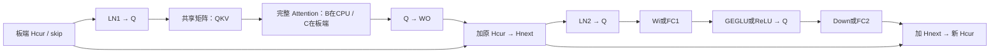

# M006：CPU–FPGA协同高性能推理实现

revision: 3 / 2026-10-17
architecture_decision: D-M006-RESIDENT-ARCHITECTURE-02
document_state: detailed_plan_ready
review_state: editorial_reorganization_of_static_reviewed_plan_not_experimentally_validated
execution_state: paused
verdict: unassessed
owner: A001主控；恢复后复用A002工程与A003研究角色
implementation_root: project/E002_Laya_HLS/experiment

[Goal](../../goal/goal.md)定义项目目标、范围和完成标准；本文是当前详细架构与实施合同。按用户要求，将原Goal v6的详细设计集中到此，合并修订2的重复内容，架构选择与数值规则不变。

用户[架构原文](../../design_source/Laya_CPU_FPGA_Codesign_Architecture_20261017.md)作为来源；原CPU全LN/residual、90服务段方案保留作对照，不作为必须先实现的路线。本次仅整理文档，工程、基准、模型与EDA实验仍暂停；用户明确恢复后按本合同连续实施。

## 1. 已知平台、工作量与设计状态

| 项目 | 已知值/规划 | 状态与用途 |
| --- | --- | --- |
| 对标 GPU | 本机两张 NVIDIA RTX A6000、每张约48GB；比较只用其中一张 | 只读设备身份已核；性能未测 |
| RTX A6000 | 标称768GB/s显存带宽、38.7TFLOPS FP32 | 厂商峰值，不能直接代入严格Q8分组路径延迟 |
| U55C | 9,024 DSP、1,304K LUT、16GB HBM、标称460GB/s；片上RAM约43MB | 板卡资源上限，不是用户核可独占容量/可达带宽 |
| 平台 | U55C官方目标、对应shell/XRT/工具版本 | 综合前固定真实part、speed grade、平台和XDC；不以近似器件代签 |
| 主线 | 120次Q8矩阵，47,143,976,960 MAC | 固定完整图静态计数 |
| 分组恢复 | 1,473,249,280个group32结果；2次F32乘法＋1次F32累加，共4,419,747,840次运算 | 另计I32→F32转换、bias、控制和非线性 |
| 权重 | 主线Q8+scale共391,331,840B，另有73,728B bias | 初始装载与每请求HBM→片上流量分账 |
| 其他工作 | GEGLU 9,404,416输出；QK+AV共1,006,632,960 FP MAC；softmax 7,864,320分数 | 不能按主线INT8 MAC占比当作可忽略部分 |
| 初选时钟 | 250MHz核心设计点；300MHz为后续候选 | 主控规划值，尚未综合/布线，不能作为实际运行频率 |
| 当前执行 | 仅文档规划 | 所有新模块/性能结论NOT_RUN |

平台依据：[AMD DS978](https://docs.amd.com/r/en-US/ds978-u55c/Product-Details)、[U55C通道说明](https://docs.amd.com/r/en-US/ug1469-alveo-u55c/Card-Features)、[NVIDIA A6000规格](https://www.nvidia.com/content/dam/en-zz/Solutions/products/workstations/nvidia-rtx-a6000-datasheet.pdf)。工作量依据：[矩阵清单](../../source/feasibility_20261014/v4/matrices.csv)、[独立参考](../../project/E002_Laya_HLS/experiment/tests/full_reference.py)。本轮整数复算、来源SHA与旧文档归档见[规划输入记录](../../goal/codesign_v6_planning_inputs_20261017.json)。

## 2. 完整图与首选执行分工

**方案定位：B为当前首选候选，C为条件备选；两者的Attention执行端不同，均尚未实现。** QKV/WO在FPGA不代表完整Attention在FPGA。

本版优先规划 **B：板端驻留主线＋CPU完整Attention桥接**。同时为 **C：板端驻留主线＋板端完整Attention** 预留同一数据接口和资源复用切口。A6000实测预算决定B是否足够、是否必须实施C；不要求先完整实现旧90服务段方案再迁移。只保留这两个明确切口，不建设任意算子动态切换框架。

| 子图/数据 | B的执行端 | C的执行端 | 不可省略的语义 |
| --- | --- | --- | --- |
| 请求、tokenization、位置/mask、模型管理、Embedding、initial embedding LN | CPU | CPU | 向设备提交完整128×1024 F32；第0个Encoder不能再加pre-Attention LN |
| Encoder主线LN、QKV、WO、两次residual、pre-FFN LN、完整FFN | FPGA | FPGA | LN/residual连同hidden一起驻留，不能逐个小算子往返CPU |
| Encoder RoPE＋QK/mask/softmax/AV | CPU完整子图 | FPGA完整子图 | layer % 3 == 0使用full，其余原sliding；仍计算完整S128 |
| Encoder→Decision final LN＋type add | FPGA | FPGA | CPU只选择type向量或标识；带gamma的final LN和广播加法按原顺序 |
| Decision ×2 | FPGA主线、CPU Attention | FPGA完整主线 | 完整S128；无RoPE/sliding；QKV/WO/FC1/FC2的bias与ReLU保留 |
| marker gather | FPGA | FPGA | 输出16槽原始hidden行＋独立raw hidden[0]，共68KiB |
| marker LN、完整scorer与ACT尾部 | CPU | CPU | 所有16槽；scorer先baked bias再独立bias；ACT输入为raw hidden[0]＋4统计量 |
| 最终输出 | CPU发布final18 | CPU发布final18 | 16个masked logits＋2个ACT logits，前16项不是概率 |

权威hidden/skip只在设备端更新；CPU桥接Attention只能产生context，不持有可独立修改的第二份主线hidden。C中的GPU仅作基线，不参与生产推理；不借用A6000计算来宣称单U55C胜出。

以下为一层的共同数据流，LN1在第0个Encoder按规则跳过：

## 3. 服务组织与主机接口

生产设备包含固定图控制器、共享Q8矩阵引擎、量化服务、向量/LN服务、GEGLU/ReLU服务、存储搬运服务，以及C可选的完整Attention控制。矩阵与数值叶子保持单一生产实现，局部TB和父图必须实例化相同模块。

- **模型初始化：** 验证原模型身份，持久重排权重为group/Ntile连续布局并写入HBM；保存原字节到新布局的可逆映射、校验和、bias/gamma/RoPE表。初始化和冷启动不混入热请求，不默改数值权重。
- **B的粗粒度执行：** BEGIN接收一次请求并执行至首个QKV完成；CPU显式D2H后计算完整Attention，上传context，再提交ATTENTION_CONTINUE。设备执行WO/residual/LN/FFN/下一层LN/QKV至下一Attention边界。共30个Attention交接，最后导出紧凑尾部；CPU不调group/tile。可用复用的run对象实现粗粒度段，不强制先建设持久kernel mailbox。
- **C的执行：** 同一图描述符运行主线，Attention在设备内部完成，最后一次导出尾部。主机仅处理请求入口、完成与错误。
- **原三服务：** QKV/WO/FFN仍是可独立测试的内部/诊断服务；不要求每层都由CPU发三个生产命令。
- **CPU后端：** 编译实现、固定核数SIMD/多线程、复用pinned buffer；QKV打包视图直接接Attention，避免重复转置/分配。通用BLAS/exp库须验证语义，不能默认等价。

新ABI按版本独立定义：64位request_id、32位generation、模型/数值/布局版本、执行方案、层与固定shape、64位地址/span、权重引用、mask/position/type/marker元数据、上下文slot。命令前验证完整地址范围、不重叠规则、对齐和整数溢出。数据小端，外部AXI按平台512bit优先设计，64B对齐；突发遵守4KiB和AXI长度上限，窄尾拍明确WSTRB。

完成事件区分 QKV_READY、CONTEXT_ACCEPTED、TAIL_READY、ERROR，不把中间事件命名为请求完成。Check回执包含request/generation/layer/op、status16、detail32、bad64及有效输出范围；错误码和优先级在首段ABI中完整列出，旧接口需要固定适配，不能复用旧字段而暗改语义。CPU只在真实设备写响应及D2H完成后消费结果，最终final18完成还包含CPU尾部。

## 4. 矩阵阵列、恢复与部分和

### 4.1 明确建设点

基本tile采用 Tm=8、Tn=16、Pk=32，即每拍4096个INT8乘累加工作量。主候选为两个tile按M维并联，合16行×16列×32＝8192 MAC/cycle，两tile共享/广播同一W组。先以一tile验证映射与完整服务，然后扩到两tile；一tile功能通过不是性能任务完成。

两tile在250MHz的整数峰值为2.048TMAC/s，主线纯整数理想下界23.01952ms；300MHz下为19.18293ms。量化、等待、恢复、非线性、Attention与Host均未包含。若A6000留给矩阵的时间预算小于该下界，此配置必须调整，不能靠假定更高利用率解决。

精确INT8共享操作数打包是优先验证项：跨row共享W，按DSP48E2允许的输入范围、符号修正和有限段累加映射。group32 dot保留精确I32，不能把两个18bit打包通道直接累加32项而忽略溢出。需整数证明、边界反例和综合映射；无需降低精度也可以做精确打包。[AMD WP487](https://docs.amd.com/v/u/en-US/wp487-int8-acceleration)

不将9024个DSP全部计作INT8阵列。恢复、向量、非线性、shell以及布线都占资源。是否采用更多tile由“整数＋恢复＋银行＋实际Fmax”的完整结果决定，不先承诺4tile或高利用率。

### 4.2 恢复吞吐必须匹配

两tile峰值每拍产生256个group32 dot，必须匹配256次I32→F32、512次F32乘法和256次有序F32加法的接收能力。每个输出执行原 sa×sw、乘dot、按group顺序加到PS；不同输出可交错。恢复实际只能接收128组/拍时，整数峰值再大也不能称有效8192 MAC/拍。

| 两tile每拍逻辑需求 | 字节/操作 | 设计含义 |
| --- | ---: | --- |
| A整数 | 16×32＝512B | 按row lane分银行 |
| W整数 | 16×32＝512B | 按column lane分银行，两tile广播 |
| scale输入 | 16个A scale＋16个W scale，各F16 | 分别读取/精确扩为F32后广播，非256份scale外读 |
| PS读取 | 256×4＝1024B | 必须有对应并行读能力 |
| PS写回 | 256×4＝1024B | 与读取并行，返回tag确定唯一地址 |
| FP32结果恢复 | 256 group/cycle | 供数、转换、乘法、加法、提交都要匹配 |

PS按row lane×column lane形成256路逻辑访问，候选为分布式RAM/寄存器银行的同步1R+1W，或经过证明的等效分银行实现；不能用一个8KiB单口RAM冒充这些端口。真实映射的碎片、寄存器、旁路和路由计入物理预算。

### 4.3 确定循环顺序与反馈隐藏

初版每次先形成完整S128量化A缓存。外层Ntile，内层按group从0递增，每个W组依次服务全部128行窗口：

Ntile → group → S128中的8个M16窗口 → 下一个group。

一次N16的PS逻辑容量为128×16×4＝8192B。相同输出两次访问间隔8拍；只有覆盖“PS同步读→浮点累加→写回→下次可读”的完整反馈延迟才合法。若回路为L拍，选择至少ceil(L/8)个独立Ntile交错，并同步增加PS/W保持、tag和credit；不能只看加法IP latency或添加未证明多周期约束。

每个输出group次序不变，dot整数树可在无溢出条件下调整。所有不可反压叶子发射前预留最终返回容量，所有ready/valid阻塞保持payload稳定，flush等待真实FP返回及PS提交，而非固定计数延时。

## 5. 权重布局、HBM与复用

主线权重在HBM常驻，片上只保存当前/下一Ntile工作集及必要偏置。权重转成连续group×Ntile布局；scale与整数对应。两tile一组W含512B整数＋32B scale＝544B，服务8个M窗口后换组，理想平均读取68B/cycle，即17GB/s@250MHz。此为跨128行复用、无填排/碎片条件下的需求，必须核实际AXI字节。

- W tile双缓冲：当前tile计算时预取下一tile；预取窗口有界，只读模型已声明范围。允许在不改变可见首错的前提下验证未来权重，不能把未来层错误提前发布。
- 初选4个逻辑HBM权重通道，外加独立activation/回传通道；最终映射由真实平台和突发测试确定。32个伪通道和460GB/s是设备能力，不等于一个AXI口能获得全带宽。
- W一次装入片上后跨全部128行复用；若因实际循环导致每16行重新加载，权重流量变8倍，必须计入结果，不准继续用391MB/请求估计。
- 输出/中间量优先片上消费；B交接的QKV/context需要真实HBM与DMA staging，其读写成本不能隐藏。
- 初始化重排、PCIe权重加载、HBM工作集换入分三笔计量。只读权重可跨请求共享；任何更新需新model generation和完整失效。

以K4096/N32为例，一份W tile量化payload为139264B，双缓冲278528B；实际突发padding、bank复制和交错Ntile另计。无需先保留旧约11MB的整矩阵双cache，更不能因该旧容量限制新供数设计。

## 6. FFN融合、量化与向量流水

### 6.1 Encoder FFN

Wi仍为128×1024×5248，Down为128×2624×1024。按32列逻辑组配对计算 Wi[:,j:j+32] 与 Wi[:,2624+j:2624+j+32]；每个GEGLU元素保持 GELU(前半)×后半。N16物理tile要收齐相邻两个tile，才能形成完整G group32及量化amax。

一个配对块的两个F32半张量共2×128×32×4＝32KiB；采用至少双缓冲或等价的分银行释放证明，防止下一块覆盖未消费数据。G输出按原FP32舍入进入Q，生成完整128×2624的Q/scale缓存356864B。初版待全部G量化有效后，同一矩阵引擎执行Down；不在Wi与Down之间逐行频繁换入整套权重，不跨PCIe传宽中间量。

在8192 MAC/拍的Wi峰值下，每个G输出对应2×1024 MAC，平均需要4个G元素/拍。GEGLU规划4条可持续流水通道，真实II、tanh资源和填排必须测量；4条只是平均匹配，没有余量。若有非II1或突发，需要增加容量/通道或计入停顿，不能保持峰值假设。G与matrix同时工作需要独立资源或明确仲裁成本。

### 6.2 Decision FFN与Q规则

Decision FC1宽4096，ReLU后再量化，FC2的K4096。FC1每输出只需1024 MAC，8192MAC/拍对应8输出/拍，ReLU/量化入口不能沿用仅4元素/拍的GEGLU预算。完整中间Q/scale缓存557056B。

量化器规划16个F32元素/拍输入、多group上下文，必须分别报告输入带宽和完成group吞吐。使用amax/127得到FP32 scale，**量化使用该FP32 scale的倒数，缓存scale才转F16**。保留round-away-from-zero、零/微小组、F16溢出与有限值检查；禁止先将scale舍入为F16再反推Q。GEGLU完整group未形成前不能提前按局部amax量化。

### 6.3 LN、residual与type add

规划16–32个F32元素/拍的向量数据接口及多个行上下文；这是端口/阶段吞吐目标，不是完整LN每拍完成16–32元素的承诺。LN明确为读整行求原相邻树均值→中心化平方及原树方差→eps/sqrt/倒数→归一化/gamma，多遍行缓冲与整行屏障计入周期。

保留Hcur/Hnext直到相应residual真正完成；残差和type add可流水，不能逐元素发射后等待整条FP流水清空。matrix空闲的向量/LN阶段可复用恢复单元中的F32乘加资源，使用固定模式和固定银行路由；复用阶段不能与matrix同时计算并重复计收益。精确sqrt/div、tanh、exp是显式功能，不能被一般“向量核”文字掩盖。

## 7. Attention的两条落地路径

### B：CPU完整Attention桥接

CPU拿到完整QKV后执行RoPE（Encoder）、QK、原有限mask、softmax和AV，返回context。主线hidden/残差留设备。使用打包视图、固定线程数和复用缓冲，记录数据布局、向量数学函数与实际数值一致性。不能用旧逐标量HLS软件执行时间当作优化CPU Attention的基准。

主线30次交接共60MiB；加入口0.5MiB和尾部68KiB，总有效payload为60.56640625MiB，另计元数据、对齐与驱动。以8GB/s示例累计7.93856ms，仅是传输算式；CPU时间与同步仍未知，可能成为决定性瓶颈。

### C：板端完整Attention

C执行RoPE、QK、mask、softmax与AV完整子图；保留B的QKV/context逻辑端口以便相同输入对照，生产运行不跨Host。初始候选按1–2个head上下文调度：

- Q/K/V从驻留银行读取；QK每个score为64项原相邻树乘加，再缩放/有限mask。不能用不同的串行FMA替代原树。
- 每head有128×128 F32 score；score/probability双存128KiB/head，或证明可安全原位转换。采用1–2head则逻辑容量128–256KiB，另计归约/行上下文和端口复制。
- softmax保留max、原expf、128项相邻sum树及除法。exp/div lane数量由完整61,440行/7,864,320分数的目标服务时间决定，不能假设不占周期。
- AV保持每个输出按key顺序累加；并行不同query/head/channel，按完整反馈延迟配置独立PS上下文。
- 优先在Attention阶段复用matrix恢复/向量的F32乘加阵列，减少永久重复资源；因此Attention服务时间与该请求matrix时间相加，不能按重叠扣除。
- QK+AV约1.0066G FP MAC，必须单列吞吐、资源和时序预算，不能按47.144G INT8 MAC比例判定很小。C无需实现scorer/ACT硬件或任意Transformer算子。

C在正常请求上只需要0.5MiB入口＋68KiB尾部出口＝0.56640625MiB有效payload；前提是板内gather、final LN/type add及全部主线驻留真实成立。这是数据量，不是C已具备完整能力或预测速度。

**选择规则：** 用B实测CPU Attention＋交接成本，与C同数值服务耗时、资源引起的matrix降频/吞吐损失比较。C只有在完整请求净收益成立且物理可实现时进入生产方案；若B的非矩阵开销已耗尽GPU预算，不把B当作最终高性能交付。两者都不满足时明确剩余差距，重新规划受限部分。

## 8. 存储与生命周期预算

下表是每请求的保守逻辑payload，可按生命周期证明复用；不代表实际BRAM/URAM消耗。

| 数据 | 大小 | 生命周期/所有权 |
| --- | ---: | --- |
| H0、H1 | 各0.5MiB | 当前hidden和residual来源，禁止提前覆盖 |
| norm/vector工作区 | 0.5MiB | LN输出到Q消费完成 |
| QKV | 1.5MiB | Attention消费者完成前持有 |
| Attention context | 0.5MiB | WO输入Q完成前持有 |
| A0、A1量化cache | 各557056B | 按最大K4096分配，分别保留输入Q和FFN中间Q |
| 每请求上述合计 | 4.5625MiB | 不含W、PS、G配对、LN/Attention局部银行和元数据 |
| 两请求上述合计 | 9.125MiB | 仅容量算式，不能证明双请求已可并行 |
| W双缓冲示例 | 278528B | K4096/N32，交错增加时重算 |
| PS一N16 | 8192B逻辑 | 256路1R+1W映射成本另计 |
| GEGLU配对双缓冲 | 64KiB | 上下半配对，最后消费者退后复用 |

主线权重驻HBM；热路径激活优先片上，端口不足或布局失败时允许有据地spill至HBM，必须把流量/等待计入性能。可选完整Wi F32暂存2.5625MiB只作实现对照或必要fallback，不默认持久存在。

初始物理规划为用户核DSP不超过约80%、LUT不超过约70%，BRAM/URAM分别保留约25%余量，并扣除真实shell占用；这些是可修订的设计护栏，不是已有资源结果或用户硬门槛。达到高占用后必须以route、拥塞和Fmax决定，不能只因总字节小于43MB宣称可放下。

## 9. 调度、错误、时钟与双请求

固定图控制器只维护层、子图、row/group/Ntile计数、buffer有效范围和有界在途tag，不恢复通用portal/任意任务执行框架。允许预取未来只读W和独立输出交错，取消旧“后续tile零读取”和逐小块全局排空的默认限制；模型算术与可见错误语义保留。

Ntile外层改变了物理检查次序。定义逻辑排序键：图中调用序号→该调用规定的逻辑row/element/group/check优先级；键必须逐项映射原参考，不能随返回时间变化。保存候选首错和尚未检查的更早逻辑范围，只有较早范围已决后才发布；错误路径仍可能需要完成更早检查，不能首次物理Fatal就宣布模型首错。协议缺失数据与数值错误的优先级在ABI明确，不伪称CPU参考能覆盖AXI传输故障。

输出先写请求私有工作区，成功提交位只在数据、Check、所有真实R/B和算术返回/consumer完成后更新。失败排尽已发事务，丢弃未提交上下文；不允许强制债零、force内部状态或提前tensor release。复位/取消测试不能删去实际返回追踪。

应用控制/算术默认同一core clock，平台AXI/HBM域用标准CDC桥与对应复位握手；禁止用门控时钟或false-path掩盖数据依赖。内部统一复位包装、极性和同步释放在模块合同中固定。旧510拍只对应旧叶子身份，新设计按真实最大返回延迟和reset行为确定隔离；不能照抄常数即宣称无ghost。Host请求级abort与整平台硬reset分开定义。

两个请求上下文是有界吞吐优化：B可使CPU执行请求A的Attention时，FPGA执行请求B的就绪矩阵；独立hidden/cache/PS/tag/完成事件，权重只读共享。不得为凑batch额外引入无上限排队，记录等待与工作集换入；不将steady-state重叠作为单请求延迟收益。

## 10. 性能预算必须从A6000倒推

旧120–220ms与CPU20–80ms是未测假设，不作为目标或可信预测；50ms、10倍等没有被规定为硬指标。对标目标尚未证明可达，若可验证下界已超过预算，应修改受限架构或明确未达成。

先取得同口径实测 T_GPU，再用可复现目标版本冻结比较标准。单请求模型为：

T_request = CPU入口 + 设备关键路径 + 未隐藏的Host交接/CPU Attention + CPU尾部 + 完成同步。

串行依赖相加；真正并行区间按事件时间线取关键路径，不重复累计，也不能直接把全部CPU/FPGA耗时取最大值。

| 主线持续有效矩阵算力（假设） | 47.144G MAC耗时 |
| --- | ---: |
| 1 TMAC/s | 47.144ms |
| 2 TMAC/s | 23.572ms |
| 3 TMAC/s | 15.715ms |

算式只说明需要什么算力，不证明U55C达到。矩阵服务实测还要从命令接受至真实结果退休，包含该服务量化、恢复、bias、访存/停顿和填排；峰值阵列算力与完整服务吞吐分两列。已在前一阶段隐藏的预取时间不再重复加算。

对B，以实测CPU Attention、交接与其余非矩阵开销求可用矩阵预算；对C改为板端Attention和向量/非线性代价。若可用预算≤0，该切分无法达到目标；若所需持续算力或资源超过已验证能力，先改切分/数据路径，再考虑扩大阵列。不能将未测CPU20–80ms等占位值直接填成结论。

计数器至少分出有效issue、A/W等待、scale/恢复/PS冲突、输出背压、填排、实际AR/R/AW/W/B字节、权重重装和真实退休。使用关键路径/互斥状态分类，重叠stall不能直接相加。同时记录分项时延、HBM/PCIe有效带宽、目标与实测频率、资源、CPU核数和请求在途数。

## 11. GPU基线、数值规则与验证

### 数值规则保持

保留全部122次Q8（主线120，CPU尾部2）、完整层数、S128、16槽和原权重。不引入token/候选裁剪、提前退出、低位宽新方案或近似非线性。Q8保持独立舍入和group有序累加；LN保持均值/中心化方差原树；Attention保持QK64项树、softmax原树与AV key顺序；scorer两次bias独立，ACT使用raw hidden[0]。

吞吐并行发生在独立输出、行、head、规定归约的同层节点之间。若将来考虑FMA/不同归约/FP16/近似exp，必须另定数值/质量合同；本次未授权。独立gold不随DUT更新，数据集质量与单请求逐位一致分开。

### A6000对照要足够强

- 使用单A6000、模型/权重常驻、合理预热和优化后的实际后端，不以Python逐元素或旧HLS CSim作为GPU对照。
- 严格数值基线须检查Q8 group32恢复、FMA/归约等；能复用现有CUDA后端则复用，不符合的部位需显式适配。不得把普通库输出默认标成逐位等价。
- 若现有GPU使用FP16/TF32或不同归约，可另列“现有工程性能参照”并明确质量/数值差别；它不是严格等价结果，但也不能通过只选择弱的严格实现来虚报实际竞争力。
- 计时从相同请求输入就绪至final18可读；另列纯设备执行。冷启动、权重初始化、首请求、热请求分开；报告重复数、P50/P95、QPS/排队、CPU核数和并发。
- 固定核数/CPU预算，记录NUMA/PCIe拓扑、GPU/FPGA平台、频率/温度/功耗状态与其他负载。不能使用两张GPU结果冒充单卡，也不能为了测试管理他人进程。
- 实际benchmark、profiling和GPU运行在用户恢复后按独立预算执行，本轮没有新增GPU性能数据。

验证由整数/FP叶子→完整S128矩阵→完整FFN→完整Encoder/Decision→全部请求推进；同时验证有限反压、页界、尾拍、错描述符、错误后恢复、复位和双请求隔离。局部TB从合法输入边界起测，不必每次执行旧LN128前缀，但最终系统必须真实从请求入口运行，不能预填中间量代签。

## 12. 实施顺序与停止条件

| 阶段 | 实际交付 | 验收出口 |
| --- | --- | --- |
| P0 基线与预算 | 单A6000及兼容CPU基线、数值差异表、端到端计时和版本化接口；同步建立新数据路径设计 | 明确T_GPU、CPU Attention/交接、可用矩阵预算；未知保持UNKNOWN |
| P1 矩阵与恢复 | 一tile完整服务→两tile；精确打包、A/W/PS银行、真实prefetch、计数器与早期综合/route样本 | 完整代表S128形状正确，服务吞吐与真实映射；若反馈或资源不支持目标则立即修结构 |
| P2 驻留主线与FFN | H0/H1、LN/residual/type add、配对Wi→G→Q→Down、Decision FFN和gather | 宽激活不跨Host，全部shape/bias，FFN真实性能与同模块联合证据 |
| P3 Attention边界 | B真实CPU桥接；按预算并行推进或转入C完整Attention | 相同输入/语义的完整Attention与全层对照；依据净收益确定生产方案 |
| P4 整模与物理交付 | 28Encoder＋2Decision＋CPU尾部、Host/XRT、联合P&R、顺序请求与有界双请求 | 完整final18、物理资源/时序、端到端GPU对比与可复现工程 |

P0不是无期限研究前置：可确定的矩阵/驻留实现与基线建设同步推进。P3的C若预算已显示必要，可以在P1/P2同时设计，不要求把B当成必须完成的慢路线。普通修复在阶段内连续完成，集中审核阶段结果；不为每次源码/编译/运行增加放行文件。

长例先取得同层次pilot及实际周期依据，建立独立阶段CPU/RSS/内存/墙钟帽；超预算记录COST_STOP，改合法分解或架构，不能无限延帽或删checker。旧M004余额不继承。全项目单重工具、CPU0–3、nice19、idle I/O、MemAvailable>192GiB继续有效，具体本阶段预算在恢复时登记。

停止/转向条件包括：可验证下界已超过GPU预算；真实供数/恢复吞吐失配；资源或route持续不能满足核心设计点；方案净收益为负。给出证据和替代结构，不通过不断新增旧控制测试来延后判断。单次工具失败不等于方法无效。

## 13. 职责与历史衔接

A001维护Goal、Mission、共享接口和阶段审核；A002恢复后维护唯一实现根、模块design/results及三摘要；A003提供独立方法、来源与瓶颈证据。同一实现模块保持单一写入负责人，不修改原Laya-baseline。

旧资产只按适用身份复用；实际运行保存完整源码/输入/依赖身份、原始日志与费用，不将旧局部结果升级为本架构通过。当前无U55C板卡，可先交付离线实现和物理证据，实板保持NOT_RUN。

M004/SM004继续暂停且未完成，AT404待审和AT405–408证据本轮不补签。旧FAIL/COST_STOP、费用和未测项保留，余额不转；旧任务全部完成不是M006前置。本次未唤醒A002/A003。

文档调整前的[Goal v6](../../goal/goal_v6_before_mission_split_20261017.md)与[合同修订2](contract_v2_before_goal_split_20261017.md)保留为历史，当前执行依据为本文及现行Goal。
