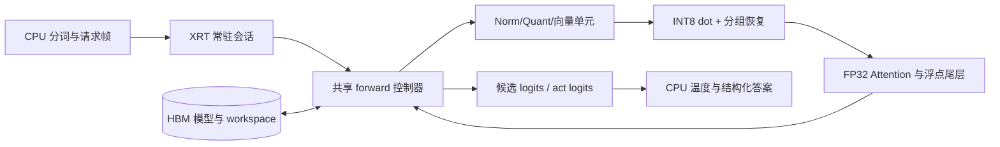

# Laya Typed-Decisions Q8_0 在 U55C 上的部署设计规格与评判

> 2026-10-05文档归并说明：本文保留模型核查和条件性能推导，属于来源资料。当前唯一硬件规格入口为[design_source/README.md](/home/user/EDA-202/zhuowenjun/Workspace/Laya/LLAMA-HLS/Laya-baseline/vivado/design_source/README.md)，总体状态/来源见00，接口见15，验收见14。本文旧“要求/冻结/准入线”的措辞不自动代表用户已确认；资源比例、质量线、25/50ms等按统一规格的证据状态解释。

版本：v0.3，2026-10-05。对象：本地 `laya_typed_decisions_q8_0.gguf`。本文定义数值合同、模块预算和验收条件；**尚未完成 HLS 综合、布局布线或 U55C 上板测量**。表中的频率、利用率、资源上限和延迟预算是设计要求或条件计算，不是已实现性能。

v0.3明确首版沿用两个Llama baseline的HLS C++→Vitis/U55C xclbin→XRT部署路线，采用一个完整Laya前向核。可读的总体、代码迁移依据及上板步骤见[新版总体文档][module-overall]；外部寄存器由HLS生成，内部以函数/缓存/流组织，前版自定义命令和手写寄存器草案已归档。本文继续提供模型与条件性能推导，不作为已经实现的硬件报告。

v0.2在模块联合设计核查中，按嵌入图明确两处运算顺序：局部mask先与padding bias合并，再加到scaled QK；act近似top2先算delta/denom，再乘p。同时修正第7.2节工作区加总为125.625MiB，原表多计了8MiB。实现接口、缓存/共享资源及联合验收进一步细化到[总体与模块文档][module-overall]和[跨模块合同][joint-contract]。原性能表保留为条件分析，具体schedule仍须计入实际读出、重排和屏障重新对账。

## 1. 设计结论与适用范围

**该 Q8_0 模型值得做 U55C 功能部署，但当前没有依据承诺两题请求快于 A6000 的约 25 ms。** 推荐先用一个共享计算核完成正确推理，再逐步融合数据流、提高并行度。Q8 降低了权重容量和整数乘法成本，仍然保留大量分组缩放恢复、LayerNorm、GELU 和 attention 计算。

| 评判项 | 本规格的结论 | 必须补齐的证据 |
| --- | --- | --- |
| 模型容量 | GGUF 文件 455.180 MB，远小于 U55C 的 16 GB HBM；容量可行 | 实际 shell 内存拓扑、模型包地址检查 |
| 完整推理功能 | 共享阵列逐层执行，工程上有实现路径 | Golden-C、C/RTL 仿真、完整网络板上输出 |
| 首版资源 | 4096 条 INT8 MAC 通道、128 个分组恢复通道、64 条 FP32 MAC 通道是候选起点 | 合并后的 DSP/LUT/BRAM/URAM/时序报告 |
| 首版完整延迟条件估算 | 两题S=128，150MHz/65%、向量算子串行模型约0.91–1.15秒；具体推导见第10.6节 | 融合/访存重叠、各单元真实产率及完整请求测量 |
| 短请求平均 HBM 带宽 | 两题 S=128，融合且缓存权重/KV 后，约 43.70 GB/s 才能在 23 ms 设备预算内搬完；短序列全状态片上缓存可降到约 17.15 GB/s | 真实端口数、读写并发、阶段带宽和停顿计数 |
| 25 ms 算力 | S=128 的 Linear 16 ms 预算要求约 2.81 万条 INT8 MAC 通道，另需大规模恢复和 attention 引擎 | 常规 Q8-F 架构尚无资源可行性证据 |
| 实际 GPU 加速 | 旧 25.05 ms 数据来自通用英文 Laya BF16；Typed Q8 的历史数据是五题变长请求 | 同 Typed 模型、同请求、同计时边界的 GPU/FPGA 对照 |

本文使用十进制 `MB/GB/GB/s`；容量另标 `MiB=2^20 bytes`。**1 MAC 表示一次乘加；若换算 FLOP，通常计为 2 次运算。** “MAC 通道”表示理想流水每周期完成一项乘法贡献的并行位置，不等于一个 DSP。

### 1.1 三个实现阶段

| 配置 | 功能与数值 | 存储/数据流 | 性能定位 |
| --- | --- | --- | --- |
| F0 功能版 | 全图；Q8-F Linear；FP32 状态、attention、归一化与非线性；保留有限 mask | 当前 Linear 权重整张缓存；每 head KV 缓存；其余中间结果主要落 HBM | 首次请求 150 MHz；不设 25 ms SLA |
| F1 融合版 | 与 F0 使用同一数值合同及累加顺序 | 融合 norm/quant、QKV/RoPE、Wi/GELU/gate、projection/residual；减少 HBM passes | 根据实际停顿和带宽提高性能 |
| P25 研究版 | 两题短请求；先保持 Q8-F，再独立评估其他数值变体 | 更大阵列、多真实 AXI master 或短序列状态片上缓存 | 整请求 25 ms 的条件目标；尚未通过资源评判 |

这里更新了[此前的通用 Laya 搭建规划][old-plan]：部署对象改为 Typed-Decisions GGUF；首版由三核改为一个共享核；`B_MAX=2`、`S_MAX=1024`、候选固定 16 列；Q8 使用对称 S8 activation，不沿用旧方案的 U8 zero-point 或原始 checkpoint 重新量化权重。

## 2. 冻结模型、输入范围与已有证据

### 2.1 模型身份

| 项目 | 冻结值 |
| --- | --- |
| 模型文件 | [laya_typed_decisions_q8_0.gguf][model] |
| 上游 | `mys/laya-typed-decisions-GGUF`，revision `1e9e8ba1f5271316601e0fefd940786660bd6964` |
| GGUF 文件大小 | 455,179,648 bytes，约 434.093 MiB |
| 文件 SHA-256 | `6eb6ef58bc4f99bd9db40381604108af782ffc314aa00da6641f429991ca1f18` |
| 存储张量 | 153 个：124 Q8_0、28 F32、1 F16 |
| 张量 payload | 453,123,852 bytes；不含 GGUF 元数据与对齐 |
| Q8_0 payload | 447,250,144 bytes，420,941,312 个元素 |
| F32 / F16 payload | 5,347,372 / 526,336 bytes |
| 主干 | D=1024；28 encoder layers；16 heads；head_dim=64 |
| Encoder FFN | intermediate I=2624；Wi 输出 2I=5248；GEGLU |
| Decision Transformer | 2 层；D=1024；FFN F=4096；ReLU；无主干 RoPE |
| 计算图核查 | 1364 nodes；62 LayerNorm；30 attention；124 Linear |
| Linear 类型 | 122 个 Q8_0，1 个 F32，1 个 F16；另有两个 Q8_0 embedding |
| 图中主要 activation | F32；不能把文件名 Q8 理解成全模型 INT8 |

本轮重新核查本地 GGUF 的 hash、tensor shape、图输入输出与关键常量。模型包 exporter 必须从此 GGUF 提取实际 q/scale/bias，禁止从 FP checkpoint 重新量化后仍使用同一模型 ID。

### 2.2 模型原生限制与硬件限制

| 项目 | GGUF 元数据/图 | 本设计硬件合同 |
| --- | --- | --- |
| 上下文长度 | `max_len=1024` | `S_MAX=1024` |
| 问题头预算 | `head_max_len=256` | CPU 序列构造预算；Decision 层仍处理完整 S |
| batch | `max_batch=8` | 单次 kernel `1<=B<=2`；大 batch 按 2+2+… 调度 |
| 序列长度桶 | `[64,128,256,512,1024]`；`min_seq=64` | F0/F1 使用这些桶；C94 为独立验证的紧凑模式 |
| 候选数 | `max_opts=16`；图 marker/logits 列数静态为 16 | `K_FIXED=16`；有效候选数 1…16 |
| 特殊 token | CLS=50281，SEP=50282，PAD=50283，MASK=50284 | 使用相同 tokenizer/ID；有效 ID `<50368` |
| qtype | choice、score、noul | I32 索引 0、1、2，沿用 SDK 映射 |

已知图的 B/S 是符号维度，但候选维固定 16。**不能把旧 GPU 请求的 `K_pad=3` 直接用作 Typed Q8 的硬件候选维。** 长度桶来自元数据；旧 daemon 的实际 padding/batch 执行 shape 未做运行时探针。本规格选 S=128 作为两题兼容模式的设计算例，不能声称历史 daemon 已按该物理 shape 执行。

### 2.3 性能和质量对照的边界

| 已有记录 | 结果 | 在本设计中的用途 |
| --- | --- | --- |
| Typed FP32 / Typed GGUF Q8_0，400 案例、2000 决策 | 76.60% / 76.85%；答案一致率 98.55% | 质量起点，详见[配对质量报告][quality] |
| Typed Q8 历史 A6000 调用，每案例五题、长度变化 | 均值 54.62 ms，P50 56.93 ms，P95 75.30 ms | 已有部署证据；单轮、未独立预热，包含 daemon IPC，不能直接作为两题 SLA |
| 通用英文 Laya，A6000，BF16 SDK，两题 S=94、K_pad=3 | 预热整请求 P50 25.05 ms，P95 25.22 ms | 用户短请求的旧性能参照，**模型和计算路径不同** |
| Typed Q8，同一两题请求、独立预热与固定 shape | 尚无同口径报告 | 实现阶段必须补测；之后才能计算 GPU speedup |

Laya 返回候选概率和 action，不做自回归生成。主指标是“请求 ms / 决策 ms / 决策每秒”；输出 token/s 不适用。常驻推理与冷启动分别计时。

## 3. 必须实现的计算图语义

### 3.1 Encoder 与 Decision 网络

```text
X = LN_embedding(dequant_Q8(token_embedding(input_ids)))
for l = 0..27:
    A = X                     # l=0，无 attention 前 LN
        或 LN_no_affine(X)    # l>0，affine 已折入后续实际权重
    Q,K,V = split(Q8_Linear_qkv(A))
    Q,K = RoPE(Q,K,本层 full/slide 表)
    Z = Attention(Q,K,V,padding_bias + 本层 local_bias)
    X = FP32_add(X, Q8_Linear_att_out(Z))
    N = LN_no_affine(X)
    U,G = split(Q8_Linear_wi(N))  # 各 2624 维
    X = FP32_add(X, Q8_Linear_mlp_out(GELU(U)*G))
H = LN_final(X)
H = FP32_add(H,dequant_Q8(type_embedding(qtype)))
for l = 0..1:
    Q,K,V = split(Q8_Linear_head_qkv(LN_no_affine(H)))
    H = FP32_add(H,Q8_Linear_head_out(Attention(Q,K,V,padding_bias)))
    H = FP32_add(H,Q8_Linear_head_fc2(ReLU(Q8_Linear_head_fc1(LN_no_affine(H)))))
M = gather(H,marker_pos)
```

实际 bias 必须逐张量、逐节点加载。此示意图用于说明顺序，不替代 GGUF 图中 bias、reshape、slice 和加法的精确合同。

| 算子 | 必须保留的定义 |
| --- | --- |
| LayerNorm | 每 token 在 D=1024 上归一化；population variance；eps=1e-5；不是 RMSNorm |
| LN affine | 仅按 GGUF 图保留 embedding/final 的 affine；其他已折叠参数不得重复应用 |
| Full attention | Encoder 0、3、6、…、27 共 10 层；Decision 2 层；双向 |
| Sliding attention | Encoder 18 层；`abs(q-k)<=64` 为窗口内，内部最多 129 个 key |
| Score scaling | QK 点积乘 0.125，即 `1/sqrt(64)` |
| Padding bias | 图中化简为 `(attention_mask[k]-1)*10000`；仅 mask key，不把 padding query 强制归零 |
| Local bias | 窗口内 0，窗口外有限 -10000；与 padding bias 相加，可能出现 -20000 |
| RoPE | full theta=160000；slide theta=10000；half-split 配对 `(0,32)…(31,63)`；使用实际 F32 表 |
| Dropout | 推理关闭 |
| GEGLU | 第一半先 GELU，再与第二半相乘；不能改成 SwiGLU |

GGUF `slide_bias` 为 `[1025,1025]` F32。本轮穷举 1,050,625 个值，全部符合上述 0/-10000 规则，允许 exporter 移除这张表，由硬件位置比较精确产生 bias。**有限 -10000 不能未经验证改成 -inf 或直接删除被 mask 的项。** 特别是局部层的 padding query 可能没有任何窗口内真实 key，仍须按全体有限 scores 执行 softmax；合法 key 跳算优化必须为这些行保留 dense fallback。

### 3.2 Scorer、act head 与温度

Scorer：marker gather → 无 affine LN → Q8 fc1（含 `linear_120_baked_bias`）→ 加原 `scorer_fc1.bias` 后 GELU → F32 fc2（含原 bias）。**folded bias 与原 scorer bias 在图中是两次操作，首版保留加法顺序。**

以下是实际 GGUF act 特征合同，候选分布始终为 16 列：

```text
masked_logits[i] = scorer_logits[i] + (1-marker_mask[i])*(-10000)
p = softmax(masked_logits)                      # 此时还未施加问题温度
k = max(sum(marker_mask),2)
entropy = -sum(p[i]*log(max(p[i],1e-9))) / log(k)
top1 = graph_relu_max_chain(p)
delta[i] = FP32(top1-p[i])
denom[i] = FP32(delta[i]+FP32(1e-6))
ratio[i] = FP32(delta[i]/denom[i])
r[i] = FP32(p[i]*ratio[i])
top2_approx = graph_relu_max_chain(r)
features = [top1,top1-top2_approx,entropy,k/255]
act_in = concat(H[:,0,:],features)               # 1028 维
act_logits = Q8_fc2(GELU(F16_fc1(act_in)+bias1))+bias2
```

这里的 `top2_approx` 是图定义的近似值，特别在并列最大值附近不同于 SDK 的 hard top-k。首版执行原图 ReLU max chain 的运算顺序，不换成 sort/top-k。无效候选的 mask 是**加 -10000**，不能直接覆盖成常数 -10000，也不能因无效就跳过 gather/scorer。

CPU 按 GGUF/Typed 配置中的基础温度和 option bucket 规则对最终候选 logits 后处理，再恢复 choice/score/noul、confidence、action。act 特征使用未温度缩放分布。保存未舍入 logits/probabilities，四位小数只在 API 展示层应用。score 用分布期望，noul 保留 false/true 顺序。[Typed 配置][typed-agent-config]、[SDK 后处理][sdk-common]

### 3.3 GELU 与数值参考版本

本规格采用检查到的 GGML tanh 近似：

```text
GELU(x) = 0.5*x*(1+tanh(0.7978845608028654*x*(1+0.044715*x*x)))
```

固定检查源码为 ggmlc commit `dcc300def5c5bc8fa778223589244abb0555a5de`，CPU/CUDA helper 均为该形式。旧 CUDA daemon 二进制 hash 已记录，但其源码 commit 未确认，且矩阵执行分支可能不同。因此 Golden-C 冻结自身操作/舍入顺序；不声称逐位复现所有历史 CUDA kernel，也不改用 PyTorch 的精确 erf GELU。[固定 CPU 源码][ggml-cpu]、[固定 CUDA 源码][ggml-cuda]、[旧运行环境][typed-run]

## 4. 软件、硬件与 ABI

### 4.1 职责和运行生命周期

| 模块 | 职责 | 要求 |
| --- | --- | --- |
| 离线 exporter | 解析 GGUF；提取 q/scale/F16/F32；按硬件 tile 重排；生成 manifest | 保留 payload 字节；记录原 tensor hash、重排校验和、模型 hash、graph/numeric/ABI 版本 |
| Python frontend | 验证输入；Typed tokenizer/build_sequence；形成长度桶、qtype、marker；最终答案解码 | 不加载完整 PyTorch 网络来准备输入；不额外删选项或截断 state |
| C++ XRT session | device/xclbin/kernel/BO 管理；首次上传模型；请求提交与结果读取 | 常驻进程；BO 复用；无逐请求权重上传、文件 I/O、进程创建 |
| FPGA 共享 kernel | embedding/LN → 28 encoder → final LN/type → 2 decision → scorer/act | 每 microbatch 一次 forward；控制器共享整数、浮点、向量引擎 |
| Golden-C / replay | 运行固定输入帧和精确数值路径；输出中间检查点 | 与生产 tokenizer/runtime 解耦，可定位层内误差 |
| benchmark | 原始时延、shape、质量、板卡状态及 kernel 计数 | 分冷启动、设备计算、完整请求及吞吐 |

从两个 Llama baseline 继承 Vitis HLS、宽 AXI、分组整数点积、XRT 常驻权重与 HBM 部署方法；不继承 decoder KV cache、逐 token 生成和词表分类。这里的 KV 缓存只是本次 forward 的 attention 重用，不跨请求、不跨层。[Llama baseline 研究][llama-research]



### 4.2 请求合同 v1

host 内存统一 little-endian、row-major。头部使用固定宽度字段和显式偏移，禁止依赖 Python/C++ struct 默认 padding；数据区按 64 bytes 对齐，BO 按 XRT/platform 要求对齐。物理容量可固定为最大值，但循环只执行本次 B/S。

| 字段 | 类型/逻辑形状 | 校验与含义 |
| --- | --- | --- |
| header | magic、ABI version、model/numeric ID、request ID、generation、B、S、各区 byte offset/size | 版本、长度、地址范围先检查；offset 为 byte 单位 |
| `input_ids` | I32 `[B,S]` | `0<=ID<50368`；CLS/SEP/MASK 使用冻结 tokenizer |
| `attention_mask` | U8 `[B,S]` | 只能为 0/1；在图中转换为精确 F32；每行至少一个真实 token |
| `marker_pos` | I32 `[B,16]` | **GGUF gather 对 `[B*S,D]` 使用的全 batch 扁平索引**；全部列属于本问题行 `[b*S,(b+1)*S)` |
| `marker_mask` | U8 `[B,16]` | 0/1；转换为图的 F32 mask；每行有效数 1…16 |
| `qtype` | I32 `[B]` | 0/1/2 |
| result logits | F32 `[B,16]` 和 `[B,2]` | 返回 masked candidate logits 和 act logits，保持问题/候选顺序 |
| result status | ABI/model/numeric ID、request ID、generation、error code、已实现的诊断计数 | Host等待HLS/XRT kernel完成并同步BO后读取；错误结果不得解码成正常答案，首版不额外要求CPU轮询自定义commit行 |

有效 marker 指向真实 MASK token。SDK 的行内位置须由 frontend 对全部16列加 `b*S`，转成全 batch 索引；本ABI的无效列行内位置固定为0，即gather本行CLS。Golden-C与参考请求执行同一填法，禁止因 `marker_mask=0` 读越界或跳过scorer。若原daemon的无效位置填法不同，捕获并记录差异，不能拿不同输入的无效raw logits直接做逐位比较。跨 microbatch 时重新建立对应的扁平索引，使每行gather保持本行独立。

错误码至少包括：`E_ABI`、`E_MODEL`、`E_SHAPE`、`E_INDEX`、`E_BUFFER`、`E_NUMERICAL`、`E_TIMEOUT`。kernel 输入域错误先于网络计算返回；硬件 timeout 由 runtime 管理。超时 BO/run 不复用，直到终止或确认设备完成；通过 generation 排除旧结果。首版一个 session 串行执行，权重只读共享；每个并发 session 必须拥有独立 workspace。

模型原生 B<=8，硬件 B<=2。五题质量请求拆成 2+2+1 时，保留原长度桶 S、16 列候选和问题顺序，不因拆批重新缩短序列。空问题集由 CPU 直接返回；超出原生限制显式报错，不额外截断。若增加多请求并发，需要新的 workspace 生命周期与性能报告。

### 4.3 manifest 与 kernel 参数

候选核名：`laya_typed_q8_forward`，HLS生成`ap_ctrl_hs`及AXI-Lite控制接口。当前模块设计规划13个BO指针：`embedding/io/w_q0/w_q1/w_scale/aux/state0/state1/qkv0/qkv1/ff0/ff1/att_out`，其中请求与结果共用io；参数顺序、bundle和HBM候选映射以新版模块文档02为准。实际接口宽度、资源和带宽由HLS/link报告确认，不手写一套独立于生成元数据的寄存器offset。

manifest 包含：各矩阵 `(N,K,type)`、group=32、q/scale shard offset、逻辑 stride、tail mask、bias 列表与顺序、RoPE 表、长度桶、无效 marker 填法、图中每层 full/slide 类型、数值合同、kernel 几何、平台/XRT/toolchain 版本及资源报告 hash。host 按 `kernel.group_id()` 分配对应 BO，不能只写 bank 编号而忽略 xclbin 参数连接。

## 5. Q8-F 数值合同与恢复引擎

### 5.1 权重与临时 activation

每个 Q8_0 权重组为 34 bytes：little-endian FP16 scale + 32 个 S8。输入维度连续分组。重排只改变排列，不改变 q/scale 位模式；本设计不添加 zero-point、`sum_w` 或 ScaleCode 元数据。

每个 Linear 输入组的数值路径定义为：

```text
amax = max(abs(x[0..31]))
d_full = FP32(amax/127)
inverse = (d_full != 0) ? FP32(1/d_full) : +0
q_a[i] = roundf(FP32(x[i]*inverse))       # 半整数远离 0
d_a_saved = FP16_RNE(d_full)
dot = sum_i(S8(q_a[i])*S8(q_w[i]))        # INT32，组内整数精确
term = FP32(FP32(d_a_saved*d_w_saved)*FP32(dot))
acc = FP32(acc+term)                     # 沿 group index 升序
```

FP16 scale 转 F32 后参与 R0 计算。acc初始为+0，全部group累加结束后再按图逐次加bias。activation q 在正常有限输入下落在 [-127,127]；若舍入/范围检查越界返回 `E_NUMERICAL`，不静默采用另一种裁剪规则。全零组 q=0、scale=+0；`d_full` 下溢为 0 时按同一分支处理。允许 FP16 scale 次正规数和舍入成零，**禁止默认 flush-to-zero**。非有限输入、非有限 reciprocal、FP16 scale 溢出或中间非有限结果显式报错；黄金参考执行相同的输入域检查。

量化使用 FP32 reciprocal 乘法和 `roundf`；换成直接除法、整数 RNE、原始模型的 U8 asymmetric quantization，均属于新数值版本。Golden-C 需禁用未授权的 reassociation/FMA contraction，并冻结 FP32 舍入及归约树。该路径借鉴 GGML 通用 Q8_0 算术参考，但 CUDA MMQ/Q8_1/cuBLAS 分支可能不同，质量需重新验证。[Q8 源码][ggml-quants]、[已有量化研究][quant-research]

本轮扫描全部 **13,154,416 个 Q8 权重 scale**：无负值、负零、零、Inf/NaN；有 28 个 FP16 次正规数；非零范围约 `[3.59416008e-5,0.0331115723]`；权重 q 范围 [-127,127]。这些事实支持本模型的非负 FP16 scale 处理，但 activation scale 仍须在运行时检查。

### 5.2 R0 与保持结果相同的 R1

R0：用常规 FP32 乘法生成 term，作为数值基准。R1：将有限、非负 FP16 scale 精确分解，再用整数乘法生成**同一 term**，组间仍按同样的 FP32 顺序累加。

```text
FP16 exponent E，fraction f：
    E==0: m=f,       e=-24
    E>0 : m=1024+f,  e=E-25
    d = m * 2^e
raw = dot * m_a * m_w
term = FP32_RNE(raw * 2^(e_a+e_w))
```

`m_a*m_w` 最多 U22；保守 `abs(dot)<=524288` 时 `abs(raw)<2^41`，采用 S43 暂存。两个 FP16 scale 的乘积最多 22 个有效位，处于 F32 可表示范围，R0 的第一次 F32 乘法是精确的；dot 可精确转为 F32，故最终对 raw 的一次 IEEE F32 RNE 打包与 R0 term 一致。还须保留零 scale 与负 dot 产生的负零。

本轮用独立整数 IEEE32 RNE 打包与常规 FP32 操作，检查了 30,343 个边界/随机组合，term 位模式一致，包括 signed zero。**这仅验证 term 算术，不证明 HLS II、资源、时序或整网络逐位一致。** R1 可以省去通用 FP32 乘法恢复器，但仍需要宽整数乘法、规格化、RNE 打包和 FP32 累加。推荐将 R1 做成可替换单元，先对 R0 逐位验收，再计资源收益。

整数恢复 term 与整数跨组累加不同。将 FP16 scale 改成 SC13，或改为 S48/S56 跨组累加，都是新的量化/数值变体。[ScaleCode 的已有质量结果][scalecode]针对原 checkpoint 量化，不能直接作为当前 GGUF folded 权重的验证证据。

### 5.3 浮点例外与累加依赖

| 层 | 实际权重 | 处理要求 |
| --- | --- | --- |
| scorer fc2 | F32 `[1,1024]`，4096 bytes | 用共享 FP 引擎；保留 bias |
| act fc1 | F16 `[256,1028]`，526,336 bytes | F16 精确转 F32后乘加；逻辑输入仍 1028，物理向量尾部 mask |
| act fc2 | Q8_0 `[2,256]`，544 bytes | Q8-F；输出很少，单独安排低并发归约 |

**不把 act fc1 补成 1056 后重做 Q8 量化。** 这会修改当前模型，而不是部署其 Q8 文件。

同一输出的 FP32 group accumulator 有反馈延迟。主 Linear 使用“token tile → group 升序 → output tile 轮转”，以多个输出地址隐藏加法延迟；片上保存该 token tile 的所有 output partial sums，保证每个输出 group 顺序不变。最大 partial 为 `[16,5248]` F32，0.3203 MiB，双缓冲 0.6406 MiB。act fc2 等短层不能据此假设 II=1，允许使用单独较慢的安全归约。

FP32 attention 的 AV 同样有反馈依赖：交错 query/feature 地址或明确设置多个 partial accumulator。改变归约树会改变舍入，必须在 numeric manifest 和 Golden-C 中同步；不能只添加流水 pragma 就认定获得每周期一次 FP32 MAC。

### 5.4 F0 浮点参考的具体运算顺序

为了使硬件有可执行的比较对象，Golden-C v1 采用以下顺序；它定义 FPGA 参考路径，不把原 CUDA 归约实现当作已复现：

| 算子 | Golden-C v1 合同 |
| --- | --- |
| LN mean/variance | FP32 固定相邻二叉树求和，除以1024；先算mean，再对 `FP32(x-mean)` 的平方求和得到variance；不使用 `E[x^2]-E[x]^2` |
| LN 输出 | `inv=FP32(1/sqrt(FP32(var+eps)))`；`norm=FP32(FP32(x-mean)*inv)`；仅按图另乘保留的gamma；不默认加原checkpoint affine |
| QK score | 64个FP32乘积，以固定相邻二叉树归约；再乘0.125；full使用padding bias，local先将local bias与padding bias做FP32加法合并，再将合并bias加到scaled score一次 |
| Attention softmax | 减FP32 row max；FP32 exp；按key位置构造固定求和树；除以sum；使用完整finite scores |
| AV | 对每个query/feature按key升序，FP32乘法后单独FP32相加；query交错仅改变调度，不改变该输出的key顺序 |
| 浮点尾层 | scorer F32 / act F16转F32后，按输入维升序乘加；bias与GELU按图顺序；可慢速执行 |
| 非线性 | GELU常量转FP32并冻结表达式求值顺序；exp/tanh/log/sqrt参考函数版本随numeric manifest保存；HLS近似函数按第12节单独验收 |

如果为达到II而使用分块AV归约、在线softmax或改变LN求和树，需生成新的明确参考；“数学公式相同”不等于FP32舍入相同。

## 6. 模块配置与算量定义

### 6.1 首版模块规格

| 模块 | 首版候选并行度 | 缓存/数据合同 | 性能验收项 |
| --- | --- | --- | --- |
| HBM loader | q 两个独立读 master；scale/aux 独立；初始 512 bit | 当前 Linear 全量载入缓存，跨所有 B/S tile 重用；下一矩阵预取 | 每矩阵 bytes、装载 cycles、读放大、stall |
| Embedding | 8 个特征/周期反量化路径 | token 行 1088 bytes；type 行同尺寸；读取实际 FP16 scale | 随机行读延迟、LN 衔接、ID 越界检查 |
| LN/quant/vector | 初始 8 个特征通道 | LN 行归约、amax Group32 归约、第二遍输出各自安排 buffer | 各阶段实际 II、行延迟、端口冲突与非有限检查 |
| INT8 Linear | `T_M=16,T_N=8,T_K=32`，4096 乘法贡献/周期 | 16 个 token × 8 个输出 × 32 组内输入；整数 dot tree | dot 与 golden 精确一致；阵列利用率、tail 和 bubbles |
| 分组恢复 | 128 groups/周期候选，与 INT8 阵列平衡 | R0 或通过逐位检查的 R1；FP32 group acc | FP32 反馈间距、cache banking、恢复/acc stall |
| RoPE | 8 个特征通道候选 | half-split；实际 F32 cos/sin 表；QKV 输出时融合 | 表访问和配对带宽；Q/K 结果误差 |
| FP attention | 64 条等效 FP32 MAC 通道候选 | full/local 共用；每 head KV 缓存；score/softmax/AV tile | QK、max/exp/sum、AV cycles；全 mask/边界行 |
| Softmax | 初始 4 个 exp 通道，加 FP32 max/sum/normalize | 减 row max；保留全部 finite scores；完整行或明确 two-pass | 指数近似误差、归约延迟、row buffer 流量 |
| GELU/gate | 初始 4 个 tanh-GELU 通道候选 | 对 U 做 GELU，乘 G；不保存整张 GELU 表 | 吞吐、tanh 精度、gate 对齐 |
| Decision ReLU/residual/type | 8 个特征通道候选 | 显式 FP32加法；ReLU；type 向量可片上广播 | 不成为 producer/consumer 瓶颈 |
| scorer/act | 重用上述整数/浮点/向量资源 | 固定 16 markers，保留1028/F16/F32例外 | 低并发效率、bias 顺序、top2_approx与温度边界 |

这些通道数是综合起点。若合并后无法满足资源预算，先将 INT8 阵列降为 2048、恢复降为 64，保持模型、ABI 和数值合同，再记录延迟代价。不得通过删层、删候选来伪装资源通过。

### 6.2 三个分析输入

用户短请求包括 refund 与 department 两题，给定有效长度 72/94、state 29 tokens。实现时仍需用 Typed tokenizer 保存真实 token ID、markers 和请求 hash。

| Profile | B | 执行 S | 有效长度 | 候选列 | 用途 |
| --- | ---: | ---: | --- | ---: | --- |
| C94 | 2 | 94 | 72、94 | 16 | 紧凑执行敏感性分析，须独立验证 padding 改变 |
| T128 | 2 | 128 | 72、94 | 16 | 本规格主要两题长度桶算例 |
| L1024 | 2 | 1024 | 1024、1024 | 16 | 容量与长上下文压力，不能套用短请求 SLA |

令 `M=B*S,D=1024,I=2624,F=4096`，主 Linear 均处理 padding token。Q8 Linear MAC 为：

```text
C_q8 = 28*M*(4*D^2+3*D*I)
     + 2*M*(4*D^2+2*D*F)
     + B*16*D^2 + B*256*2
C_fp_tail = B*16*D + B*1028*256
N_restore = C_q8/32
C_att_dense = 2*D*30*B*S^2
```

attention 公式包括 QK 和 AV；不包含 softmax/exp/LN/RoPE。embedding 是查表/反量化，不算成大矩阵 MAC。若允许跳过 finite mask 的项，令 `P_full` 为每行所有 query × 有效 key 数，`P_local` 为落在 ±64 窗口且有效的 query/key pair 数：

```text
C_att_legal = 2*D*(12*P_full+18*P_local)
```

这一 legal 公式仅描述跳算后的工作量，**没有证明它保持原有限 mask 的结果**；F0/F1 的基准使用 dense。tail、padding到硬件 tile、归约树和启动空泡另计入实际利用率。

| Profile | Q8 Linear GMAC | 分组恢复次数 | 浮点尾层 MAC | Dense attention GMAC | Legal-only attention GMAC |
| --- | ---: | ---: | ---: | ---: | ---: |
| C94 | 69.276272 | 2,164,883,488 | 559,104 | 1.085768 | 0.909570 |
| T128 | 94.321509 | 2,947,547,168 | 559,104 | 2.013266 | 1.139773 |
| L1024 | 754.337187 | 23,573,037,088 | 559,104 | 128.849019 | 60.972073 |

T128 的 `P_full=21248,P_local=16753`；C94 为 15604/14271。S=128 比 S=94 多约 36.2% 的主序列 Linear 工作，dense attention 约增 85.4%，不能继续沿用旧 S94 的阵列需求。

### 6.3 T128 各 Linear 的工作与条件预算

下表权重包含 Q8 scale 或实际浮点矩阵，bias 另在 aux。Linear 总预算 16 ms 按 Q8 MAC 占比分配；scorer/act 还有装载/小层开销，单独归入尾层预算。主序列矩阵合计 391,331,840 bytes，全部 Linear 权重 392,976,928 bytes。

| 模块（所有层合计） | 矩阵形状 `[N,K]` | 权重 bytes | Q8 GMAC | 16 ms 预算内占用 ms |
| --- | --- | ---: | ---: | ---: |
| Encoder QKV ×28 | `[3072,1024]` | 93,585,408 | 22.548578 | 3.825 |
| Encoder attention Wo ×28 | `[1024,1024]` | 31,195,136 | 7.516193 | 1.275 |
| Encoder Wi ×28 | `[5248,1024]` | 159,875,072 | 38.520488 | 6.534 |
| Encoder MLP Wo ×28 | `[1024,2624]` | 79,937,536 | 19.260244 | 3.267 |
| Decision QKV ×2 | `[3072,1024]` | 6,684,672 | 1.610613 | 0.273 |
| Decision attention Wo ×2 | `[1024,1024]` | 2,228,224 | 0.536871 | 0.091 |
| Decision FC1 ×2 | `[4096,1024]` | 8,912,896 | 2.147484 | 0.364 |
| Decision FC2 ×2 | `[1024,4096]` | 8,912,896 | 2.147484 | 0.364 |
| Scorer fc1/fc2 | `[1024,1024]` / `[1,1024]` | 1,118,208 | 0.033554；另 32,768 F32 MAC | 单独尾层预算 |
| Act fc1/fc2 | `[256,1028]` / `[2,256]` | 526,880 | 0.000001；另 526,336 F16×F32 MAC | 单独尾层预算 |

Encoder Wi/GEGLU/down 占主 Linear 工作的大部分；首先优化 FFN 和权重复用。只优化 QKV 无法解决整体延迟。

## 7. 缓存、HBM 容量与端口布局

### 7.1 缓存策略是带宽成立的前提

当前 Linear 的权重在片上缓存一次，遍历全部 token tiles 后再替换。最大的 Encoder Wi 为 **5,709,824 bytes=5.4453 MiB**，双缓冲 10.8906 MiB。这是当前 GGUF Q8_0 的实际尺寸，不能沿用旧 U8/FP32 scale 包的尺寸。

如果 `T_M=16` token tile 为最外层且每 tile 重读权重，T128 的主序列有 16 tiles；一次 forward 全部 Linear 权重读取将变成 **6,262,954,528 bytes**，约为一次缓存方案的 15.94 倍。因此“权重驻留 HBM”与“每次推理权重只读一遍”是不同要求：前者避免 PCIe 上传，后者依赖片上缓存和循环组织。

attention 每次缓存一个 head 的 K+V，跨本 head 的所有 queries 重用。B=2、S=1024 时为 **1 MiB/head**，双缓冲 2 MiB；S=128 时为 128 KiB/head。另需 Q、score/probability、AV partial buffers。先按完整 head 缓存定义 F0；local ring/window cache 属于后续优化。

F0 query tile 先取每问题行 `T_Q=16`：最大score buffer `[2,16,1024]` F32为128KiB，softmax完成后可原地覆写为probability；AV partial `[2,16,64]`为8KiB。保留score后只计算一遍QK。AV按key外层、query内层交错，需实际FP32反馈延迟不超过可用交错间距；否则增加query tile或调整经过记录的归约方案。

| 片上逻辑缓存 | 首版预算 |
| --- | ---: |
| 当前/下一 Linear 权重，按最大 Wi 双缓冲 | 10.891 MiB |
| Linear partial sums 双缓冲 | 0.641 MiB |
| Group32 临时 A8、scale、输入/输出 tile | 约 1–2 MiB，依调度核算 |
| 当前/下一 head KV | 2 MiB（最大形状） |
| Q、score/prob、AV tile | 约 0.5–1 MiB，依 query tile 核算 |
| 四张 F32 RoPE 表 | 1.001 MiB |
| marker、bias、type、控制/FIFO | 约 0.5–1 MiB |
| 逻辑量级 | 约 16–20 MiB；设计上限先设 28 MiB |

逻辑容量不含数组分区、读口复制、宽度碎片和布局开销。U55C 标称 43 MB 片上 SRAM 分布在 BRAM/URAM 等资源中，不能视作一块任意多端口 RAM；必须同时验收每类资源和缓存读写端口。

### 7.2 HBM workspace

F0 最大形状 B=2、S=1024，以 F32 中间状态预分配 **192 MiB** workspace。区域可跨 BO，manifest 明确地址；不同 live tensor 禁止错误 alias。Decision FFN 复用已结束生命周期的 Encoder FF 区域。

| 区域 | 最大逻辑形状 | 容量 MiB |
| --- | --- | ---: |
| X ping / X pong | 各 `[2,1024,1024]` | 8 + 8 |
| norm / residual | 各 `[2,1024,1024]` | 8 + 8 |
| QKV | `[2,1024,3072]`，可按 head/row 分 shard | 24 |
| attention output | `[2,1024,1024]` | 8 |
| Encoder Wi 临时 | `[2,1024,5248]` | 41 |
| Encoder gate 临时 | `[2,1024,2624]` | 20.5 |
| Decision FF 临时 | `[2,1024,4096]` | 32，复用 Wi 区，不再相加 |
| markers | `[2,16,1024]` | 0.125 |
| 合计主要 live 区域 |  | 125.625 |
| 对齐、debug、状态与预留 |  | 余量至 192 |

固定模型数据包含：全部 Linear 392,976,928 bytes；两类 embedding 54,803,648 bytes；F32 vectors/bias（不含 scorer weight）91,148 bytes；RoPE 1,049,600 bytes；7 个 F32 scalar 28 bytes。移除已验证可程序化的 slide bias 后 payload 为 **448,921,352 bytes**，对齐另计。模型包按 512 MiB 预算，加 workspace 192 MiB，基础预算约 704 MiB，仍远低于 16 GB。

### 7.3 候选 HBM 映射

以下编号是待实际平台验证的连接提案，不声称已经存在对应 xclbin。U55C HBM 通常公开 32 个伪通道；可用 bank、容量与 host group 以实际 platform/XRT 报告为准。

| 数据/AXI bundle | 候选 bank | 说明 |
| --- | --- | --- |
| token/type embedding | HBM0 | 随机行访问；不与顺序大矩阵流抢同一 master |
| request/result/status | HBM1 | 数据量小；首版可共用低频 bundle |
| Linear q shard0 / shard1 | HBM4 / HBM5 | **两个真实独立读 master**，按输出 tile 均匀分片 |
| FP16 scales | HBM6 | 与 q 一一对应；独立 metadata burst |
| F16/F32 尾层、bias、RoPE | HBM7 | 启动/层切换预取；RoPE 首次载入片上 |
| X ping / X pong、norm/residual 子区 | HBM12 / HBM13 | 定义互不重叠 region；读写方向按当前 phase 切换 |
| QKV shard0 / shard1 | HBM14 / HBM15 | 明确同一 tensor 的物理分片与地址生成 |
| FF shard0 / shard1 | HBM16 / HBM17 | Wi/gate/Decision FF 按生命周期复用 |
| attention output | HBM18 | 与 residual 的 live 区区分 |
| 其余 bank | 未分配 | 扩展并行端口/调试/性能版布局 |

Q8 文件的 34-byte AoS 组可拆成 q 与 scale SoA：`q[tile_n][group_k][lane_n][32]`、`scale[tile_n][group_k][lane_n]`；两 q shards 按 tile_n 交错。尾部按 descriptor mask，不改变逻辑矩阵。加载到 banked SRAM 后，以 group 为外层读取并广播到 16 个 token。

将一个 pointer 映射到多个 HBM bank 只增加地址容量，不自动增加该 AXI master 的 bytes/cycle。P25 的多个状态路径也必须把**当前正在使用的同一 tensor**条带化到多个可并行的 master；分别把“不同层的 tensor”放到不同 bank 无法增加当前层吞吐。

### 7.4 短序列片上状态候选

针对 B=2、S<=128，可单独构建短序列 profile：X ping/pong 共 2 MiB，QKV 3 MiB，attention output 1 MiB，FF gate 2.5625 MiB；Wi→GELU/gate 流式融合，不保存 5.125 MiB 整张 Wi。再加权重双缓存、partial sums、RoPE 等，逻辑量级约 22 MiB，有容量研究空间。

这会显著减少 HBM activation passes，但增加多端口片上存储和布线压力。需分别验证实时 buffer 生命周期、port banking、跨区布线和 LUT/URAM 实际用量；**容量能相加不等于能持续喂饱大阵列**。长序列仍使用 HBM workspace 或另一个 bitstream；不能在内部默默缩小 S_MAX。

## 8. 各模块的外部带宽要求

### 8.1 端口能力假设

对于 512-bit master，单方向峰值为 `64*f bytes/s`。初始 150 MHz、假设有效率 65% 时约 **6.24 GB/s**；性能分析 300 MHz、假设有效率 70% 时约 **13.44 GB/s**。这些不是测得的 HBM 带宽；实际 AXI 宽度、shell 转换、burst、bank争用及 read/write 共享都要测量。

若保守地将全部 Linear 权重装载安排在 16 ms 窗口内，需要 **24.561 GB/s**：q 369,361,408 bytes，对应 23.085 GB/s；FP16 scale 23,085,088 bytes，对应 1.443 GB/s；浮点例外 530,432 bytes另计。采用 SoA 时至少两个上述性能假设下的 q 读 master，再配 metadata/aux 路径。尾层可从独立预算装载，其具体schedule另计。若所有权重只经过一个 13.44 GB/s master，装载下界为 **29.24 ms**，已经超出完整 25 ms 目标。

当前矩阵与下一矩阵双缓存仅提供重叠条件：必须证明 prefetch 在实际各 phase 完成，不能默认所有搬运完全被计算隐藏。无重叠部分在延迟模型中相加。

### 8.2 总流量模型

令 `A=4BSD`（一份 F32 hidden），`G=4BSI`（一份 gate），`F_b=4BSF`（Decision FF），`A_valid=4D*sum(valid_lengths)`。以下是定义的数据流下的 logical HBM bytes，不含对齐、多次失败读、额外 debug 和小型 head workspace。

```text
F0 未融合的非 KV passes：
    RD = 357A+84G+4F_b
    WR = 358A+84G+4F_b
    总计 = 715A+168G+8F_b
F1 融合的非 KV passes：
    RD = 181A+28G+2F_b
    WR = 182A+28G+2F_b
    总计 = 363A+56G+4F_b
KV 缓存装载：dense 为 60A；legal-only 为 60A_valid
一次只读量 = 392976928 + B*S*1088 + B*1088 + 1140776
```

F0 每 encoder 层非 KV passes 为第 0 层 `22A+6G`、其余 `24A+6G`；每 Decision 层 `20A+4F_b`，再加 embedding/final norm/type。F1 每 encoder 层 `12A+2G`，每 Decision 层 `12A+2F_b`，再加 embedding和 final norm/type 融合，构成上述总式。导出后的 schedule 必须能逐 pass 对账；若实际多读，使用实测流量更新模型。

| Profile | 一次只读 GB | F0 dense 总 GB | F1 dense 总 GB | F1 legal-only 总 GB |
| --- | ---: | ---: | ---: | ---: |
| C94 | 0.394324 | 1.347259 | 0.842877 | 0.837471 |
| T128 | 0.394398 | 1.692011 | 1.005194 | 0.983076 |
| L1024 | 0.396348 | 10.777251 | 5.282712 | 5.282712 |

T128 的读写拆分：

| 路线 | RD GB | WR GB | 在 23 ms 设备预算内平均 RD+WR GB/s |
| --- | ---: | ---: | ---: |
| F0 dense | 1.074138 | 0.617873 | 73.566 |
| F1 dense | 0.730729 | 0.274465 | 43.704 |
| 全状态片上、只读量作为 HBM 主体 | 0.394398 | 小型结果另计 | 17.148 |

这里的平均总带宽是必要条件，不能代替当前 phase 的单路带宽，也不能把 RD+WR 总量直接套进一个单方向 master 的 13.44 GB/s。

### 8.3 T128 主 Linear phase 的瞬时路径需求

下表按第 6.3 节比例预算和 F1 passes 反推。输入指本 phase 的 norm/quant 输入 F32；residual 与输出使用 F32。单位 GB/s，权重一遍缓存且预取需相应达标。

| Phase | 权重 RD | 输入 RD | residual RD | 输出 WR | 路径评判 |
| --- | ---: | ---: | ---: | ---: | --- |
| Encoder/Decision QKV | 24.467 | 7.676 | 0 | 23.028 | 权重 q、QKV 输出需至少两个性能 master或片上存储 |
| Encoder/Decision attention Wo | 24.467 | 23.028 | 23.028 | 23.028 | 合计约 93.55 GB/s；三条状态路径各需并行资源 |
| Encoder Wi + GELU/gate | 24.467 | 4.493 | 0 | 11.514 | 权重为主；gate 写入单性能 master有余量，但需保持 GELU 产率 |
| Encoder MLP Wo + residual | 24.467 | 23.028 | 8.986 | 8.986 | gate 输入需至少两个性能 master或片上多端口 |
| Decision FC1 + ReLU | 24.467 | 5.757 | 0 | 23.028 | FF 输出需要双路写入或片上存储 |
| Decision FC2 + residual | 24.467 | 23.028 | 5.757 | 5.757 | FF 输入需要双路读取或片上存储 |

“至少两个”依据 13.44 GB/s/master 的假设，不是已经确定的端口设计。F0 单状态端口可完成功能，但不能用上述 P25 预算证明其速度；P25 要补齐当前 tensor 的条带化和输入/残差/输出并发调度。

scorer/act 权重虽小，不能只按 MAC 比例给几微秒预算。约 1.645 MB 两个尾模块的权重在 13.44 GB/s 下装载也需约 0.122 ms；再计 LN/GELU/统计和小输出归约。候选目标为 scorer+act <=0.5 ms，归入向量/尾层预算，实际需测量确认。

### 8.4 Attention 的 KV 与 score 流量

若每 query 都从 HBM 重读 K/V，T128 dense 仅 KV 就约 **8.053 GB**，4 ms 预算要求约 **2013 GB/s**；即使只读 legal pairs，也有 4.559 GB / 4 ms = **1140 GB/s**，超过整卡标称 460 GB/s。因此 KV 缓存是必须项。

每层每 head 缓存一次后，T128 dense KV 读为 62,914,560 bytes，在 4 ms attention 预算内仍需 **15.729 GB/s**；一个 13.44 GB/s 读 master 的加载时间为 4.681 ms，必须增加独立读路、复用已经片上生成的 QKV，或明确从邻近 phase 的时间预算重叠装载。legal-only 为 40,796,160 bytes，要求10.199 GB/s，但数值跳算尚未验收。

score/probability tiles在片上做 row max/exp/sum和 AV，不把完整 `[B,16,S,S]` 中间矩阵往返 HBM。softmax 的 two-pass 若重算 QK，需把第二遍 QK MAC 加回算量；若保存 scores，须算入片上容量/端口。本文 QK 只计一遍，要求相应 score tile 可保留。

## 9. 片上带宽与向量单元产率

### 9.1 INT8 阵列的 SRAM 供给

对于 `T_M × T_N × 32`，每周期权重 q 读 `T_N*32 bytes`，activation A8 读 `T_M*32 bytes`，FP32 partial RD/WR 各 `T_M*T_N*4 bytes`。权重跨 M 广播，activation 跨 N 广播；scale 和控制另计。

| 几何与时钟 | 权重 q 读 GB/s | A8 读 GB/s | partial RD GB/s | partial WR GB/s |
| --- | ---: | ---: | ---: | ---: |
| F0：16×8×32，150 MHz | 38.4 | 76.8 | 76.8 | 76.8 |
| P25 候选：16×56×32，300 MHz | 537.6 | 153.6 | 1075.2 | 1075.2 |

这是满发射周期的内部数据需求；全局 70% 利用率不降低正在运行时的读口要求。对 FPGA 来说，1 TB/s 片上并行访问可以通过 banking 分散，但会消耗大量存储端口、LUT/FIFO和路由。必须用真实数组分区后的资源报告证明，不能只依据 SRAM 总字节数。

FP attention也要核查内部供给：64通道每周期处理一个head_dim=64向量，QK需要256bytes的Q和256bytes的K，150MHz时各38.4GB/s；AV的V及partial RD/WR也各为256bytes/周期，p可按64个特征广播。扩大FP通道后可以广播K/V和暂存Q，但partial端口与FP反馈仍随输出并行度增长。若按2432个FP输出位置计，300MHz下partial RD/WR各为2.9184TB/s的满发射需求；需明确banking、寄存器累加及反馈调度，不能只核算HBM KV装载。

### 9.2 T128 非矩阵事件量

| 类别 | logical events/request | 计数含义 |
| --- | ---: | --- |
| LN | 16,023,552 | 所有62个LN处理的 feature 数；均值/方差归约可能多遍 |
| A8 quant input | 44,532,224 | 所有 Q8 Linear 输入特征；amax和输出至少需相应访问 |
| GELU | 18,842,112 | 28层GEGLU第一半，以及scorer/act |
| RoPE | 14,680,064 | 28层Q/K被旋转的特征 |
| Decision FF ReLU | 2,097,152 | 两层FF中间特征 |
| Attention softmax dense / legal-only | 15,728,640 / 8,904,480 | head/query/key scores，不含候选16列的小softmax |

融合单元应跟上相邻矩阵的产率，不能把所有类别都要求在独立 2 ms 内串行完成，也不能把它们全当成零耗时。以 300 MHz、70% 利用率，按第6.3节矩阵预算反推：

| Phase 的 producer/consumer | 必要产率 G features/s | 每 lane 210 M/s 时的理论通道下限 |
| --- | ---: | ---: |
| QKV 输入量化 | 1.919 | 10 |
| attention Wo / MLP Wo / Decision FC2 输入量化（峰值） | 5.757 | 28 |
| Encoder Wi 输入量化 | 1.123 | 6 |
| Encoder Wi GELU/gate 输出 | 2.879 | 14 个 GELU/gate 通道 |
| Decision FC1 输入量化 | 1.439 | 7 |
| Decision FC1 ReLU 输出 | 5.757 | 28 |

因此 P25 可研究 32 个 quant/简单向量通道和16个 GELU通道。LN/amax 的 reduction、scale/reciprocal/rounding、残差读口仍须单独配平；理论通道下限并不保证 HLS II=1。

attention softmax若在4ms中处理全部dense scores，需要3.932 G scores/s，至少19个上述产率的exp通道；legal-only需要2.226 G/s、至少11个。这只是整个attention窗口的平均下限：若softmax只能占其中2ms，通道需求约加倍；若紧跟QK产出，要按QK瞬时score产率配置或提供足够buffer和跨tile重叠。除exp还需max、sum、除法/倒数和AV供给。短序列小row时的启动/归约开销也应入账。

## 10. 延迟预算与算力反推

### 10.1 时间模型

对实际频率 f 和有效发射比例 η：

```text
T_linear_arith = max(C_q8/(N_int*f*eta), N_restore/(N_restore_lane*f*eta))
T_attention_arith = C_att/(N_fp*f*eta)
T_phase >= 该phase算术服务时间、独立RD时间、独立WR时间中的最大项
T_device = 各依赖phase时间 + 未重叠的装载/归约/向量/切换时间
T_e2e = CPU预处理 + 提交/传输 + T_device + 结果同步/后处理
```

对于不能并发的共享端口，RD/WR负载按真实仲裁相加，而不是取max。跨层主要有数据依赖；不同引擎共享整层资源不等于可以把所有Linear/attention时间全局重叠。只有实际schedule证明的重叠才能扣除。

### 10.2 F0 的条件算术时间

假设150MHz、η=65%、4096 INT8/128恢复/64 FP32 MAC通道，恢复吞吐与dot平衡；dense attention；仅计Linear和QK/AV：

| Profile | 条件矩阵时间 ms | 判断 |
| --- | ---: | --- |
| C94 | 347.47 | 功能原型量级，不能追赶25ms |
| T128 | 558.82 | padding/attention成本更明显 |
| L1024 | 22,537.75 | dense 长上下文非常重，需要局部跳算/精度/并行优化 |

这不是完整推理预测，也不是与频率无关的严格物理下界；它是在给定并行度/η下的算术服务时间，还需加入未重叠访存、非线性、CPU/XRT等。首版性能验收应报告真实各模块cycles，不以这些数值替代测量。

### 10.3 300 MHz 下的并行度敏感性

T128，假设η=70%、恢复通道>=INT8通道/32、dense attention，仍只计矩阵算术：

| INT8 / FP32 MAC通道 | Linear ms | Attention ms | 合计 ms |
| --- | ---: | ---: | ---: |
| 4096 / 64 | 109.656 | 149.797 | 259.452 |
| 8192 / 256 | 54.828 | 37.449 | 92.277 |
| 16384 / 512 | 27.414 | 18.725 | 46.139 |
| 24576 / 1152 | 18.276 | 8.322 | 26.598 |

即使最后一行还未计向量、搬运和host，也已超过25ms；因此“扩大一些阵列”不能直接证明完成GPU加速。

### 10.4 P25 两题请求的条件预算

将25ms规划为下列窗口。融合的norm/quant/RoPE/GELU/残差若与矩阵同步执行，计入对应Linear/attention窗口；独立2ms只留给未隐藏向量/尾层工作。

| 工作 | 条件预算 ms | 需要验证的前提 |
| --- | ---: | --- |
| CPU分词、提交/传输、同步、最终解码 | 2 | 常驻session，真实typed请求host计时 |
| Q8 Linear及其融合流水 | 16 | 包括恢复、累加、量化/归一化供给、权重预取不超时 |
| Attention及softmax | 4 | KV加载/供给与softmax吞吐达到第8/9节要求 |
| 未隐藏向量与scorer/act尾层开销 | 2 | 小层不能照搬大矩阵η |
| 预留 | 1 | pipeline切换、波动等 |

300MHz、η=70%下，反推必要吞吐：

| 要求 | C94 | T128（主规格） |
| --- | ---: | ---: |
| Q8 Linear有效吞吐 TMAC/s | 4.330 | 5.895 |
| INT8理想通道数学下限 | 20,618 | 28,072 |
| 对齐32的通道数 | 20,640 | 28,096 |
| 恢复 groups/周期下限 | 645 | 878 |
| 恢复有效吞吐 G groups/s | 135.305 | 184.222 |
| Dense FP attention有效吞吐 GMAC/s | 271.442 | 503.316 |
| Dense FP MAC通道下限 | 1293 | 2397 |
| Legal-only FP MAC通道下限 | 1083 | 1357 |

上述32对齐仅是分组算术下限，不能直接映射成 `T_M=16,T_N=8` 的整tile阵列。T128 若M=16且N按8的倍数分块，可选 `16×56×32=28,672` INT8通道、896恢复groups/周期；尾部、FP反馈、广播和非线性供给仍会继续影响η。它是资源压力算例，不是推荐直接综合的首版。

U55C全芯片标称 **9024 DSP**。若假设每DSP每周期持续提供两条合法INT8 MAC通道，仅T128的28,096通道就要 **14,048 DSP**，还没分配恢复、FP32 attention、向量单元；这一DSP分工显然不够。即使以全卡DSP平均分摊，dot也要求约3.11通道/DSP/周期，其他模块还要资源。更强packing、LUT乘法、较低精度attention、改变scale/acc路径或不同频率都需综合与质量证据。

**25ms是请求延迟目标，不是要求匹敌A6000的整卡峰值TFLOPS。** 此处按实际模型工作量反推即可。若仅以50ms目标给Linear32ms、attention8ms，通道需求大致减半，但仍需恢复、向量和完整资源评判；也不能据此宣称快于已经观察到的约25ms通用模型对照。

对T128，达到25ms意味着40请求/s或80决策/s（串行两题），这是目标换算，不是实测吞吐。batch/并发吞吐另测，不能将每请求25ms误写成每题12.5ms的单题独立延迟。

### 10.5 长上下文限制

S从128到1024，主序列Linear约增8倍，dense attention增64倍。L1024若仍用16ms/4ms矩阵预算，需要超过22.45万条INT8通道、15.34万条FP32 attention通道（同f/η假设），不适合作为单卡首版SLA。

长上下文功能支持不等于短请求性能承诺。local窗口跳算能大幅减轻18层attention，但仍有12层full、全部Linear与归一化；同时须解决有限mask和padding query fallback。长度桶的P50/P95分别报告。

### 10.6 完整推理性能的条件估算：首版与优化版

**针对用户两题请求，主算例是B=2、S=128、有效长度72/94、候选固定16列。首版F0是接近1秒的功能原型；充分融合后的8192 INT8 / 256 FP32配置，在下述附加开销假设下约为100–120ms；25ms需要更激进且尚未证明能装入U55C的配置。** 这些数字是工程模型，不是板上P50/P95，也不是保证实际落入的统计区间。

#### 10.6.1 首版F0：把矩阵、向量和搬运分开算

第10.2节的558.82ms只含Q8 Linear与attention的QK/AV。补齐下列首版假设：150MHz、算术有效发射比例65%；简单向量8通道、GELU/gate及exp各4通道；算子串行，当前算子的片上行/tile缓存支持以下passes。本节η用于供给充分时的算术服务率，HBM搬运另按重叠模型计算。

| T128额外工作 | 明确的计算假设 | 条件时间ms |
| --- | --- | ---: |
| LayerNorm | mean、centered variance、输出共3遍feature访问；8通道 | 61.63 |
| A8量化 | amax与输出q共2遍；8通道；reciprocal/rounding流水不降低这一产率 | 114.19 |
| GELU/gate | 每通道完成一项GELU/gate结果；4通道 | 48.31 |
| RoPE | 每通道完成一项旋转feature；8通道 | 18.82 |
| Decision ReLU | 8通道 | 2.69 |
| 60次hidden residual更新 | Encoder每层2次、Decision每层2次；8通道 | 20.16 |
| Attention softmax | max 8通道、exp/sum 4通道、normalize 8通道，3阶段串行 | 80.66 |
| Embedding反量化/type add | 按两份hidden feature工作量近似；8通道 | 0.67 |
| F16/F32尾层矩阵 | 64 FP32 MAC通道 | 0.09 |
| 上述合计 | 未融合、串行服务模型 | **347.22** |

向量时间按 `passes*events/(lanes*150e6*0.65)` 计算；softmax为 `N_scores*(1/8+1/4+1/8)/(150e6*0.65)`。LN树归约/逆平方根、amax/reciprocal和row切换的额外启动等待仍需实际pipeline报告核查；不能因为写了通道数就认定这些运算全部达到II=1。

F0总HBM logical流量为1.692GB。为使搬运模型可复算，取每master有效6.24GB/s：两个q master并行，scale master同时加载；workspace RD/WR在本模型中按一个活动通路串行，KV/浮点aux另计。无重叠搬运服务时间为：

```text
T_q_and_scale = max(369361408/(2*6.24e9),23085088/6.24e9)
T_other_read = (530432+1140776+B*S*1088+B*1088)/6.24e9
T_workspace_and_KV = (1234698240+62914560)/6.24e9
T_memory_serial = 237.86 ms
```

假定常驻host的预处理/提交/同步/后处理合计2ms（待测），得到：

| F0 T128重叠情景 | 完整请求计算式 | 条件延迟ms | 串行吞吐：请求/s；决策/s |
| --- | --- | ---: | --- |
| 保留串行向量工作，HBM搬运全部被计算隐藏 | 558.82+347.22+2 | **908.04** | 1.10；2.20 |
| 保留串行向量工作，搬运也完全串行 | 558.82+347.22+237.86+2 | **1145.90** | 0.87；1.75 |

因此可用**约0.91–1.15秒/两题**作为这一F0实现模型的排期尺度；它不构成性能上下界：跨算子流水充分时可快于串行向量情景，实际频率/II、随机访问、cache冲突或host开销更差时也可更慢。558.82ms仍只是矩阵服务参考，不能直接当完整推理延迟。

同样假设下，紧凑C94模式约588.83ms（搬运隐藏）或771.44ms（搬运串行）；但C94是独立padding变体，需先通过语义/质量验收。

#### 10.6.2 优化版：明确展示附加开销敏感性

对F1/P25候选，假定实际300MHz、算术η=70%、恢复通道不低于INT8/32、dense attention，且norm/quant/GELU/softmax的通道和buffer已按矩阵生产率重新配置。**不能沿用F0的347ms串行向量模型，同时又宣称这些工作全部融合为零。** 融合实现必须证明剩余开销。

定义 `Delta=T_e2e-T_linear_arith-T_attention_arith`，包括未隐藏的HBM搬运、非线性/归约、尾层、切换、host与传输。下表的Delta=5/15/30ms是三种明确的敏感性输入，尚无上板测量支持；它们不是置信区间，也不保证Delta<=30ms。

| INT8 / 恢复groups / FP32 MAC通道 | 矩阵服务ms | 完整请求ms，Delta=5 | Delta=15 | Delta=30 | 单卡资源评判 |
| --- | ---: | ---: | ---: | ---: | --- |
| 4096 / 128 / 64 | 259.45 | 264.45 | 274.45 | 289.45 | 小阵列，但300MHz与融合效果尚未证明 |
| 8192 / 256 / 256 | 92.28 | 97.28 | 107.28 | 122.28 | 有研究价值；需合法DSP packing、恢复资源和完整综合 |
| 16384 / 512 / 512 | 46.14 | 51.14 | 61.14 | 76.14 | 资源高风险；仅按两通道/DSP的dot就占8192 DSP，未计其余模块 |
| 24576 / 768 / 1152 | 26.60 | 31.60 | 41.60 | 56.60 | 常规两通道/DSP分工已超dot资源；不作为可装入的配置承诺 |
| 28672 / 896 / 2432 | 19.61 | **24.61** | 34.61 | 49.61 | 仅在Delta约5ms时接近25ms；完整资源远未通过 |

以Delta=15ms换算，8192/256配置约9.32请求/s、18.64决策/s；16384/512约16.36请求/s、32.71决策/s。这里每请求两题，单题独立提交时延不能直接除以2；这些吞吐也是串行条件换算，不是并发测量。

紧凑C94若保持上述优化条件，8192/256的矩阵时间约60.47ms，加Delta=15ms约75.47ms；16384/512约30.23+15=45.23ms。不能把这两行的S94性能用于承诺默认S128。

性能评判应据此表述：**小阵列先实现功能，数百毫秒至约1秒是当前模型下的尺度；在更高频率、较大阵列、权重/KV缓存和充分融合都达标后，才有约百毫秒的条件方案；50ms或25ms属于资源和数据流压力明显增加的研究目标。** 同Typed Q8两题GPU对照仍需补测；旧通用英文模型25.05ms及Typed五题54.62ms均不能直接当这里的配对speedup分母。

## 11. 资源、时序与方案评判

### 11.1 U55C边界

参考[AMD官方规格][u55c]：U55C采用UltraScale+ FPGA，16GB HBM、标称整卡HBM带宽460GB/s、9024 DSP、约43MB片上SRAM，主机经PCIe Gen3 x16。DSP数量和SRAM总量都是芯片级信息，实际用户区还要扣除shell、保留区和布线约束；实际part/package以platform报告冻结。

参考Llama工程的platform ID为 `xilinx_u55c_gen3x16_xdma_3_202210_1`，工具版本以2023.2工程为起点；部署前冻结实际可用的platform/XRT/Vitis/Vivado组合。150/300MHz是kernel的设计/分析请求，**不是U55C固定运行频率**；使用实现后的实际clock更新所有表。

| 资源/实现项 | 首版go/no-go预算（设计值） | 判据 |
| --- | --- | --- |
| DSP | <=实际用户区可用DSP的80% | dot、恢复、attention、LN/GELU及控制合并核对 |
| LUT | <=用户区可用LUT的70% | dot reduction、FP operators、banking/FIFO及广播一起计入 |
| BRAM / URAM | 各<=用户区对应资源的75% | 不只看逻辑MiB；检查读口复制和宽度碎片 |
| 逻辑SRAM预算 | 首版<=28MiB | 该值不替代各类资源上限；短序列版重新计port物理开销 |
| 时序 | 实际目标clock下WNS>=0、TNS=0 | 以最终link/implementation报告为准 |
| 数据通路 | 主矩阵阶段达到设计II或有明确降频/降并行结果 | feedback、HBM stall、FIFO backpressure可追踪 |
| 地址与稳定性 | 无越界、stale result、timeout后误复用 | 请求generation、BO所有权、错误路径验证 |

不能分别拿整数核和浮点核的孤立综合频率再相加推断整机性能。扩阵列需要评估SRAM banking、scale/partial的分发、跨物理区域/SLR路径、HBM所在区域和大扇出广播。

### 11.2 方案取舍

| 方案 | 数值/质量风险 | 资源/带宽收益 | 当前决策 |
| --- | --- | --- | --- |
| GGUF Q8-F + FP32 attention，共享小阵列 | activation路径与CUDA可能不同，需验证；模型权重保留 | 明确的容量优势；算术仍重 | F0首版 |
| 同数值融合、整Linear缓存、KV缓存 | 需保持操作顺序 | 减少流量/重复读取，通常先于扩阵列 | F1必须推进 |
| R1精确term生成 | term已做数学/样本检查，仍需硬件逐位验证 | 可能降低恢复器FP乘法资源 | 优先做独立单元评判 |
| 短序列全状态片上缓存 | buffer调度/端口问题 | HBM需求可降到约17GB/s平均，但片上带宽压力大 | P25研究候选 |
| FP16/BF16 attention或状态 | 新数值版本，注意score/softmax稳定性 | 可能降低FP算力和缓存资源 | 独立质量实验后决定 |
| legal/window跳算 | finite mask与无合法key行需证明 | 降attention算量/KV流量，尤其长S | 带dense fallback验证后启用 |
| SC13或整数跨组累加 | 改scale表示/加法次序；旧checkpoint成绩不能直接搬用 | 可能降低恢复/acc资源 | 独立GGUF质量线，不能当原Q8-F验收 |
| 直接实例化约2.9万INT8+约2400FP32通道 | 资源/布线高风险 | 条件算力接近P25预算 | 不作为首版；先综合单元及完整资源模型 |

评判通过顺序为：**模型/语义正确 → 数值及质量通过 → 合并资源与时序通过 → 模块带宽通过 → 同口径完整性能通过**。容量通过只代表能存下；功能通过只代表能跑；部署加速必须有GPU/FPGA配对实测。

## 12. 验收标准与实现里程碑

### 12.1 数值与功能验收

| 层级 | 验收要求 |
| --- | --- |
| 模型包 | 所有Q8 q/FP16 scale重排后逆变换逐字节一致；F16/F32矩阵、bias/RoPE/scalar完整；hash/shape正确 |
| 整数单元 | dot逐整数一致；覆盖±127、零组、所有K类型、tail；不得溢出 |
| 恢复R1 | 对R0的term逐位一致；覆盖normal/subnormal/zero scale、符号零及舍入边界；再执行实际权重/activation样本 |
| Golden-C与HLS/RTL | 给定相同输入位模式时，quant的q/scale、整数dot应精确一致；固定归约树/FMA规则后逐项对账浮点算子。全网络若上游近似引起后续q改变，保存首次差异及对应输入，不误报为整数dot错误，并继续验收最终误差和质量 |
| 初始浮点误差门槛 | 相同Golden-C算子序列下，中间检查点先用 `abs_err<=1e-4+1e-4*abs(ref)`；最终raw logits先用 `1e-3+1e-3*abs(ref)`，最终概率abs_err<=1e-3 |
| 近似非线性 | 记录exp/tanh/log/rsqrt的误差和输入范围；若上面的门槛失败，先修算子，不能只看四舍五入后的答案 |
| 完整图 | layer0 identity、folded norm/bias、RoPE half-split、decision无RoPE、F16 1028输入、16候选及act近似top2均覆盖 |
| Mask/位置 | full/sliding边界、padding query、无窗口内真实key行、无效marker、全batch扁平index、microbatch offset、单候选与并列logits |
| 系统 | 模型/ABI不匹配、非法shape/index、错误offset、timeout与过期结果明确失败；不能读越界或返回未完成答案 |

误差门槛是首轮实现的**预设验收线**，不是已经证明全图满足；将FP32归约或函数近似改成另一版本须有新numeric ID、新误差与质量报告。GPU GGUF/Typed FP只作为独立质量/部署参考，不把与它们的全部误差当作HLS实现错误；HLS的首要实现参考是冻结的Golden-C。

### 12.2 质量验收

使用同一400案例/2000决策快照及对应原始Typed Q8结果，保持温度、选项顺序、state构造。设初始go/no-go：相对Typed Q8准确率下降不超过0.5个百分点，即至少 **76.35%（1527/2000）**；答案一致率至少98%，并分别报告choice/score/noul和action。

该门槛用于决定是否继续工程实现，不表示2000题能证明泛化无损。还需保存未舍入候选/act概率、熵、top1/margin，检查低margin、ties、noul临界点和action翻转；输出差异逐案例可追溯。若使用新的数值变体，必须同时与Golden-C、Typed GGUF Q8、Typed FP比较，不能用另一个模型的历史成绩代替。

### 12.3 性能验收

冻结Typed短请求token帧和API请求，各平台同样B=2、有效长度72/94（以实际分词为准）、16列候选；分别测默认S128和可选C94。GPU的物理padding/执行路径如不同，应如实记录，同时比较相同用户请求的完整调用时间。

要求至少30次独立预热、200次正式请求、3轮测量；保存每次时延，P50/P95采用明确同一分位规则。分别记录初始化/xclbin/上传时间、CPU预处理、H2D、kernel、D2H、后处理；串行延迟测量与并发吞吐分开。报告实际clock、temperature、功耗状态、其他负载、XRT/platform/tool版本。

kernel计数器至少分：embedding、各层LN/quant、weight load、Q8 dot/restore、QK、softmax、AV、FFN/GELU、decision、scorer/act、AXI RD/WR bytes、各stall、cache读放大。F1验证HBM流量下降且质量不退化；P25验收要求完整请求P50<=25ms并报告P95，且实际快于同Typed GPU对照后才写“加速”。

连续至少1000个不同合法请求检查稳定性和内存所有权；另测B1/B2、S64/128/256/512/1024、1/2/3/16有效候选。长序列不沿用25ms指标，单独报告性能。

### 12.4 交付顺序

| 里程碑 | 交付物 | 进入下一阶段条件 |
| --- | --- | --- |
| M0 合同冻结 | model/numeric/ABI manifest；真实Typed两题帧；platform清单；同口径GPU报告 | shape/mask/bias/温度/索引与参考对应 |
| M1 软件黄金 | GGUF exporter、Golden-C、层级中间输出、质量报告 | 完整图及初始质量线通过 |
| M2 单元硬件 | dot、quant、R0/R1、LN、RoPE、attention、GELU/尾层C与RTL仿真；资源/II | 位模式和误差合同通过；单元资源可预算 |
| M3 F0 全网络 | 一个共享kernel、HBM布局、XRT常驻session、完整C/RTL功能、合并综合 | 地址正确；资源在预算内；无反馈II假设缺口 |
| M4 U55C功能上板 | xclbin与build manifest、时序/资源报告、板上数值/质量/稳定性 | 功能和合并实现通过 |
| M5 F1优化 | fusion schedule、真实RD/WR与stall、缓存重用、模块瓶颈报告 | 同numeric质量通过；流量/延迟有实测改善 |
| M6 P25评判 | 短序列缓存/更大阵列/数值变体的完整综合与配对性能 | 质量、资源、时序、完整请求延迟全部通过 |

当前状态为设计规格完成，M0中真实Typed请求帧、平台冻结和同口径GPU性能仍待实现阶段完成；没有将本文理论表当作HLS报告或上板结果。

## 13. 核查来源与复算依据

本轮工作只读取模型、源码和已有测试记录，复算算量、payload、流量与条件延迟；未启动新的GPU推理或HLS/FPGA测试。R1 term核查与全scale扫描是局部算术/文件检查，不是端到端性能测试。

| 来源 | 支持的信息 |
| --- | --- |
| [模型README与inventory][model-readme] / [实际GGUF][model] | 模型身份、shape、payload、嵌入图与meta；本文以实际GGUF核查为主 |
| [Typed encoder config][typed-encoder-config] / [agent config][typed-agent-config] | 主干结构、上下文/问题头限制、温度配置 |
| [Typed质量比较][quality] / [全量速度汇总][quality-summary] / [运行metadata][typed-run] | 同模型FP/Q8质量及五题历史性能边界 |
| [旧A6000短请求报告][gpu-benchmark] | 通用英文BF16的约25ms参照及计时边界 |
| [Q8_0量化研究][quant-research] | GGUF混合类型、Q8分组与后端路径区别；该旧文主要对象为通用英文版 |
| [固定GGML quant源码][ggml-quants] / [CPU helper][ggml-cpu] / [CUDA helper][ggml-cuda] | Q8参考舍入、FP16 scale、GELU实现 |
| [ScaleCode质量研究][scalecode] | 新整数数值路径的已有探索及不能直接套用的范围 |
| [Llama源码研究][llama-research] / [旧Laya规划][old-plan] | HLS/XRT/HBM部署框架；本规格的修改以当前Typed图为准 |
| [AMD U55C规格][u55c] | 芯片级容量、DSP/SRAM、HBM总带宽，不能代替kernel有效带宽 |

公式中的全部权重字节数按GGUF tensor header与Q8 block=34/32复算；分组恢复次数=C_q8/32；延迟由相应工作量/(并行通道×实际频率×η)计算；HBM路径要求由该phase bytes/预算时间计算。后续实现改变循环、缓存或归约时，需更新对应合同和流量模型。

[model]: /home/user/EDA-202/zhuowenjun/Workspace/Laya/model/quantized/gguf/mys/laya-typed-decisions-GGUF/Q8_0/laya_typed_decisions_q8_0.gguf
[model-readme]: /home/user/EDA-202/zhuowenjun/Workspace/Laya/model/quantized/gguf/mys/laya-typed-decisions-GGUF/Q8_0/README.md
[typed-encoder-config]: /home/user/EDA-202/zhuowenjun/Workspace/Laya/model/finetuned/convaiinnovations/laya-typed-decisions/encoder/config.json
[typed-agent-config]: /home/user/EDA-202/zhuowenjun/Workspace/Laya/model/finetuned/convaiinnovations/laya-typed-decisions/rl_agent_config.json
[quality]: /home/user/EDA-202/zhuowenjun/Workspace/Laya/experiment/acc_FP_vs_gguf/source/typed_decisions_results.md
[quality-summary]: /home/user/EDA-202/zhuowenjun/Workspace/Laya/experiment/acc_FP_vs_gguf/results/summary.md
[typed-run]: /home/user/EDA-202/zhuowenjun/Workspace/Laya/experiment/acc_FP_vs_gguf/results/gguf/typed_full_20260927/metadata.json
[gpu-benchmark]: /home/user/EDA-202/zhuowenjun/Workspace/Laya/results/laya_gpu_inference_benchmark_20261005.md
[quant-research]: /home/user/EDA-202/zhuowenjun/Workspace/Laya/model/quantized/gguf/source/q8_0_quantization.md
[scalecode]: /home/user/EDA-202/zhuowenjun/Workspace/Laya/idea/scalelaya/source/07_integer_scalecode_accuracy.md
[llama-research]: /home/user/EDA-202/zhuowenjun/Workspace/Laya/LLAMA-HLS/Laya-baseline/source/llama_baseline_research.md
[old-plan]: /home/user/EDA-202/zhuowenjun/Workspace/Laya/LLAMA-HLS/Laya-baseline/source/laya_baseline_research.md
[sdk-common]: /home/user/EDA-202/zhuowenjun/Workspace/Laya/model/.venv/lib/python3.12/site-packages/laya/common.py
[ggml-quants]: https://github.com/monatis/ggmlc/blob/dcc300def5c5bc8fa778223589244abb0555a5de/third_party/ggml/src/ggml-quants.c
[ggml-cpu]: https://github.com/monatis/ggmlc/blob/dcc300def5c5bc8fa778223589244abb0555a5de/third_party/ggml/src/ggml-cpu/vec.h
[ggml-cuda]: https://github.com/monatis/ggmlc/blob/dcc300def5c5bc8fa778223589244abb0555a5de/third_party/ggml/src/ggml-cuda/unary.cuh
[u55c]: https://www.amd.com/en/products/accelerators/alveo/u55c/a-u55c-p00g-pq-g.html
[module-overall]: /home/user/EDA-202/zhuowenjun/Workspace/Laya/LLAMA-HLS/Laya-baseline/vivado/design_source/00_overall_design.md
[joint-contract]: /home/user/EDA-202/zhuowenjun/Workspace/Laya/LLAMA-HLS/Laya-baseline/vivado/design_source/15_integration_interfaces_and_pipeline.md
