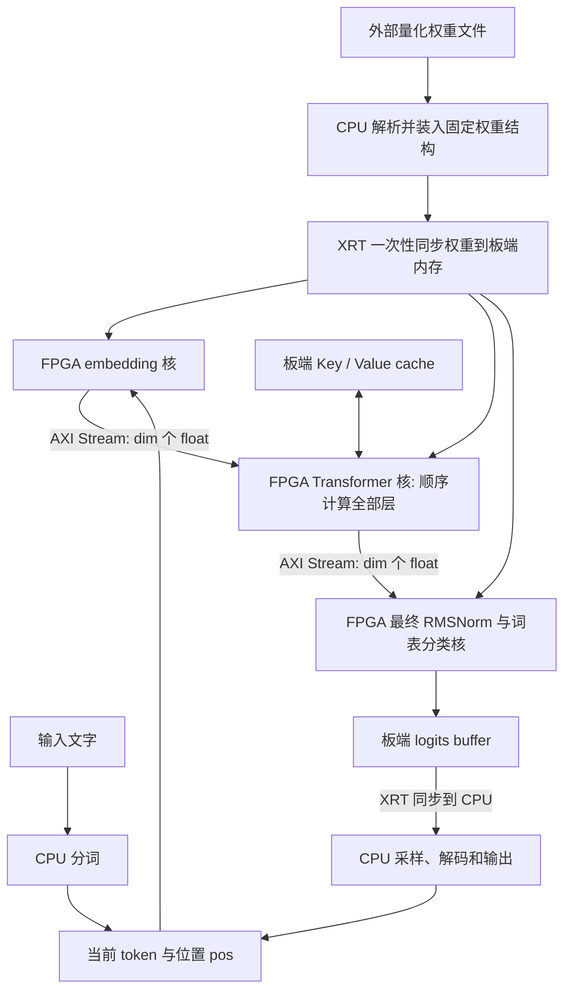
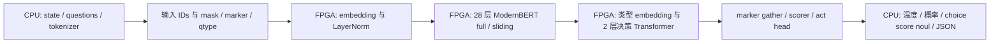

# 两个 Llama HLS baseline 的实现研究与 Laya 迁移分析

研究日期：2026-10-05。目标：理解两个仓库实际完成了什么、CPU 与 FPGA 如何协作部署，并为后续 Laya-baseline 的功能实现和加速设计提供依据。

## 1. 核心结论与研究边界

两个分支使用的是同一套 **C++ 手工实现的量化 Llama 前向 + Vitis HLS + XRT 主机控制**。CPU 装载权重、分词并采样；FPGA 上的三个核完成 embedding、全部 Transformer 层、最终归一化和词表分类。每处理一个 token，host 启动一次三核链路。Prompt 也逐 token 处理，没有单独的批量 prefill 算法。

最有价值的可复用部分是：HLS 算子的实现方法、AXI 内存/流接口、XRT buffer 与启动流程、分阶段构建验证思路。**Laya 的计算图必须另外实现**：本地英文 Laya 是 ModernBERT-large 双向编码器加两层决策头，处理整段输入并输出候选分数，没有这里的自回归生成循环和跨 token KV cache。

当前源码存在会影响复现的实质问题：Tiny 的 host/hardware 上下文长度不一致、7B 的三个完整权重副本占用过大、host 的重复释放、构建路径和脚本错误。后文将“源码已经实现的行为”“本次静态检查发现的问题”“后续设计建议”分别标明。

本次完成源码阅读、分支差异比较、编译器 `sizeof` 验证和本地产物检查；**没有执行 Vitis C 仿真、综合、软/硬件仿真或 FPGA 板上推理**。不能把 README 的成功截图当成本次复现结果，也不能从 HLS pragma 推断实际吞吐、资源或收敛时钟。

## 2. 分支版本与实际模型配置

| 项目 | llama2-7b-baseline | Tiny-llama-baseline |
| --- | --- | --- |
| 本地 Git commit | `69d70e3d5906570a49d2d959c4b39be37f243c66` | `ee327e91cd69cb8ed6dc1fc735af4c3ee5931236` |
| 最新提交时间 | 2025-09-17 19:55:03 +08:00 | 2025-09-17 18:46:58 +08:00 |
| 隐藏维度 `dim` | 4096 | 768 |
| FFN 中间维度 `hidden_dim` | 11008 | 2048 |
| Transformer 层数 | 32 | 12 |
| Query / KV head 数 | 32 / 32 | 12 / 12 |
| 每个 head 的维度 | 128 | 64 |
| 词表 | 32000 | 32000 |
| 硬件编译时 `seq_len` | 128 | 128 |
| host 编译时 `seq_len` | 128 | **2048** |
| 量化组大小 `GS` | 64 | 64 |
| 板卡平台字符串 | `xilinx_u55c_gen3x16_xdma_3_202210_1` | 相同 |
| 分核综合请求时钟 | 300 MHz | 300 MHz |
| 随仓库提供 `forward.xclbin` | 未发现 | `hw_end1/forward.xclbin`，49,231,321 字节 |
| 随仓库提供权重和 tokenizer | 未发现 | 未发现 |

依据：[7B 硬件配置][7b-config]、[Tiny 硬件配置][tiny-config]、[Tiny host 配置][tiny-host-config]、[分核 HLS 配置][hls-config]。

这里的 Tiny 分支应按 **768 维、12 层、12 个 MHA head** 理解。分支名称不能保证它与任意公开名称为 TinyLlama 的检查点兼容。实际外部权重未下载，本次没有验证其头部参数、训练来源或模型准确率。

两个分支的 `src/forward.h`、`src/typedefs.h`、三个独立仿真核和三个 host 源文件逐文件相同；`src/forward.cpp` 只有一行注释差异。主要变化是模型尺寸、Tiny host 上下文长度、7B C 仿真的大对象处理和默认输入文件名。因此它们是同一架构的不同配置实例。

## 3. 仓库的各部分负责什么

| 文件或目录 | 实际作用 |
| --- | --- |
| `src/config.h` | 硬件侧编译期模型尺寸；改变尺寸会改变数组、权重布局和计算图，需要重新综合 |
| `host/config.h` | host 独立的一份模型尺寸；必须与硬件和权重匹配，当前 Tiny 的长度不匹配 |
| `src/typedefs.h`、`host/typedefs.h` | 固定数组的量化张量、权重和运行状态结构 |
| `src/forward.cpp` | 三个硬件顶层核，包含完整单 token 前向 |
| `src/forward.h` | 硬件使用的量化、反量化、RMSNorm、Softmax、量化矩阵乘辅助函数 |
| `src/independent_kernal/` | 软件仿真分别编译的三个核，目录名原样拼写为 `kernal` |
| `src/tb_llama2_csim.cpp` | 不使用 XRT，直接调用三核的 C 仿真程序；包括权重读取、分词和生成 |
| `src/u55C1.cfg` | 三核实例、SLR 放置、HBM 地址连接和核间 stream 连接 |
| `host/llama2.cpp` | 板上 XRT 主机程序，负责 buffer 分配、同步和核启动 |
| `host/sw_emu_llama2.cpp`、`host/hw_emu_llama2.cpp` | 仿真 host，主要区别是默认 xclbin 路径 |
| `llama2/hls_config*.cfg` | C 仿真/三个核分别综合的配置 |
| `sw_emu/hls_config*.cfg` | 软件仿真各核的连接配置；最终三核链接使用 `src/u55C1.cfg` |
| 根目录脚本 | 设置环境、C 仿真、综合、仿真、实现和板上运行 |

`host/forward.h` 还保留了旧的 `forward()` 声明和与 `src/forward.h` 不同的量化实现。当前 XRT host 实际前向调用三个硬件核，只在装载时使用 CPU 反量化；不能将这个 host 头文件视作已验证的独立 CPU 前向参考。

本次比较确认，`independent_kernal` 的三个函数体与 `src/forward.cpp` 对应函数体在去掉注释和空白后相同。它们仍是两套复制维护的源码，后续修改时有漂移风险。

## 4. 部署方式：从模型文件到 FPGA 推理

这套工程不是将 PyTorch/ONNX 模型自动编译为硬件。Llama 的运算已经由开发者写成 HLS C++；外部权重需预先转换为 loader 认识的二进制格式，然后放入 FPGA 可访问的全局内存。



编译部署有两条链：

1. **硬件链**：HLS C++ → 分别综合得到三个 `.xo` → Vitis 链接、Vivado 实现 → `.xclbin` → XRT 加载到 FPGA。
2. **运行链**：模型/tokenizer 文件 → C++ host → XRT buffer 与 kernel → token 前向 → CPU 采样 → 下一个 token。

权重数值与 bitstream 分离。同结构、同布局、同量化格式的新权重可以重新装载；改变层数、维度、注意力类型或接口则需要修改源码并重建硬件。没有看到训练、微调或导出 `weights.bin` 的脚本；仓库要求从 README 的外部链接取得已经准备好的模型文件。

## 5. CPU 软件具体做了什么

### 5.1 装载权重：文件格式与内存布局

`read_checkpoint()` 检查 magic `0x616b3432` 和 version `2`，依次读取七个模型参数、一个 `shared_classifier` 字节和一个 group-size 整数，然后跳到 **256 字节**的权重起始位置。模型参数顺序是 `dim, hidden_dim, n_layers, n_heads, n_kv_heads, vocab_size, seq_len`。[权重读取实现][host-loader]

随后通过 `mmap` 读取文件，`memory_map_weights()` 将内容复制进固定数组结构，再解除文件映射。因此函数名称里的 “map” 并不表示 FPGA 直接读取原始磁盘文件，也不是全过程零拷贝。

权重区实际读取顺序为：

```text
rms_att_weight：全部层的 FP32 参数
rms_ffn_weight：全部层的 FP32 参数
rms_final_weight：FP32 参数
q_tokens：embedding 的 int8 q 数组，再接 FP32 scales
wq：逐层 q 数组与 scales
wk：逐层 q 数组与 scales
wv：逐层 q 数组与 scales
wo：逐层 q 数组与 scales
w1：逐层 q 数组与 scales
w2：逐层 q 数组与 scales
w3：逐层 q 数组与 scales
wcls：仅在 classifier 不共享时读取独立数据
```

同一种矩阵在每层都是 `q` 紧接 `s`，不是先存所有层的 `q` 再存所有层的 `s`。若 classifier 共享，loader 仍将 embedding 的量化数据复制到 `wcls`，没有用指针共享节省该结构空间。[张量定义][weights-type]

CPU 还将整个量化 embedding 表反量化成 FP32，供 embedding 核直接读取。常驻权重结构同时保存量化 embedding 和 FP32 embedding。

这里的格式不能直接接受 Hugging Face safetensors、GGUF 或任意 int8 文件。尤其不能因为都叫 int8 就认为与 Laya 的已有 Q8_0 文件兼容：必须对齐矩阵方向、组大小、scale 类型、张量名称、存储顺序和 bias。

### 5.2 分词、输入和输出

host 从 `tokenizer.bin` 读取最大 token 长度、词表分数和词条；建立排序词表，通过查找和相邻片段合并构造 token。代码硬编码 BOS=`1`、EOS=`2`。[分词与采样实现][host-tokenizer]

这是仓库自己的简化实现，不能据此断言与原始模型 tokenizer 在所有输入上完全一致。Laya 需保留自己 tokenizer 的特殊 ID、序列模板、padding 和 truncation 语义。

host 支持读取温度、top-p、随机种子、生成步数、prompt、tokenizer 路径和 `-k` xclbin 路径。实际默认温度为 `0.0`，即 greedy argmax；温度非零时 CPU 执行 logits 的 temperature/softmax 和采样。帮助文本写默认温度为 1.0，与实际初始化值不同。

`-m chat` 与 `-y` 被解析，但 `main()` 只执行 `mode == "generate"` 的分支，其他模式报错；当前源码没有完整 chat 路径。

### 5.3 XRT 内存与控制

host 打开 `xrt::device(0)`，加载 xclbin，并取得三个核对象。利用 `kernel.group_id(参数编号)` 为各输入输出分配板端 buffer，使 buffer 的内存组与硬件连接对应。[XRT 初始化与 buffer][host-xrt]

| 核 | host 设置的参数编号 | 含义 |
| --- | --- | --- |
| `initial_embedding_lookup` | 0、1 | FP32 embedding buffer、token ID |
| `transformer_layer_pipeline` | 2、3、4、5、6 | attention 权重 buffer、FFN 权重 buffer、pos、K buffer、V buffer |
| `final_norm_classifier` | 1、2 | logits buffer、最终 norm/classifier 权重 buffer |

AXI Stream 端口包含在函数参数编号中，但由 linker 接线，不由 host 传普通 buffer。classifier 的参数 3 `GS_val` 没有设置，当前实现也没有使用它，实际组大小来自编译期 `GS`。

权重和 embedding 通过 `write()` 与 `sync(TO_DEVICE)` 在生成前上传一次。K/V buffer 跨 token 保留在板端，每步由硬件写入当前位置；host 没有每步搬运整个 cache。C 仿真将 cache 清零；XRT host 没有显式清零。正常从 pos=0 开始且逐步递增时，历史有效位置先写后读，但复用/异常恢复不能依赖未初始化区域。

每个 token 的操作顺序是：创建并设置三个 `xrt::run` → `run1.start(), run2.start(), run3.start()` → 等待三个核完成 → `logits_out.sync(FROM_DEVICE)` → CPU 读取 32000 个 FP32 logits → 采样。三个核需要在等待之前全部启动，有限 FIFO 下若先等待生产者再启动消费者可能死锁。[每 token 启动与读取][host-run]

Prompt 阶段也使用此流程，且每个 prompt token 都读回全部 logits；只有最后一个 prompt token 的 logits 用来取得第一个生成 token。生成每步再启动一次，完成后得到下一个 token。没有 token batch、连续常驻控制核或批量 prefill。

## 6. FPGA 硬件具体做了什么

### 6.1 核 1：`initial_embedding_lookup`

从全局 FP32 表读取 `embedding[token, :]`，先装入本地 `embedding_buffer[dim]`，再逐个输出 `dim` 个 `float`。[embedding 核][embed-kernel]

- 输入 embedding：AXI4 memory-mapped（`m_axi`）。
- 输出向量：AXI4-Stream（`axis`）。
- token 与启动控制：AXI4-Lite（`s_axilite`）。
- 主要 pragma：本地数组 cyclic partition factor=2；流输出请求 `II=1`。
- 非法 token 会输出全零向量，而不是中止整次推理。

### 6.2 核 2：`transformer_layer_pipeline`

读取整条 embedding 流到本地 `current_x[dim]`，然后循环 `l=0..n_layers-1`。**层循环明确写了 `#pragma HLS PIPELINE off`**；不是将 12/32 层全部展开成并行硬件，也没有看到层级 `DATAFLOW`。[Transformer 核入口与层循环][transformer-kernel]

每层顺序完成：

```text
当前 x
  → attention RMSNorm
  → activation 分组 int8 量化
  → Wq/Wk/Wv 三次 GEMV，得到 FP32 Q/K/V
  → 按 pos 应用 RoPE
  → 写入本层、本位置的 K/V cache
  → 对每个 head 计算 Q 与历史 K 的点积
  → 对 t=0..pos 做 Softmax
  → 用注意力概率加权历史 V
  → activation 量化 + Wo GEMV
  → 加 attention 残差
  → FFN RMSNorm
  → activation 量化 + W1/W3 两次 GEMV
  → SiLU(W1·x) × (W3·x)，即 SwiGLU
  → 中间 activation 量化 + W2 GEMV
  → 加 FFN 残差，更新 x，进入下一层
```

attention 只遍历 `t <= pos`，实现单 token 因果注意力。cache 布局是 `[layer, seq_len, kv_dim]`，当前行地址为 `layer*seq_len*kv_dim + pos*kv_dim`。Q/K/V、残差、attention 概率、cache 及非线性计算均为 FP32。[attention 与 cache][attention-code]、[FFN 实现][ffn-code]

RoPE 基数为 10000，按相邻维度 `(i,i+1)` 旋转。虽然定义了 `kv_mul_local=n_heads/n_kv_heads`，attention 实际使用 `kv_head_idx=h`，没有使用 GQA 的 head 映射；当前两个配置均为 MHA，所以不触发该问题。若未来改变 `n_kv_heads`，同时还需修正 Query 的旋转范围。

循环与本地数组多使用 unroll/partition factor=2。Q、K、V 和两路 FFN 在源码中依次调用，不能把函数调用个数理解成这些算子已经并发执行。

### 6.3 核 3：`final_norm_classifier`

读入最后一层的 `dim` 个 FP32 值，执行最后的 RMSNorm，量化 activation 后与 `[vocab_size, dim]` classifier 权重做 GEMV，产生 `[32000]` FP32 logits 并写回全局内存。[classifier 核][classifier-kernel]

FPGA 不负责最终词表采样；CPU 读取 logits 后选择下一 token。因此硬件 attention Softmax 和 CPU 词表 Softmax 是两个不同计算阶段。

### 6.4 量化线性算子到底是什么

`QuantizedTensor<S, GS>` 保存 `int8_t q[S]` 和 `float s[S/GS]`。每 64 个值对应一个 FP32 scale，因此每个量化元素平均需要 `1+4/64=1.0625` 字节，尚未计入 embedding 的 FP32 副本和其他状态。

activation 在每次线性层前动态对称量化：对组内求 `max(abs(x))`，令 `scale=max/127`，舍入并截断到 `[-127,127]`。接近全零组令 scale 为 0。[硬件量化实现][quantize-code]

虽然函数叫 `matmul()`，实际接口是 **矩阵乘向量 GEMV**：`W[D,N] × x[N] → y[D]`，没有 batch/token 矩阵维度。[GEMV 实现][gemv-code]

```text
每个输出行 i：
    将该行 int8 权重与 scales 读入局部缓存
    每个组 g：
        int32_sum[g] = Σk int8_x[g,k] * int8_w[i,g,k]
    float_y[i] = Σg float(int32_sum[g]) * x_scale[g] * w_scale[i,g]
```

乘积与组内求和走整数计算，分组缩放和输出累加是 FP32。应称为 **W8A8 线性层加浮点非线性/状态的混合实现**，不能称为整个网络纯 int8。当前代码没有 int4、FP16/BF16 主数据通路、二维 systolic GEMM 或显式宽向量打包接口。

## 7. 片上状态、HBM 与数据流

### 7.1 linker 连接

两分支 `src/u55C1.cfg` 相同。[完整连接配置][connectivity]

| 计算单元 / 端口 | 连接 |
| --- | --- |
| `init_embed_1` | SLR1 |
| `layer_pipeline_1` | SLR0 |
| `final_norm_1` | SLR1 |
| embedding 表 | HBM[1] |
| value cache | HBM[4] |
| key cache | HBM[5] |
| Transformer `w` | HBM[6:10] |
| Transformer `w_ffn` | HBM[17:21] |
| classifier `w` | HBM[26:30] |
| logits | HBM[25] |
| embedding 输出 | 连接 Transformer `s_initial_in` |
| Transformer `s_final_out` | 连接 classifier 输入 |

中间向量通过片内 stream 传递，避免把 embedding 和最后一层输出再绕回 CPU。Transformer 内各层 `current_x` 也保留在本地。

K/V 两个指针的 HLS pragma 都绑定到 **同一个 `gmem_kvc` AXI bundle**。连接到不同 HBM bank 不等于已经产生两个独立 AXI master，更不等于同时获得两倍带宽。权重端口绑定多个 HBM bank 也只表示可达的地址资源；实际并发、burst 和有效带宽要看生成的互连及报告。

跨 SLR 的 stream 连接可能影响布线时序。配置注释提到 FIFO 深度 32，但本次没有看到这里显式设置该深度的生效配置，不能以注释作为已验证 FIFO 容量。

### 7.2 完整权重被复制三次的问题

从 host 的 buffer 分配、写入和同步代码可以确认：`w_buffer`、`w1_buffer`、`w2_buffer` 都分配 `sizeof(transformer->weights)`，并分别上传**完整**权重结构。[权重三次复制][host-copy]

因此“attention、FFN、classifier 分开读”当前通过完整结构的不同副本实现，而不是只上传各自需要的子集。另有一份独立 FP32 embedding buffer；三个完整副本内部也各有 FP32 embedding、量化 embedding 和 classifier。

本次用 g++ 编译只计算 `sizeof` 的小程序，未实际分配大权重，得到：

| 项目 | 7B | Tiny |
| --- | ---: | ---: |
| 完整权重结构字节数 | 7,684,636,672 | 240,847,872 |
| 完整结构大小 | 7.1569 GiB | 0.2243 GiB |
| 独立 FP32 embedding | 524,288,000 字节（500 MiB） | 98,304,000 字节（93.75 MiB） |
| 单个 K 或 V buffer，按 host 配置 | 67,108,864 字节（64 MiB） | 75,497,472 字节（72 MiB） |
| 三份权重 + 独立 embedding + K/V + logits | **23,712,543,744 字节（22.0840 GiB）** | **971,970,560 字节（0.9052 GiB）** |

注意：Tiny 表中 K/V 按 host 的 2048 长度计算；按硬件的 128 长度，每个只需 4.5 MiB。以上是源码要求分配的 buffer 字节总量，不是测量的板端占用峰值，尚不包含 runtime 保留空间等额外开销。

计算公式可复核。设隐藏维度 d、FFN 维度 f、层数 L、词表 V，当前两模型均为 MHA：

```text
量化矩阵元素数 Q = L*(4*d*d + 3*d*f) + 2*V*d
sizeof(weights) = Q*(1+4/64) + 4*V*d + 4*(2*L+1)*d
板端申请总字节 = 3*sizeof(weights) + 4*V*d
                 + 2*L*host_seq_len*d*4 + V*4
```

常见 U55C 配置为 16 GB HBM；7B 当前 22.08 GiB 的申请需求已经超出容量，且还需要核查各 bank group 自己的容量和单 BO 分配限制。因此本次审计**不能支持“当前 7B host 已可在目标板正常运行”的结论**。README 虽描述了预编译 bitstream，但本地 7B 分支也没有对应文件。后续必须分拆紧凑权重区域或重新设计分层装载，不能沿用三份完整结构的做法。

## 8. 仓库如何构建、验证和上板

### 8.1 环境与产物

`env.sh` 将执行时的当前目录保存为 `MODEL_BASE_PATH`，并加载指定位置的 Vitis 2023.2、Vivado 2023.2 和 XRT 环境。需要从正确的项目根目录 `source`，否则模型和默认 xclbin 路径会指向其他位置。[环境脚本][env-script]

host 使用 g++、C++17、`-O0`、XRT 头文件与 `-lxrt_coreutil -pthread` 编译。随仓库的 `.exe` 经文件头检查是 **Linux x86-64 ELF**，不是 Windows 可执行文件，也不能据此证明它们与当前源码、XRT 和 bitstream 匹配。

Tiny 的 xclbin 文件头确认为 `xclbin2`，不是 Git LFS 指针；本次未用 xclbinutil 解析其 kernel/端口元数据，也未加载到设备。因此其模型配置和接口是否与当前源码对应仍待验证。

### 8.2 六个阶段各自验证什么

| 阶段 / 入口 | 脚本实际动作 | 能说明什么、不能说明什么 |
| --- | --- | --- |
| `csim.sh` | `vitis-run --mode hls --csim`，使用 testbench 直接调用 HLS C++ | 验证 C 代码路径；不能验证板端容量、有限 FIFO 行为、时序和实际加速 |
| `csynth.sh` | 分别以三个 `syn.top` 编译，生成 `.xo` 及综合报告 | 估计调度、资源与延迟；必须读实际报告，不能把目标 II/频率当结果 |
| `software_emulation.sh` | 编译 XRT host；三个独立核编译为 sw_emu `.xo`；链接仿真 `.xclbin`；设置 `XCL_EMULATION_MODE=sw_emu` | 检查 host/kernel 接口和软件仿真功能；不代表真实硬件吞吐 |
| `hardware_emulation.sh` | HLS 编译三个核；链接 hw_emu xclbin；运行对应 host | 能进一步检查硬件仿真交互；当前脚本有链接参数错误，不能直接认定可用 |
| `hardware_implement.sh` | 编译三个核，`v++ -l -t hw` 调用实现工具生成 `hw_end1/forward.xclbin` | 完成器件实现，需要平台、工具、容量和时序都满足 |
| `run_inference.sh` | 重编译 host，使用 `weights.bin`、`tokenizer.bin`、prompt `Once` 和硬件 xclbin | 执行板上生成；现有命令是运行示例，不是严格的性能评测程序 |

依据：[综合脚本][synth-script]、[软件仿真脚本][sw-script]、[硬件仿真脚本][hwemu-script]、[实现脚本][impl-script]、[上板入口][run-script]。

分核 `hls_config1/2/3.cfg` 的 `freqhz` 为 300,000,000。C 仿真公共 `hls_config.cfg` 为 30,000,000，且没有像分核配置一样显式给出 `syn.top`；正式整理可复现工程时需明确此配置由工具如何识别入口。

testbench 会读取实际权重并生成文字，但没有看到与独立软件黄金模型逐层比较、logits 误差阈值或模型准确率断言。因此“程序退出成功”属于运行烟雾验证，不足以证明完整数值正确。普通 C 仿真里的 stream 调用还不能替代有限 FIFO 的 RTL/系统验证。

7B C 仿真将大 `Transformer` 对象改为 heap 分配，并设置 `-mcmodel=large` / `--no-relax` 以处理大对象相关问题；Tiny C 仿真仍使用 static 对象。7B 的 XRT host 则仍保留 static 大对象。这些是主机编译/内存策略差异，不是 FPGA 上层并行度的变化。

README 给出的约 15 分钟综合、4–5 小时完整编译是作者环境的描述，本次没有验证。当前环境中 `vitis-run`、`v++`、`xbutil`、`xbmgmt`、`xclbinutil` 不在 PATH，`env.sh` 引用的三个安装/设置文件也不存在；本次没有启动这些构建流程。

## 9. 复现前必须注意的问题

以下结论以当前 checkout 的源码为准；没有在本轮替仓库修复或重新编译。

| 问题 | 证据及影响 | 后续处理建议 |
| --- | --- | --- |
| **7B 三份完整权重超出通常板卡容量** | host 分配三个 7.16 GiB 的完整结构；合计 buffer 需求约 22.08 GiB | attention、FFN、最终输出权重按需分拆；共享只读数据；按实际板卡重新核算容量与 BO 限制 |
| **Tiny host 2048，硬件 128** | 两个 `config.h:10`；host 的 pos 检查使用 2048，硬件 attention/cache 索引使用 128 | 将参数收敛到单一来源并生成两端配置；启动时校验 xclbin 与模型契约 |
| prompt 阶段没有长度边界检查 | prompt 循环对所有 token 发起计算，没有像 decode 阶段先检查 `pos >= seq_len` | 在所有核调用前校验 token 数与 pos，定义一致的截断/拒绝策略 |
| **host 重复释放 `prompt_tokens`** | 在生成前释放一次，函数结束又释放同一个地址；三个 host 都有此代码 | 改用 RAII 容器或移除重复释放，重新构建后做退出路径检查 |
| 每步分配 logits 未释放 | prompt/decode 内部 `malloc(vocab_size*sizeof(float))`，没有对应 free；token 大数组也未释放 | 复用固定 logits buffer；用容器管理所有权，避免长时间运行泄漏 |
| xclbin 加载两次 | 先加载环境目录的默认文件，再加载 `-k` 指定文件；即使 `-k` 正确也要求默认路径先可用 | 一次选择、验证、加载唯一 xclbin；缺参时使用明确默认值 |
| 环境变量没有空值检查 | `std::string(getenv("MODEL_BASE_PATH"))` 可收到空指针 | 改为显式 CLI 或检查环境变量后报清晰错误 |
| 权重头部校验不足 | loader 读入多个维度，但只对 GS 做匹配检查；复制长度主要由编译期模板决定，未检查完整 payload 长度 | 校验全部维度、类型、字节数、offset 和校验和；禁止错模型装入固定硬件 |
| `hardware_emulation.sh` 有孤立 `h` 参数 | 链接命令 `... --config ../src/u55C1.cfg h ./...` | 删除多余参数并重新验证链接 |
| sw_emu 配置使用作者机器绝对路径 | 两个分支还分别残留另一个模型目录名；与本地目录无关 | 以项目根目录派生路径；统一相对路径或生成配置 |
| 构建脚本非稳健重复运行 | 直接 `mkdir`，缺少统一错误退出；`sw_emu/` 在 checkout 中已存在 | 分离源码配置与产物目录；检查失败并停止；重复运行应可控 |
| 7B 预编译 xclbin 缺失 | README 声称 `hw_end1/` 可直接上板，但本地分支没有对应产物 | 明确缺失依赖；需要有效 artifact 或重新实现，不能直接执行示例 |
| 当前 MHA 代码不完整支持 GQA | head 映射使用 `h`，`kv_mul_local` 未使用；RoPE 只遍历 kv_dim | 如需 GQA，修改 head 映射、Query 旋转和 cache 并验证；当前 Laya 为 MHA，不必引入此分支 |
| 帮助文本/README 与源码不完全一致 | 帮助写默认温度 1.0，源码为 0.0；chat 参数有解析但无执行路径 | 文档以实际可运行配置更新，明确不支持的模式 |

关键行号：[提前释放][host-free-early]、[结束时再次释放][host-free-late]、[双重加载][host-xrt]、[prompt 循环][host-run]、[loader 检查][host-loader]、[仿真链接错误][hwemu-script]。

Tiny 在 `pos >= 128` 后，不只是“多分配了 cache”。硬件每层按 128 的步长定位 cache，写当前 token 会覆盖其他层的区域；Softmax 的本地数组大小也只有 128，继续使用更大的 pos 会越界。即使 XRT 为它分配了足够大的总 buffer，也不能使硬件支持更长上下文。

## 10. 它加速了什么，以及性能仍受什么限制

已经迁移到 FPGA 的核心工作包括：每层 Q/K/V/O 的线性计算、attention、FFN、归一化、RoPE，以及最终词表分类。CPU 只做运行控制和文本/概率后处理，所以属于端到端推理的软硬件协作部署，而非仅一个 GEMV 的测试工程。

但当前加速器仍有明显限制：

1. **逐 token GEMV 大量读取权重。** 当前每个输入 token 都重新执行全部层的矩阵向量乘，缺少跨多个输入 token 的矩阵块复用。7B 的主要线性层每 token 约 6.6071 GMAC，Tiny 约 109.51 MMAC；这些计数包括最终 classifier，不含 attention QK/AV、非线性和量化成本。
2. **权重访问与计算尚未形成成熟的块流水。** 每个 GEMV 输出行先读该行权重/scales，再求组内点积；源码没有显式的双缓冲权重 tile 或 load/compute dataflow。实际能否 overlap 要看 HLS 调度报告。
3. **浮点归约和非线性可能限制 II 与资源。** RMSNorm、Softmax、点积、SiLU 以及 RoPE 用 FP32；有 `sqrtf/expf/powf/sinf/cosf`。pragma 中的 `II=1` 是请求，带依赖的浮点累加不保证实现该 II。
4. **核与 token 的控制开销。** 每个 token 创建三次 run 并等待；读回完整 128,000 字节 logits。prompt 的非最后一步也读回 logits，增加同步开销。
5. **层级和 token 级没有整体并行。** 各层按依赖顺序计算，下一 token 需等 CPU 采样；三核 stream 连接并不代表多层、多 token 已形成吞吐流水。
6. **HBM bank 数量不是有效带宽证明。** 多 bank 地址连接、窄标量数据类型、实际 AXI 宽度、访问合并、burst 和 outstanding 需要一起分析。

以当前 GEMV 所读取的 int8 矩阵及 FP32 group scales 估算，主要线性权重流量为 `MAC_count * 1.0625` 字节/前向：7B 约 **6.5379 GiB/token**，Tiny 约 **0.10836 GiB/token**。这是假设每个矩阵元素读取一次的算法流量，不包括 KV、其他向量或额外事务，也不是测得的 AXI 流量。理想带宽约束可写为 `token/s <= 有效带宽 / 每token权重字节`；有效带宽必须测量，不能直接代入板卡宣传峰值后当成结果。

host 的 tokens/s 计时从 prompt 处理完成后开始，排除了权重装载、xclbin 初始化和 prompt 阶段；包含生成循环中的核启动、同步、CPU 采样及打印。计数基于处理位置增量，还与实际打印 token 数在 EOS/长度边界时有差别。它不能直接作为完整请求延迟或标准 prefill/decode 基准，也不能用于 Laya 的端到端速度对比。

## 11. 本地 Laya 的真实工作负载

迁移分析先以本地 **英文 Laya 检查点**为对象。它不是这里的 Llama decoder；若后续选择 multilingual 或 typed-decisions 变体，必须重新核查配置和权重。

依据：[本地 Laya 推理说明][laya-flow]、[encoder 配置][laya-config]、[Agent 配置][laya-agent-config]、[实际 DecisionModel][laya-common]、[实际 ModernBERT 实现][modernbert]。

| 项目 | 本地英文 Laya |
| --- | --- |
| 主干 | ModernBERT-large 双向 encoder |
| 主干隐藏维度 / 层数 / heads | 1024 / 28 / 16，每 head 64 维 |
| 主干 FFN intermediate | 2624；门控输入投影实际输出 5248 |
| 主干注意力 | 第 0、3、6…27 层为全注意力，共 10 层；其余 18 层为双向滑动注意力 |
| 局部窗口配置 | `local_attention=128`；具体边界以当前后端 mask 定义为准 |
| RoPE | 全注意力 theta=160000，滑动注意力 theta=10000 |
| 主干归一化 / activation | LayerNorm / GELU 门控（GEGLU） |
| 额外决策头 | 2 层标准 TransformerEncoderLayer，16 heads，FFN=4096，`norm_first=True` |
| 决策头 FFN activation | SDK 未传 `activation`，当前 PyTorch 默认 **ReLU** |
| 选项 scorer | LayerNorm → Linear(1024,1024) → GELU → Linear(1024,1) |
| act/escalate head | 输入 CLS 向量及 4 个统计量，Linear(1028,256) → GELU → Linear |
| 词表 | 50368 |
| 模型位置容量 / SDK 默认 max_len | 8192 / 512；不等于已确定 FPGA 支持的长度 |
| 特殊 ID | CLS/BOS=50281，SEP/EOS=50282，PAD=50283；MASK 等应由 tokenizer 读取 |
| 输出 | 候选 logits、act logits，经软件转为 choice/score/noul 等结构化结果 |

本次仅读取 safetensors 的头部，确认文件大小为 842,609,210 字节，206 个张量，合计 421,293,830 个张量元素（包含 buffer，不能将其直接等同于可训练参数数）。以下实际权重形状进一步验证了配置：

| 权重 | dtype / shape |
| --- | --- |
| `encoder.embeddings.tok_embeddings.weight` | F16 / `[50368,1024]` |
| `encoder.layers.0.attn.Wqkv.weight` | F16 / `[3072,1024]` |
| `encoder.layers.0.mlp.Wi.weight` | F16 / `[5248,1024]` |
| `encoder.layers.0.mlp.Wo.weight` | F16 / `[1024,2624]` |
| `head.layers.0.linear1.weight` | F16 / `[4096,1024]` |
| `head.layers.0.linear1.bias` | F16 / `[4096]` |
| `type_emb.weight` | F16 / `[3,1024]` |
| `scorer.3.weight` | F16 / `[1,1024]` |
| `act_head.0.weight` | F16 / `[256,1028]` |

### 11.1 需要保留的推理语义

每个问题构造包含问题、候选项、state 和特殊 token 的一条序列；问题数成为 batch 行数。即使 state 在 CPU 上只分词一次，神经网络仍对每个问题行分别编码。双向 attention 使 state 的表示受到问题与候选项影响，不能直接复用一份 state 中间表示而声称行为等价。

主干 embedding 后先有 LayerNorm；主干第 0 层 attention 前的 norm 是 Identity，其他层有 attention LayerNorm；各层都有 MLP 前的 LayerNorm，主干最后还有 final LayerNorm。不能把每层统一替换为 Llama 的两次 RMSNorm。[ModernBERT embedding/层定义][modernbert]

主干使用融合 QKV 投影和 GELU 门控 FFN。两层决策 Transformer 是普通全注意力，默认 ReLU，带 standard layer 的 bias 参数；不能统一替换成主干 GEGLU，更不能统一替换成 Llama SwiGLU。scorer 的 GELU 是另外一处算子。[DecisionModel][laya-common]、[PyTorch 默认 activation][torch-head]

ModernBERT 的实际 RoPE 使用 half-split 配对：64 维 head 里 `(0,32)、(1,33)…` 配对，而 Llama baseline 代码按相邻维度配对。迁移时需按实际 Q/K 布局实现或在导出中做严格一致的变换，并对齐两类 theta。不能只将 10000 替换成 160000。[ModernBERT RoPE][modernbert-rope]

SDK 用 `AutoModel` 构造 encoder 并读取 `last_hidden_state`。虽然 encoder config 的 `architectures` 字段写着 `ModernBertForMaskedLM`，实际 Laya 路径并不执行通用 MLM 的整个词表输出层；因此不应照搬 Llama 的 32000/50368 词表 classifier。

### 11.2 Llama 到 Laya 的逐项迁移判断

| Llama baseline 设计 | 对 Laya 的处理 |
| --- | --- |
| HLS C++ 与 XRT 主机/设备分工 | 可借鉴；目标板卡确认后选择具体控制和 DMA 方式 |
| embedding lookup | 保留查表思路，但处理整段 token 矩阵，使用 Laya 词表和 embedding LayerNorm |
| 单 token GEMV | 改造成 token/block GEMM 为主要方向；多 token 复用同一权重块 |
| int8 group scale 与 int32 dot | 可作为 W8A8 候选起点，但先与 Laya 现有格式和精度实验对齐 |
| RMSNorm | 改为 Laya 实际 LayerNorm，包含均值去除和对应 weight/bias |
| 因果 attention `t<=pos` | 改为整段双向 full/sliding attention，正确处理 padding 和窗口边界 |
| KV cache | 移除生成式跨步 cache；层内仍需要暂存该序列的 Q/K/V 和 attention 工作块 |
| 相邻配对、单 theta RoPE | 改为实际 half-split 布局，区分 full/sliding theta |
| SwiGLU | 主干改 GELU 门控；决策头改普通 ReLU FFN；scorer 保留 GELU |
| 统一无 bias 的 GEMV 习惯 | 导出并实现实际需要的 bias，尤其决策头/scorer/act head |
| 三核全量权重副本 | 改紧凑共享权重区或按层/tile 分配，避免按核复制整个模型 |
| 最终 norm + 词表 classifier | 改主干 final norm、类型 embedding、两层决策 Transformer、marker scorer 和 act head |
| CPU temperature/top-p token 采样 | 改问题温度桶、选项 mask、概率、choice/score/noul 和 confidence 后处理 |
| 每 token 三次 launch | 以整个请求、一个 batch 或较粗粒度层组为控制单位 |
| tokens/s | 改端到端请求 p50/p95、请求/s、有效输入 token/s 和质量指标 |

Laya 的输入主张量是 `[B,S,1024]`，不是 `[1024]`。线性层对应 `[B*S,1024] × W`；将 Llama GEMV 逐 token 调用 S 次只能作为功能过渡，会丢掉 encoder 在权重复用上的重要机会。

两层决策头应处理编码器输出的整条有效序列，再 gather `[MASK]` 位置。SDK 配置里的 `head_max_len=192` 不能被简单理解为“决策头只算 192 个 token”；必须按实际序列构造与 `DecisionModel.forward()` 的张量检查。

## 12. 建议的 Laya-baseline 实现路径

本节是后续工作建议，不表示本次已经完成 Laya HLS 部署。建议先建立可核对的完整模型行为，再推进量化和性能优化。

### 阶段 A：冻结模型、输入与黄金结果

固定英文检查点、SDK/Transformers 版本、目标任务、序列长度、batch/问题数和 tokenizer。对同一批请求保存 `input_ids`、padding mask、marker 位置/有效 mask、qtype、最终 logits/probabilities，以及关键中间张量。

黄金张量至少覆盖 embedding norm、某个全注意力层、某个滑动注意力层、主干最终输出、两层决策头输出、marker logits 和 act logits。测试输入要包含变长 padding、窗口边界、长短选项及 choice/score/noul，不能只有一条短 prompt。

### 阶段 B：建立 Laya HLS 功能参考与导出契约

先定义统一模型描述，由同一个来源生成软件与硬件参数。导出 manifest 写明每个张量名称、shape、dtype、矩阵方向、bias、offset、scale 布局和模型版本，loader 启动时校验全部内容。

以浮点/原精度参考实现明确 LayerNorm、融合 QKV、双向 full/sliding attention、half-split RoPE、GEGLU、标准决策 Transformer、marker gather、scorer 和 act head 的行为。在 C 仿真中逐层与黄金张量比较，定位首次偏差；随后评估量化，避免同时改变多个算子而难以解释误差。

### 阶段 C：量化和可加速数据布局

将 baseline 的分组 int8 思路作为候选，而不是默认已满足 Laya 精度。核查本项目已有 GGUF/Q8_0 和 scale-format 研究后，统一一个用于硬件的格式；尤其明确 activation scale 的计算代价、scale 精度、溢出/舍入及权重 tile 对齐。

优先设计多 token 复用权重块的 GEMM、连续宽 burst、权重/activation 双缓冲，以及 full/sliding attention 的独立访问模式。对长序列避免为所有 heads 一次性常驻完整 `S×S` attention 矩阵；按块计算并正确归一化，确保分块 Softmax 与参考模型一致。

量化验收同时检查 logits 误差、选项排序、概率、score 值和置信度；任务层评估 accuracy、Brier/ECE 等。仅比较 argmax 不能说明概率输出等价。

### 阶段 D：确定板卡，再实现系统部署

当前 Llama 工程绑定 U55C 的平台、HBM、SLR 和 XRT。现有 Laya 资料提到过 VCU118，但本次请求没有确定最终板卡；两者不能按相同脚本直接上板。

- 若使用 U55C：可借鉴现有 XRT/kernel/BO 框架，但重新分配 bank、设计权重区和检查 runtime/platform 版本。
- 若使用 VCU118 等开发板：需要目标板的 DDR/片上存储布局、Vivado block design 与主机传输方案；不能假设自动具有相同 XRT shell 和 32 路 HBM。

合理的初始边界是 CPU 保留问题验证、序列构造、tokenizer、温度桶和 JSON 输出，FPGA 执行主干与决策网络。若第一阶段只把主干放到 FPGA、决策头保留 CPU，需明确称为阶段性混合实现，并测量 `[B,S,1024]` 输出搬运及 CPU head 延迟。

建议的完整链路如下，核的数量和粒度仍需按目标器件资源决定：



### 阶段 E：按实际请求衡量加速

固定同一批请求和质量要求，分开报告：冷启动/权重装载、预热后端到端 p50/p95、CPU 准备、host-device 传输、FPGA kernel、CPU 后处理。记录有效 token 数、padding、问题数、batch、目标时钟、资源和实际内存带宽。

用同条件 CPU/GPU 基线计算 speedup。HLS 估计 latency、kernel 时间和完整请求时间分别报告；只在前述误差和任务质量达标后比较加速。

## 13. 建议的源码阅读顺序

1. 两端 `config.h` 与 `typedefs.h`：先理解尺寸、量化结构与布局，尤其 Tiny 长度冲突。
2. `src/forward.h`：理解量化与 GEMV，确认整数/浮点的边界。
3. `src/forward.cpp`：沿 embedding → attention/FFN 层循环 → classifier 阅读。
4. `src/u55C1.cfg`：把函数端口与 SLR、HBM、stream 连接起来。
5. `host/llama2.cpp` 的 `generate()`：看 BO 分配/同步、三核参数和 prompt/decode 循环。
6. testbench 和所有脚本：区分 C 功能验证、系统仿真、实现、上板，理解哪些问题各阶段发现不了。
7. Laya 的 `common.py` 与 ModernBERT 实现：以实际计算图列迁移清单，而不是仅改模型尺寸。

## 14. 本次验证与尚待确认的事实

本次已完成：

- 记录两个 Git commit、branch 与 remote，两个 baseline 工作区保持干净。
- 比较所有文本源码，核查两分支相同的计算架构和不同配置。
- 逐段阅读三核、辅助算子、XRT host、testbench、linker、HLS 配置和构建脚本。
- 对独立 sw_emu 源码与综合源中的三核函数体做规范化比较，均一致。
- 用 g++ 编译并运行小型 `sizeof` 检查，验证权重结构大小；临时程序在 `/tmp` 中自动清理，没有改写 baseline 源码或构建大模型。
- 检查模型文件是否随仓库提供，以及 Tiny xclbin / host 可执行文件的文件头。
- 阅读 Laya 本地配置、SDK 和 Transformers/PyTorch 算子实现，仅读取 safetensors 头部核查权重形状。

尚待后续确认：

- 外部 Llama 权重与 tokenizer 是否符合当前 loader、是否与源码模型尺寸一致。
- Tiny 预编译 xclbin 的模型常量、接口、时钟和内存拓扑是否对应当前源码。
- 修复已列出的复现问题后，C/软件/硬件仿真和上板的实际结果。
- 三核各自资源、实际 II、时序收敛、HBM 利用率和真实端到端吞吐。
- Laya 最终采用的检查点、目标板卡、输入长度/batch、精度与质量要求。

因此本报告提供的是**有源码依据的部署机制研究与迁移方案**，没有宣称两个 baseline 在本机已部署成功，也没有宣称 Laya 的 FPGA 加速已经实现。

## 15. 源码证据索引

以下链接指向本次研究的本地文件。引用的行号以本次记录的 commit 为准；后续修改源码后应重新核对。

| 证据 | 对应内容 |
| --- | --- |
| [7B 硬件配置][7b-config] / [Tiny 硬件配置][tiny-config] / [Tiny host 配置][tiny-host-config] | 模型尺寸和上下文差异 |
| [量化张量与权重结构][weights-type] | q/scales、FP32 embedding、各层矩阵和 classifier |
| [HLS 量化][quantize-code] / [GEMV][gemv-code] | W8A8 线性层与分组缩放 |
| [embedding][embed-kernel] / [Transformer][transformer-kernel] / [classifier][classifier-kernel] | 三核计算链路 |
| [attention/cache][attention-code] / [FFN][ffn-code] | 因果访问、RoPE、SwiGLU、残差 |
| [权重 loader][host-loader] / [tokenizer 与 sampler][host-tokenizer] | 文件格式与 CPU 工作 |
| [XRT 初始化][host-xrt] / [三份权重写入][host-copy] / [核启动][host-run] | 系统控制与内存副本 |
| [连接配置][connectivity] / [HLS 配置][hls-config] | HBM、SLR、streams、请求频率 |
| [README][baseline-readme] / [各阶段脚本][run-script] | 作者部署流程与复现入口 |
| [Laya 推理说明][laya-flow] / [模型配置][laya-config] / [Agent 配置][laya-agent-config] | 本地 Laya 的任务与尺寸 |
| [DecisionModel][laya-common] / [ModernBERT][modernbert] / [RoPE][modernbert-rope] / [PyTorch 决策层][torch-head] | 需重新实现的实际运算语义 |

[7b-config]: /home/user/EDA-202/zhuowenjun/Workspace/Laya/LLAMA-HLS/llama2-7b-baseline/src/config.h:4
[tiny-config]: /home/user/EDA-202/zhuowenjun/Workspace/Laya/LLAMA-HLS/Tiny-llama-baseline/src/config.h:4
[tiny-host-config]: /home/user/EDA-202/zhuowenjun/Workspace/Laya/LLAMA-HLS/Tiny-llama-baseline/host/config.h:4
[weights-type]: /home/user/EDA-202/zhuowenjun/Workspace/Laya/LLAMA-HLS/llama2-7b-baseline/src/typedefs.h:32
[quantize-code]: /home/user/EDA-202/zhuowenjun/Workspace/Laya/LLAMA-HLS/llama2-7b-baseline/src/forward.h:74
[gemv-code]: /home/user/EDA-202/zhuowenjun/Workspace/Laya/LLAMA-HLS/llama2-7b-baseline/src/forward.h:213
[embed-kernel]: /home/user/EDA-202/zhuowenjun/Workspace/Laya/LLAMA-HLS/llama2-7b-baseline/src/forward.cpp:12
[transformer-kernel]: /home/user/EDA-202/zhuowenjun/Workspace/Laya/LLAMA-HLS/llama2-7b-baseline/src/forward.cpp:55
[attention-code]: /home/user/EDA-202/zhuowenjun/Workspace/Laya/LLAMA-HLS/llama2-7b-baseline/src/forward.cpp:155
[ffn-code]: /home/user/EDA-202/zhuowenjun/Workspace/Laya/LLAMA-HLS/llama2-7b-baseline/src/forward.cpp:234
[classifier-kernel]: /home/user/EDA-202/zhuowenjun/Workspace/Laya/LLAMA-HLS/llama2-7b-baseline/src/forward.cpp:281
[host-loader]: /home/user/EDA-202/zhuowenjun/Workspace/Laya/LLAMA-HLS/llama2-7b-baseline/host/llama2.cpp:172
[host-tokenizer]: /home/user/EDA-202/zhuowenjun/Workspace/Laya/LLAMA-HLS/llama2-7b-baseline/host/llama2.cpp:278
[host-xrt]: /home/user/EDA-202/zhuowenjun/Workspace/Laya/LLAMA-HLS/llama2-7b-baseline/host/llama2.cpp:394
[host-copy]: /home/user/EDA-202/zhuowenjun/Workspace/Laya/LLAMA-HLS/llama2-7b-baseline/host/llama2.cpp:435
[host-run]: /home/user/EDA-202/zhuowenjun/Workspace/Laya/LLAMA-HLS/llama2-7b-baseline/host/llama2.cpp:450
[host-free-early]: /home/user/EDA-202/zhuowenjun/Workspace/Laya/LLAMA-HLS/llama2-7b-baseline/host/llama2.cpp:392
[host-free-late]: /home/user/EDA-202/zhuowenjun/Workspace/Laya/LLAMA-HLS/llama2-7b-baseline/host/llama2.cpp:568
[connectivity]: /home/user/EDA-202/zhuowenjun/Workspace/Laya/LLAMA-HLS/llama2-7b-baseline/src/u55C1.cfg:5
[hls-config]: /home/user/EDA-202/zhuowenjun/Workspace/Laya/LLAMA-HLS/llama2-7b-baseline/llama2/hls_config2.cfg:1
[env-script]: /home/user/EDA-202/zhuowenjun/Workspace/Laya/LLAMA-HLS/llama2-7b-baseline/env.sh:1
[synth-script]: /home/user/EDA-202/zhuowenjun/Workspace/Laya/LLAMA-HLS/llama2-7b-baseline/csynth.sh:1
[sw-script]: /home/user/EDA-202/zhuowenjun/Workspace/Laya/LLAMA-HLS/llama2-7b-baseline/software_emulation.sh:1
[hwemu-script]: /home/user/EDA-202/zhuowenjun/Workspace/Laya/LLAMA-HLS/llama2-7b-baseline/hardware_emulation.sh:17
[impl-script]: /home/user/EDA-202/zhuowenjun/Workspace/Laya/LLAMA-HLS/llama2-7b-baseline/hardware_implement.sh:1
[run-script]: /home/user/EDA-202/zhuowenjun/Workspace/Laya/LLAMA-HLS/llama2-7b-baseline/run_inference.sh:1
[baseline-readme]: /home/user/EDA-202/zhuowenjun/Workspace/Laya/LLAMA-HLS/llama2-7b-baseline/README.md:86
[laya-flow]: /home/user/EDA-202/zhuowenjun/Workspace/Laya/source/laya_inference_flow.md
[laya-config]: /home/user/EDA-202/zhuowenjun/Workspace/Laya/model/english/encoder/config.json
[laya-agent-config]: /home/user/EDA-202/zhuowenjun/Workspace/Laya/model/english/rl_agent_config.json
[laya-common]: /home/user/EDA-202/zhuowenjun/Workspace/Laya/model/.venv/lib/python3.12/site-packages/laya/common.py:123
[modernbert]: /home/user/EDA-202/zhuowenjun/Workspace/Laya/model/.venv/lib/python3.12/site-packages/transformers/models/modernbert/modeling_modernbert.py:52
[modernbert-rope]: /home/user/EDA-202/zhuowenjun/Workspace/Laya/model/.venv/lib/python3.12/site-packages/transformers/models/modernbert/modeling_modernbert.py:188
[torch-head]: /home/user/EDA-202/zhuowenjun/Workspace/Laya/model/.venv/lib/python3.12/site-packages/torch/nn/modules/transformer.py:733
