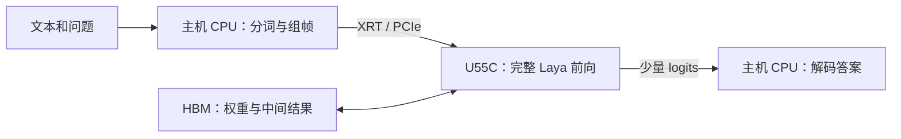
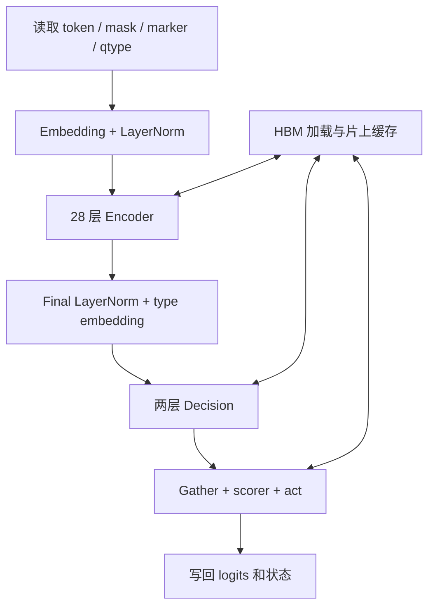

# Laya Q8 在 U55C 上的总体设计

统一规格 v1.0 · 2026-10-05。当前为文档设计，Laya HLS/RTL、综合与上板均未完成。

本文是唯一总体规格入口，先解释CPU/FPGA分工，再说明模块连接、来源和缺口。模块01–13保留详细设计，14负责验收，15负责共同接口，16负责baseline依据。所有文件统一维护，不再并列多个可实施版本。

## 1. CPU 在哪里，FPGA 负责什么

**CPU 是安装 U55C 的服务器上的 CPU。U55C 是通过 PCIe 接到服务器的 FPGA 加速卡，不是可以直接运行 Python 服务的 CPU 主板。** 板卡的管理控制器负责电源、温度等管理，不运行 Laya 应用。

一次 Laya 推理分为三个部分：

| 在哪里执行 | 做什么 | 输出什么 |
| --- | --- | --- |
| 主机 CPU | 接收文本、分词、拼接问题和选项，准备 token ID、mask 和 marker；通过 XRT 启动 FPGA | 一个完整请求，例如两题、补齐到 128 token |
| U55C FPGA | embedding、28 层 Encoder、两层 Decision、scorer 和 act；读取 HBM 中的权重 | 16 列候选 logits 和 2 列 act logits |
| 主机 CPU | 读取 logits，按 Typed 模型的温度和业务规则解释结果 | “是否退款”“由哪个部门处理”等答案 |

**Host** 指主机上的程序；**kernel** 指 FPGA 上被 Host 启动的硬件计算单元；**HBM** 是板卡上的大容量高速内存；**XRT** 是 CPU 控制板卡、传输数据和启动 kernel 的运行库。



服务初始化时，CPU 加载 xclbin，并把约 449 MB 的模型有效数据上传到 HBM。后续请求主要传输入和输出，权重继续留在 HBM。FPGA 仍会逐层把权重从 HBM 读入片上缓存；“常驻 HBM”不等于“全部权重都在片上”。

## 2. 两个 Llama baseline 对本设计有什么帮助

两个仓库采用同一条部署路线：

**HLS C++ 源码 → Vitis 编译为 `.xo` → 与 U55C 平台链接为 `.xclbin` → C++ Host 用 XRT 加载并运行。**

源码依据是 [7B 的硬件构建脚本](/home/user/EDA-202/zhuowenjun/Workspace/Laya/LLAMA-HLS/llama2-7b-baseline/hardware_implement.sh)、[Tiny 的硬件构建脚本](/home/user/EDA-202/zhuowenjun/Workspace/Laya/LLAMA-HLS/Tiny-llama-baseline/hardware_implement.sh)、[Tiny 的 Host](/home/user/EDA-202/zhuowenjun/Workspace/Laya/LLAMA-HLS/Tiny-llama-baseline/host/llama2.cpp:391) 和 [HBM/核间连接文件](/home/user/EDA-202/zhuowenjun/Workspace/Laya/LLAMA-HLS/Tiny-llama-baseline/src/u55C1.cfg)。两个分支的 Host、算子头文件、连接文件与硬件构建脚本逐文件相同，主要差别是模型尺寸。

| 设计事项 | Llama baseline 的做法 | 本版保留的Laya方案（推断） |
| --- | --- | --- |
| 板卡调用 | Linux CPU + XRT + U55C | 沿用 |
| 硬件开发 | HLS C++，由 Vitis/Vivado 生成硬件 | 沿用；`vivado` 目录不表示只交付裸 bitstream |
| 全局内存 | HLS `m_axi` 接口，连接文件绑定 HBM | 沿用方法，按 Laya 数据重新分配 |
| Host 内存分配 | `kernel.group_id()`、BO、同步和运行等待 | 沿用，修正原工程重复装载和重复权重副本问题 |
| 外部计算核数量 | embedding、Transformer、classifier 三个核，用 AXI Stream 连接 | 首版选择一个完整前向核，内部继续分模块 |
| 计算方式 | 每次处理一个 token，CPU 循环生成 | 每次处理完整问题序列，输出决策 |
| 量化与算子 | Group64/FP32 scale、RMSNorm、SwiGLU、因果 attention | 按 Typed Q8 模型改为 Group32/FP16 scale、LayerNorm、GEGLU、双向 attention |

一个核是本项目的工程选择：让 Encoder 和 Decision 共用矩阵、归一化和向量单元，减少核间接口及重复硬件。U55C 并不要求使用一个核或三个核。Llama 的三个核和已有 xclbin 不能直接装入 Laya 权重运行。

逐项代码对照、继承范围和原工程问题见 [16：两个 baseline 到 Laya 的迁移依据](/home/user/EDA-202/zhuowenjun/Workspace/Laya/LLAMA-HLS/Laya-baseline/vivado/design_source/16_llama_baseline_to_laya_u55c.md)。

## 3. 首版实际要实现什么

模型固定为本地 Typed-Decisions GGUF Q8_0，模型身份、完整数值推导见[模型设计依据](/home/user/EDA-202/zhuowenjun/Workspace/Laya/LLAMA-HLS/Laya-baseline/source/laya_baseline_design.md)。这里保留影响硬件结构的参数：

| 参数 | 首版范围 |
| --- | --- |
| 一次处理的问题数 B | 1 或 2；更多问题由 CPU 分批 |
| 每题执行长度 S | 64 / 128 / 256 / 512 / 1024 |
| hidden 维度 | 1024 |
| Encoder | 28 层，16 个 head，每 head 64 维 |
| Encoder FFN | Wi 输出 5248，分为两个 2624 维向量做 GEGLU |
| Decision | 两层，FFN 宽度 4096，ReLU |
| 候选 | 每题固定 16 列，包括无效列 |
| 浮点例外 | scorer 最后一层 F32，act 第一层 F16、输入 1028 维 |

首个真实业务测试使用用户的退款/部门两题，计划按 B=2、S=128 运行。72/94原为历史提供的长度；本次实际tokenizer/capture的原生物理S为94，ABI兼容S128已另行原生重跑，具体输入与差异见01§7，不将历史长度写成测量结果。

## 4. FPGA 内部怎样走完一次前向



Encoder 的一层按下面的顺序执行，28 层复用同一组计算单元：

```text
旧 hidden
  → LayerNorm（第 0 层 attention 前跳过）
  → 激活量化 → QKV Linear → RoPE
  → QK → mask/softmax → AV
  → 输出投影 → 加旧 hidden
  → LayerNorm → Wi → GELU(U)×G
  → 激活量化 → down projection → 残差相加
  → 新 hidden，供下一层使用
```

这里有三个不能省略的等待关系：

1. **LayerNorm 要看完整一行，量化要看完整一组 32 个值。** 消费者不能在统计完成前使用结果。
2. **Attention 要等当前层全部 Q/K/V 准备好。** Laya 是双向编码器，不能照搬 Llama 的“只读到当前位置”。
3. **Residual 要保留旧 hidden。** 新结果提交前，不能覆盖仍将被读取的旧数据。

## 5. 模块怎样共同设计

目录分成多个文件，是为了便于分工阅读；实现时按下列链路一起评审。

| 一起设计的链路 | 必须共同回答的问题 | 文档 |
| --- | --- | --- |
| Host → kernel → Host | 参数、BO、输入输出布局是否一致，错误结果会不会被当成答案 | 01、02、14 |
| HBM → embedding → LayerNorm | 随机行读能否供给归一化，完整行放在哪里 | 04、05、06、07 |
| LayerNorm → 量化 → Linear | 统计需要几遍，A8 tile 怎样交接，矩阵输出能否排得出去 | 07、08、09 |
| QKV → RoPE → attention | 数据怎样按 head 重排，何时可读，QK/AV 怎样共用浮点单元 | 04、05、09、10、11 |
| Wi → GELU/gate → down → residual | U/G 怎样配对，谁保留 gate，两次矩阵计算如何串行复用 | 08、09、12 |
| Decision → scorer/act → CPU | 16 列和 1028 维例外如何处理，温度在哪一端应用 | 01、11、12、13、14 |

这些链路的共同接口、一次 tile 的周期算例和流水条件，集中在 [15：接口与流水设计](/home/user/EDA-202/zhuowenjun/Workspace/Laya/LLAMA-HLS/Laya-baseline/vivado/design_source/15_integration_interfaces_and_pipeline.md)。先看数据从哪来、到哪去，再看位宽和缓存。

## 6. 从设计文档到 U55C 上板的路线

| 阶段 | 需要得到的东西 | 通过的含义 |
| --- | --- | --- |
| 1. 软件参考 | GGUF 导出器、统一配置、可执行的 CPU 黄金参考、真实请求文件 | 已经知道 FPGA 应算出什么 |
| 2. 算子与链路 C 仿真 | LN/量化/Linear、attention、FFN、heads 的联合测试 | 计算顺序和中间结果正确 |
| 3. HLS 综合与小型 RTL 联测 | 真实 DSP/BRAM/URAM、II、延迟和访存接口报告 | 设计能转换成合理规模的硬件 |
| 4. Host/平台联调 | 相同 Host 与顶层接口；sw_emu，关键链路 hw_emu | XRT 参数、HBM 连接和完成流程一致 |
| 5. U55C 实现 | 符合实际板卡平台的 `.xclbin`，完成时序与资源检查 | 获得可加载的硬件产物 |
| 6. 板上推理 | 正确 logits、完整业务答案、稳定性和逐次耗时记录 | 确实完成 Laya 的 U55C 推理测试 |

具体工程文件、编译链、HBM 连接和首个板上测试顺序见 [02：HLS 工程与 U55C 平台](/home/user/EDA-202/zhuowenjun/Workspace/Laya/LLAMA-HLS/Laya-baseline/vivado/design_source/02_kernel_wrapper_and_platform.md)。验收数据与计时方法见 [14](/home/user/EDA-202/zhuowenjun/Workspace/Laya/LLAMA-HLS/Laya-baseline/vivado/design_source/14_result_status_and_verification.md)。

## 7. 怎样看待当前阵列和性能数字

两个 Llama baseline 的源码主要使用较小的循环展开，并没有提供本项目的 16×8×32 阵列、128 路恢复器或 13 个独立访存 master。这些都是 **Laya 的待验证设计选择**。

本版仍用 150 MHz、整数阵列 16×8×32、64 路浮点乘加作为统一分析配置（状态：推断），便于比较模块的供需；这些数值尚未成为经实现验证的配置。实现先综合一个完整的“量化→dot→恢复→输出”切片，再决定是否保留该并行度；改变配置后统一重算所有链路。

S128 两题约需 94.32 GMAC Q8 Linear 和 2.013 GMAC dense attention。原研究的约 0.91–1.15 秒、扩阵列后约百毫秒属于条件算例，尚无 Laya 板上结果。是否能追上 A6000，必须等同 Typed 模型、同请求、同计时范围的 GPU/FPGA 测试；当前最先要获得的是完整、正确、可重复的上板基线。

## 8. 阅读导航

先读 **00 → 16 → 02 → 15**，即可了解系统、参考来源、上板流程和模块关联。其余文件按需要查阅：

| 文件 | 回答什么 |
| --- | --- |
| [01 Host](/home/user/EDA-202/zhuowenjun/Workspace/Laya/LLAMA-HLS/Laya-baseline/vivado/design_source/01_host_runtime_and_abi.md) | CPU 怎样构造请求、上传模型、调用 FPGA、恢复答案 |
| [03 调度](/home/user/EDA-202/zhuowenjun/Workspace/Laya/LLAMA-HLS/Laya-baseline/vivado/design_source/03_forward_controller.md) | 各层及共享单元何时运行，哪些数据不能提前覆盖 |
| [04 内存](/home/user/EDA-202/zhuowenjun/Workspace/Laya/LLAMA-HLS/Laya-baseline/vivado/design_source/04_model_package_and_memory_map.md) / [05 加载器](/home/user/EDA-202/zhuowenjun/Workspace/Laya/LLAMA-HLS/Laya-baseline/vivado/design_source/05_hbm_loader_and_cache.md) | 权重和状态放在哪里，怎样供给计算 |
| [06 Embedding](/home/user/EDA-202/zhuowenjun/Workspace/Laya/LLAMA-HLS/Laya-baseline/vivado/design_source/06_embedding_engine.md) / [07 LN](/home/user/EDA-202/zhuowenjun/Workspace/Laya/LLAMA-HLS/Laya-baseline/vivado/design_source/07_layernorm_engine.md) | 查表与完整行统计怎样衔接 |
| [08 量化](/home/user/EDA-202/zhuowenjun/Workspace/Laya/LLAMA-HLS/Laya-baseline/vivado/design_source/08_activation_quantizer.md) / [09 Linear](/home/user/EDA-202/zhuowenjun/Workspace/Laya/LLAMA-HLS/Laya-baseline/vivado/design_source/09_q8_linear_and_restore.md) | Q8-F 的计算、缓存、恢复和输出 |
| [10 RoPE/mask](/home/user/EDA-202/zhuowenjun/Workspace/Laya/LLAMA-HLS/Laya-baseline/vivado/design_source/10_rope_and_mask.md) / [11 Attention](/home/user/EDA-202/zhuowenjun/Workspace/Laya/LLAMA-HLS/Laya-baseline/vivado/design_source/11_attention_and_fp_engine.md) | QKV 如何进入双向 attention |
| [12 FFN](/home/user/EDA-202/zhuowenjun/Workspace/Laya/LLAMA-HLS/Laya-baseline/vivado/design_source/12_vector_and_ffn.md) / [13 决策头](/home/user/EDA-202/zhuowenjun/Workspace/Laya/LLAMA-HLS/Laya-baseline/vivado/design_source/13_decision_scorer_act.md) | 主网络后半段和候选/动作输出 |
| [14 验收](/home/user/EDA-202/zhuowenjun/Workspace/Laya/LLAMA-HLS/Laya-baseline/vivado/design_source/14_result_status_and_verification.md) | 怎样证明功能正确、确实上板、性能可复查 |

目录中仅保留本套统一规格。整理前的全部文档已经打包保存到目录外，恢复信息见[阅读入口](README.md)。手写AXI-Lite寄存器、CMD256和动态描述表的旧草案不再参与当前接口定义；后续以同源C++头文件、HLS生成接口及xclbin元数据核对。


## 9. 总体规格：什么已确定，什么还需验证

以下采用hardware-agent的五种状态：**明确要求**来自用户；**工程事实**来自模型、源码或实际检查；**推断**是有依据的设计建议；**待确认**是缺少可靠值；**冲突**表示资料给出不相容定义。文档中的“应/必须”是相应设计方案的约束，不自动升级为用户已经确认的实现指标。

### 9.1 统一规格表

| 项目 | 目标要求 | 工程现状（如相关） | 状态 | 来源 |
| --- | --- | --- | --- | --- |
| 本次工作 | 合并多版本，保留总体＋模块，统一接口/性能/流水 | 已有17份当前稿与16份旧模块稿，现归并维护 | 明确要求 | U1 |
| 最终功能 | Typed-Decisions Q8模型在U55C做完整前向并推理测试 | 还没有Laya硬件工程 | 明确要求 | U2；S6 |
| 加速评判 | 分析是否能追上/超过A6000同任务延迟 | 用户口述约50ms；历史两题/五题报告口径不同 | 明确要求 | U3；S5 |
| 模型身份 | 使用本文§3的Typed GGUF，保留权重位模式 | 本次复核455179648bytes与SHA-256；无更换模型 | 工程事实 | S1/S6；04 |
| 模型图 | D1024、Encoder28、Decision2、16head、固定16候选 | 模型/图研究和配置可查 | 工程事实 | S1/S2/S3；06–13 |
| 首版输入限制 | B1/2；S64/128/256/512/1024 | 模型原生max_batch=8；B≤2是硬件裁剪方案 | 推断 | S1/S3；01 |
| 工程路线 | HLS C++＋单forward核＋XRT常驻Host | baseline已有HLS/XRT三核路线；Laya单核是新增选择 | 推断 | S4；02、16 |
| 目标器件细项 | part、package、speed grade与实际平台一致 | 未指定；不能从板卡名称补填 | 待确认 | G1 |
| 工具/IP/许可 | 选择匹配的platform/shell/XRT/Vitis/Vivado组合 | baseline参考2023.2与U55C XDMA平台；实际环境未冻结 | 待确认 | G1；02 |
| 时钟与复位 | 一个用户计算域；平台域通过工具/平台适配 | 150MHz仅候选；复位极性、同步方式、恢复API未知 | 推断 | G1；02§8、15§8 |
| IO与HBM方案 | 13个候选512bit master；模型512MiB＋工作区192MiB | 无生成端口、BO和有效带宽测量 | 推断 | 01、02、04、05 |
| 数值参考方案 | Q8-F、FP32中间值及固定操作/归约顺序 | 权重类型已知；Golden-C实现和函数版本未冻结 | 推断 | S3§5；07–13；G3 |
| 阵列/缓存预算 | TM16/TN8/GS32、FP64lane、8lane向量；候选16–20MiB缓存 | 没有综合或布局布线数据 | 推断 | 05、09、11、15 |
| 资源与时延硬指标 | 除正确完整部署外，具体资源比例、误差、P50/P95阈值未最终指定 | 原25/50ms、资源比例和质量线保留为评估建议 | 待确认 | G6；14 |
| 执行主机与超时 | 实际U55C服务器、SSH路径、工具入口和长任务超时 | 当前工作目录可访问；尚未指定远端执行环境 | 待确认 | G1/G5；S6 |
| DUT与测试顶层 | 候选kernel名laya_typed_q8_forward；仿真顶层待建立 | 目标目录没有RTL/HLS/XDC/testbench | 工程事实 | S6；02 |

### 9.2 来源登记

| 编号 | 来源及可定位内容 | 能证明什么 |
| --- | --- | --- |
| U1 | 当前用户“按hardwareagent的硬件要求标准汇总成一个版本，分多个模块以及整体模块” | 本次只整理规格与文档 |
| U2 | 本会话此前要求“Typed-Decisions的Q8量化版…U55C部署”“CPU端负责什么”“关联模块接口、性能、流水评估” | 功能目标、板卡、分工与联合设计要求 |
| U3 | 本会话用户“A6000”“约50ms完成选择判断”“FPGA需多大阵列和带宽” | 比较意图；不等于已确认25ms验收合同 |
| S1 | [Typed GGUF与校验记录](/home/user/EDA-202/zhuowenjun/Workspace/Laya/model/quantized/gguf/mys/laya-typed-decisions-GGUF/Q8_0/README.md)、[tensor inventory](/home/user/EDA-202/zhuowenjun/Workspace/Laya/model/quantized/gguf/mys/laya-typed-decisions-GGUF/Q8_0/inventory.json) | 模型来源、hash、张量类型、形状；不证明硬件吞吐 |
| S2 | [encoder/config.json](/home/user/EDA-202/zhuowenjun/Workspace/Laya/model/finetuned/convaiinnovations/laya-typed-decisions/encoder/config.json)、[rl_agent_config.json](/home/user/EDA-202/zhuowenjun/Workspace/Laya/model/finetuned/convaiinnovations/laya-typed-decisions/rl_agent_config.json) | 模型结构、eps/theta、上下文/温度；硬件以GGUF图为对象 |
| S3 | [已有模型与性能推导](/home/user/EDA-202/zhuowenjun/Workspace/Laya/LLAMA-HLS/Laya-baseline/source/laya_baseline_design.md) §2–§12 | GGUF图核查、拟定数值路径和条件算式；旧指标不自动成为新验收承诺 |
| S4 | [16源码对应](/home/user/EDA-202/zhuowenjun/Workspace/Laya/LLAMA-HLS/Laya-baseline/vivado/design_source/16_llama_baseline_to_laya_u55c.md) §1–§5所列两仓库源文件与commit | baseline的真实实现与迁移边界 |
| S5 | [Typed质量实测](/home/user/EDA-202/zhuowenjun/Workspace/Laya/experiment/acc_FP_vs_gguf/source/typed_decisions_results.md)、[速度汇总](/home/user/EDA-202/zhuowenjun/Workspace/Laya/experiment/acc_FP_vs_gguf/results/summary.md)、[A6000短请求记录](/home/user/EDA-202/zhuowenjun/Workspace/Laya/results/laya_gpu_inference_benchmark_20261005.md) | 历史软件测量；不是本次FPGA或配对加速结果 |
| S6 | [本次整理任务与检查记录](/home/user/EDA-202/zhuowenjun/Workspace/Laya/LLAMA-HLS/Laya-baseline/hardware_agent/task.md) | 本次检查范围、模型hash、baseline状态、工具PATH及实际验证状态 |

状态“工程事实”如果来源为已有报告，只证明该报告中的对象与结果；不得推广为本版Golden-C或U55C已通过。

## 10. 工程现状、冲突和实施前缺口

**当前交付是详细接口规格和真实软件参考数据。** `reference/`已建立固定Typed Q8原生CPU采集、输入适配与离线ABI回放；`host/`、`hls/`、`include/`、硬件模型导出器、候选Golden-C、XDC和硬件自检入口仍未完成。02工程树中未落实项目仍是计划。文档检查／软件采集不能代替硬件验证。

### 10.1 多版本差异的处理

| 差异 | 两侧定义/来源 | 当前处理与影响 | 状态 |
| --- | --- | --- | --- |
| 控制与完成方式 | 旧稿手写寄存器/CMD256/commit轮询；后续稿HLS生成接口＋XRT wait/sync | 保留后者；旧值只进目录外备份，未来头文件/元数据须对齐 | 冲突（本版已统一） |
| ABI细节精度 | 旧稿有手填offset；后续稿仅给帧尺寸与同源生成原则 | 01§6、14§9、15§10–§14本次已细化字段／offset／枚举；编码器、共享头及生成接口联调仍待G2 | 推断／待实现 |
| LN交接条件 | F0要求整阶段完成；F1允许输出接量化第一遍 | 分别标注调度模式，不能混算周期；03、15联动 | 冲突（本版已澄清） |
| workspace总和 | 早期总和133.625MiB；按张量重算125.625MiB | 采用125.625MiB逻辑张量总和，BO预算另算 | 冲突（本版已纠正） |
| 频率/带宽 | baseline请求300MHz；当前候选150MHz；旧性能表还含300MHz/其他效率 | 均保留来源和前提，不能将不同场景的周期/带宽混用 | 推断 |
| 质量与资源“要求” | 旧研究给76.35%/98%、80/70/75%、28MiB等 | 移入14的建议预算；保留数值，不冒充用户确认 | 待确认 |
| 模型batch与上下文 | 模型max_batch8、agent上下文1024；硬件B≤2；encoder基础config位置上限8192 | 不混淆不同层级；按Typed GGUF/agent目标和首版硬件方案划界 | 推断 |

### 10.2 缺口及其实际影响

| 编号 | 待补信息/证据 | 在何时必须解决 | 可继续的独立工作 |
| --- | --- | --- | --- |
| G1 | 实际U55C主机、part/speed grade、platform/shell、工具/IP/许可、各域时钟复位 | 综合/平台链接与上板前；复位细项在RTL接口确定前 | 模型导出、Golden-C与纯C算子验证 |
| G2 | 字节／task／buffer／stream／错误合同已明确；共享配置头、编码器、生成参数表和Host/HLS联调未完成 | 编写实现及接口放行前 | 已可按01/04/14/15写代码和TB；真实1856B离线帧回放已做 |
| G3 | 真实两题原生/ABI兼容输入及节点数据已取得；硬件导出器、candidate Golden-C、函数/编译规则和native差异尚待闭环 | 算子正确性和整图验收前 | 可用真实capture推进模块TB；Q8 scratch／融合F16 attention见14§10.3 |
| G4 | 单切片真实II/FP延迟/资源、RAM banking/FIFO、13 master链接与有效带宽 | 扩阵列、融合或宣称性能前 | 基于明确候选值复算算量/容量/流量 |
| G5 | XRT timeout/cancel/recovery行为、BO回收条件、测试顶层与任务超时 | 故障/复位验证及稳定上板前 | 正常请求和错误状态规格整理 |
| G6 | 正式误差/质量/资源预算、时延口径和回归次数的项目准入线 | 对实现作“通过/不通过”验收前 | 先按14建议值收集完整分布，不能写成已通过 |
| G7 | 同Typed Q8、相同两题、相同计时范围的A6000测量 | 宣称快于GPU或计算speedup前 | FPGA功能验证与独立耗时记录 |

这些缺口不妨碍本次文档归并，也不代表已启动对应实现任务。后续实现按14的阶段交付并补证，更新同一套文件即可。
